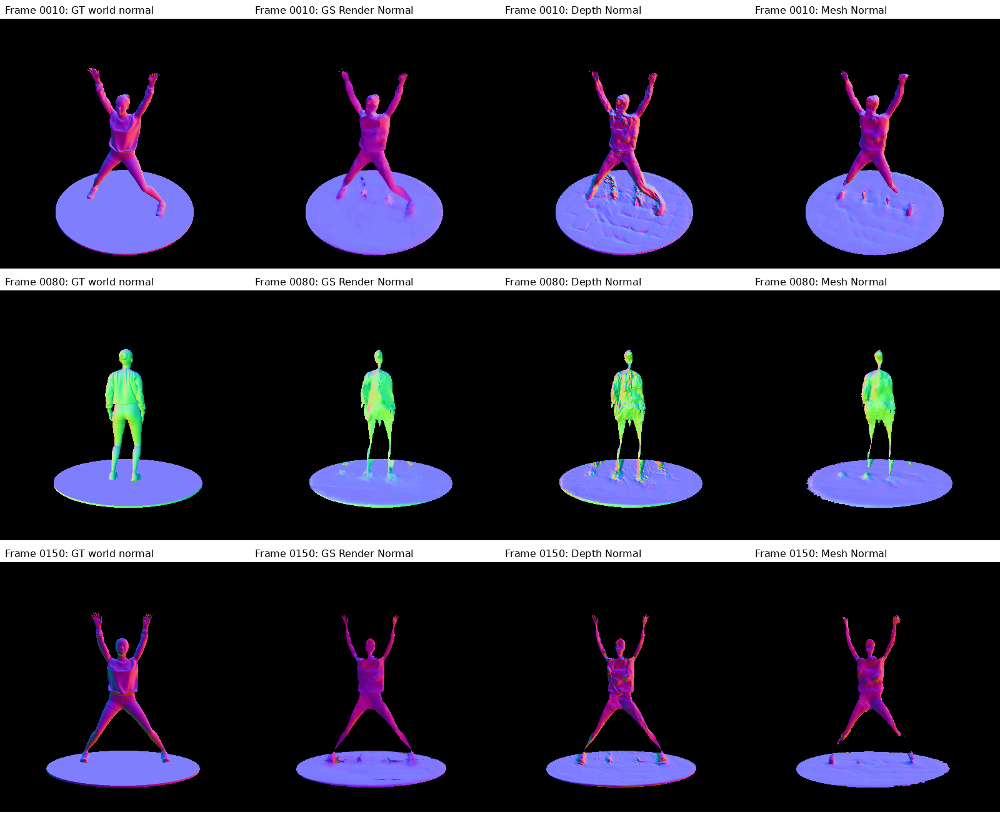

# 1009-03 jumpingjacks_environment_light 各项MAE与三类Normal评测报告

日期：2026-10-09（Asia/Tokyo），venus / lumimotion。

状态：COMPLETED，55k完整15测试帧各项MAE、三类Normal、动态Mesh、独立复算与代表图目检均完成，流程PASS。

## 归档记录

归档时间：2026-10-09T19:36:26+09:00。沿用已确认的1009-03报告名称；本报告记录原版LumiMotion env实验的最终55k、完整15测试帧评测。

- 来源模型：`/home/lihan/reproduce/LumiMotion-stage2-perlight/output/1009-01-jumpingjacks_environment_light-原版LumiMotion两阶段训练/model_mlp`，原版训练代码main提交`65287461075a1a4c0f54845325cc22039bd14e7d`；本仓库仅负责离线评测与动态Mesh提取。
- 完整评测产物：`/home/lihan/reproduce/LumiMotion-stage2-perlight/output/1009-03-jumpingjacks_environment_light-MAE`。
- [数值汇总JSON](archive/1009-03-jumpingjacks_environment_light-MAE/metrics_summary.json)、[CSV](archive/1009-03-jumpingjacks_environment_light-MAE/metrics_summary.csv)、[三法线逐帧表](archive/1009-03-jumpingjacks_environment_light-MAE/normal_depth/normal_metrics_per_frame.csv)。
- [独立复算记录](archive/1009-03-jumpingjacks_environment_light-MAE/inspection/independent_audit.json)、[真值审核](archive/1009-03-jumpingjacks_environment_light-MAE/inspection/gt_audit.json)、[目检记录](archive/1009-03-jumpingjacks_environment_light-MAE/inspection/visual_review.json)。
- [文件与SHA256清单](archive/1009-03-jumpingjacks_environment_light-MAE/archive_manifest.json)：归档保存指标、逐帧表、命令、日志、评测源码快照与首中尾代表图。完整浮点数组、GT/预测Mesh和权重保留在原输出目录，可沿清单来源追溯。

## 来源和范围

来源实验1009-01，模型model_mlp，最终iteration55000；source使用该实验data_view。测试帧0010、0020至0150，共15帧，resolution=2（400×400），time=frame/150。相机和世界坐标保持原导出定义，不进行尺度、姿态或GT法线拟合。

GT为原始env数据：/home/lihan/data/LH-data/danamic/jumpingjacks_environment_light。Albedo使用标注sRGB的原16-bit PNG，经既有评测入口PIL转8-bit后在线性RGB评分；Normal使用原32-bit世界坐标有符号Normal.X/Y/Z EXR。EXR为Blender着色法线，可能包含材质法线贴图，三类模型法线均与这一参考比较，不把它误称为几何法线真值。

Roughness从完整打包scene_snapshot.blend补导出15张float32原始RGBA EXR，真实Principled Roughness输入接Emission；身体材质为纹理节点驱动、平台r=0.95、头发r=0.8。头发/睫毛存在Alpha纹理，适配器保留与源albedo导出器相同的Transparent/Emission混合分支，除Alpha后的GT定义是可见Principled r的Alpha加权值，不声称混合BSDF有唯一等效粗糙度。沿用源EEVEE和相机，源blend不保存、不改写。

Depth从原blend按逐帧骨骼/蒙皮求值的三角面导出，使用对应测试相机的像素中心射线求交得到正camera Z。每帧验证相机误差0、网格PLY/NPZ一致性及Alpha覆盖。EXR着色法线与GT几何法线差只作为来源诊断；不把这一差当作模型重建Mesh Normal误差。完整真值审核见inspection/gt_audit.json。

## 指标与新Mesh法线

- Albedo MAE：GT alpha≥0.99、内缩2评测像素，全部前景，在线性RGB平均三个通道绝对误差；不做材质分区，不拟合尺度，漏检预测记0。
- Roughness MAE：同样GT内前景，原始标量r绝对误差，预测alpha≥0.9；联报覆盖率，不做gamma或材质分区。
- GS Render Normal MAE：高斯平面法线经Alpha/透射率混合后归一化，与GT EXR的有向夹角，单位度。
- Depth Normal MAE：模型Expected Z反投影的中心差分世界法线，与同一个GT EXR比较。
- Mesh Normal MAE：模型逐时刻重建Mesh第一交点处的几何顶点法线插值，按相机射线定向，与同一GT EXR比较；另报共同有效像素结果和覆盖率。
- Expected/Median Z Depth MAE：与逐帧GT三角面求交的正camera Z比较，世界单位；不做尺度或偏移拟合。

法线主指标使用GT alpha≥0.5的整个前景（有Depth时还要求GT射线命中），主MAE按有效像素数量汇总，另保存逐帧等权均值及alpha≥0.99内缩2像素诊断。覆盖率必须与条件MAE一起看。

新增动态提取入口scripts/extract_geometry_mesh_dynamic.py：15个测试时刻分别新建TSDF，每个时刻固定time，只使用135个训练相机位姿下的模型预测Expected Z与预测Alpha重建，不使用测试相机位姿或GT几何，不把不同动作混合。固定voxel_size=0.02、sdf_trunc=0.08、depth_trunc=20、预测alpha≥0.5，未按GT误差调参。Mesh MAE受模型深度与提取参数共同影响。

## 完整命令与输出

工作目录本仓库，CUDA_VISIBLE_DEVICES=0、OMP_NUM_THREADS=4、OPENBLAS_NUM_THREADS=4，Python lumimotion。后台commands/run_mae.py等待55k来源完整，再顺序执行以下命令。GT生成适配器、来源Blender材料审计及日志位于commands/、logs/、inspection/。

```bash
/home/lihan/miniconda3/envs/lumimotion/bin/python -u -m scripts.eval_albedo_gt --model_path '/home/lihan/reproduce/LumiMotion-stage2-perlight/output/1009-01-jumpingjacks_environment_light-原版LumiMotion两阶段训练/model_mlp' --iterations 55000 --gt_albedo_dir /home/lihan/data/LH-data/danamic/jumpingjacks_environment_light/albedo --split test --output_path /home/lihan/reproduce/LumiMotion-stage2-perlight/output/1009-03-jumpingjacks_environment_light-MAE/albedo --save_float
```

日志：`/home/lihan/reproduce/LumiMotion-stage2-perlight/output/1009-03-jumpingjacks_environment_light-MAE/logs/albedo.log`。

```bash
/home/lihan/miniconda3/envs/lumimotion/bin/python -u -m scripts.eval_roughness_gt --model_path '/home/lihan/reproduce/LumiMotion-stage2-perlight/output/1009-01-jumpingjacks_environment_light-原版LumiMotion两阶段训练/model_mlp' --iteration 55000 --gt_roughness_dir /home/lihan/reproduce/LumiMotion-stage2-perlight/output/1009-03-jumpingjacks_environment_light-MAE/gt_roughness --split test --output_path /home/lihan/reproduce/LumiMotion-stage2-perlight/output/1009-03-jumpingjacks_environment_light-MAE/roughness
```

日志：`/home/lihan/reproduce/LumiMotion-stage2-perlight/output/1009-03-jumpingjacks_environment_light-MAE/logs/roughness.log`。

```bash
/home/lihan/miniconda3/envs/lumimotion/bin/python -u -m scripts.extract_geometry_mesh_dynamic --model_path '/home/lihan/reproduce/LumiMotion-stage2-perlight/output/1009-01-jumpingjacks_environment_light-原版LumiMotion两阶段训练/model_mlp' --load_iter 55000 --split test --resolution 2 --voxel_size 0.02 --sdf_trunc 0.08 --alpha_threshold 0.5 --output_dir /home/lihan/reproduce/LumiMotion-stage2-perlight/output/1009-03-jumpingjacks_environment_light-MAE/predicted_meshes
```

日志：`/home/lihan/reproduce/LumiMotion-stage2-perlight/output/1009-03-jumpingjacks_environment_light-MAE/logs/predicted_meshes.log`。

```bash
/home/lihan/miniconda3/envs/lumimotion/bin/python -u -m scripts.eval_geometry_gt --model_path '/home/lihan/reproduce/LumiMotion-stage2-perlight/output/1009-01-jumpingjacks_environment_light-原版LumiMotion两阶段训练/model_mlp' --load_iter 55000 --gt_root /home/lihan/data/LH-data/danamic/jumpingjacks_environment_light --gt_depth_dir /home/lihan/reproduce/LumiMotion-stage2-perlight/output/1009-03-jumpingjacks_environment_light-MAE/gt_depth --split test --resolution 2 --output_dir /home/lihan/reproduce/LumiMotion-stage2-perlight/output/1009-03-jumpingjacks_environment_light-MAE/normal_depth --pred_mesh_manifest /home/lihan/reproduce/LumiMotion-stage2-perlight/output/1009-03-jumpingjacks_environment_light-MAE/predicted_meshes/manifest.json --save_arrays
```

日志：`/home/lihan/reproduce/LumiMotion-stage2-perlight/output/1009-03-jumpingjacks_environment_light-MAE/logs/normal_depth.log`。

```bash
/home/lihan/miniconda3/envs/lumimotion/bin/python -u -m scripts.verify_roughness_eval /home/lihan/reproduce/LumiMotion-stage2-perlight/output/1009-03-jumpingjacks_environment_light-MAE/roughness
```

日志：`/home/lihan/reproduce/LumiMotion-stage2-perlight/output/1009-03-jumpingjacks_environment_light-MAE/logs/verify_roughness.log`。

## 完成结果与验收

完成核验时间：2026-10-09T19:22:16.860208+09:00。**评测流程与产物验收PASS**，15/15测试帧全部完成；此结论不表示模型几何或材质达到质量阈值。

| 指标 | 主MAE（有效像素加权） | 覆盖率 |
| --- | ---: | ---: |
| Albedo MAE | 0.19101779 | 96.265820% |
| Roughness MAE | 0.19992533 | 96.555380% |
| GS Render Normal MAE | 13.88986765° | 92.935564% |
| Depth Normal MAE | 18.92264049° | 88.370929% |
| Mesh Normal MAE | 14.95726286° | 93.942224% |
| Expected Z Depth MAE | 0.05899602 m（5.8996 cm） | 92.935564% |
| Median Z Depth MAE | 0.05912712 m（5.9127 cm） | 92.935564% |
| GS Normal XYZ component MAE (supplementary) | 0.11561261 | 92.935564% |

Albedo MAE在全部GT内部前景评分，漏预测不删除；覆盖率按预测alpha≥0.9诊断。Roughness与三法线均为有效预测上的条件MAE，缺失计入覆盖率分母。Normal的Alpha阈值0.5，Depth Normal还要求中心差分邻域；各指标GT/有效像素集合不同，不能跨单位或掩码直接比数值。

三类法线共同有效像素：366343，覆盖率88.183413%。

| 三类法线（共同有效像素） | MAE |
| --- | ---: |
| GS Render Normal MAE | 12.62284621° |
| Depth Normal MAE | 18.83713042° |
| Mesh Normal MAE | 13.56331627° |

在相同像素上Mesh法线误差仍高于GS Render、低于Depth Normal。新的Mesh指标来自15个独立逐时刻预测TSDF Mesh，每个时刻融合135个训练相机位姿；GT网格未参与模型Mesh重建。它衡量模型深度经固定提取参数得到的几何法线，不是对GT网格的自洽核验。GS缺失法线按180°计入的补充指标为25.62461227°。

Depth世界单位在源scene中为METRIC且meters_per_world_unit=1，因此本报告直接标注米/厘米；未进行尺度、偏移或ICP拟合。

## 真实目检与质量限制

已打开0010/0080/0150三帧Albedo、Roughness、三类Normal、Z depth及误差图；补制三类法线首中尾总览。人物与平台整体对应，Alpha仍有肢体/头部边缘遗漏、偏移及平台残影。预测albedo明显偏暗并保留照明/褶皱/阴影痕迹，raw线性RGB平均偏差R=-0.222968、G=-0.193213、B=-0.102200；未做真值尺度校准。

roughness平台GT r=0.95，预测更低且有与GT不一致的结构；人体也含空间误差。GS人体法线斑驳，Depth Normal的中心差分进一步放大碎片/纹理结构；Mesh有所平滑，但脚部附近仍有突起、肢体缺面和平台残影。GT EXR为着色法线，不把含法线贴图的局部差异误称为纯几何误差。

代表图：

- [三类法线首中尾](archive/1009-03-jumpingjacks_environment_light-MAE/inspection/three_normals_first_middle_last.png)
- [0010完整法线/深度/误差](archive/1009-03-jumpingjacks_environment_light-MAE/normal_depth/comparison_0010.png)
- [0010 Albedo真值对照](archive/1009-03-jumpingjacks_environment_light-MAE/albedo/iteration_55000/0010_comparison.png)
- [0010 Roughness真值对照](archive/1009-03-jumpingjacks_environment_light-MAE/roughness/previews/0010.png)

代表图目检不等于所有150时刻逐帧人工审阅；主统计覆盖完整15测试帧。RGB与静动态分离的真实检查沿用1009-01 Stage1结果，Stage2材料MAE和Alpha、normal结果为本次实测。env原六步流水线已于2026-10-09 19:31:37（Asia/Tokyo）结束，状态为PIPELINE_COMPLETED_REVIEW_PENDING；最终15测试帧原版NVS为PSNR 33.86182582 dB、SSIM 0.97973040、LPIPS 0.02929334。该RGB评测沿用原版首帧BVH复用实现。本次归档的MAE流程PASS不代替原六步流水线全部视频的最终目检验收。



## 数值复算与来源保护

独立CPU脚本commands/verify_all_mae.py从保存浮点图重新归一化法线、计算有向角度、三法线有效/共同掩码、深度绝对误差、albedo线性绝对误差与覆盖率，与原JSON逐帧及全量汇总一致；83个来源哈希验证通过。scripts.verify_roughness_eval独立检查所有15帧roughness与Alpha累积归一化、真值前景/有效mask、CSV/JSON及来源哈希，PASS。模型与原始GT/Blender快照均未修改，预测网格仅使用训练相机并在每个目标time单独融合，验证每份135条记录来自train且time完全相同。

证据：inspection/independent_audit.json、logs/verify_all_mae.log、logs/verify_roughness.log、inspection/gt_audit.json、inspection/visual_review.json；主汇总metrics_summary.json/metrics_summary.csv；原始指标分别在albedo/iteration_55000/metrics.json、roughness/metrics.json、normal_depth/metrics.json。三类法线逐帧表normal_depth/normal_metrics_per_frame.csv，深度及法线汇总normal_depth/metrics_summary.csv。float数组、逐帧GT和预测Mesh、完整命令与日志全部保留。
