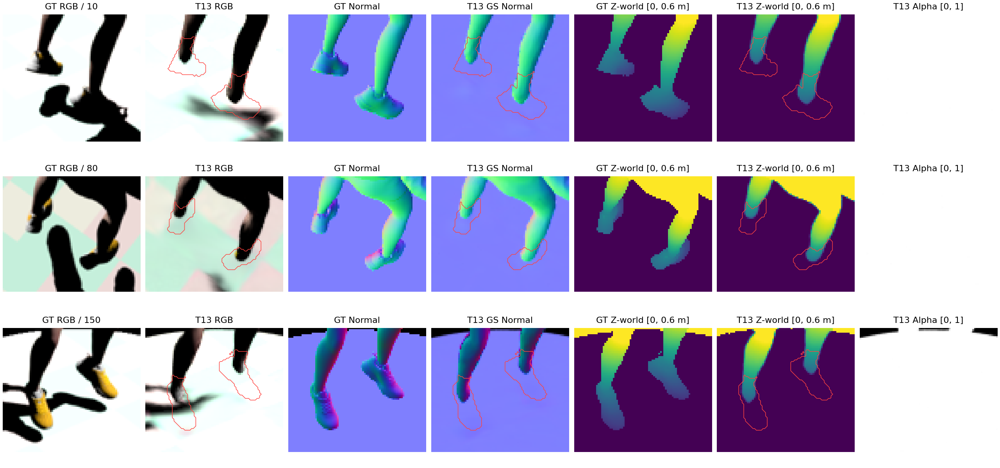
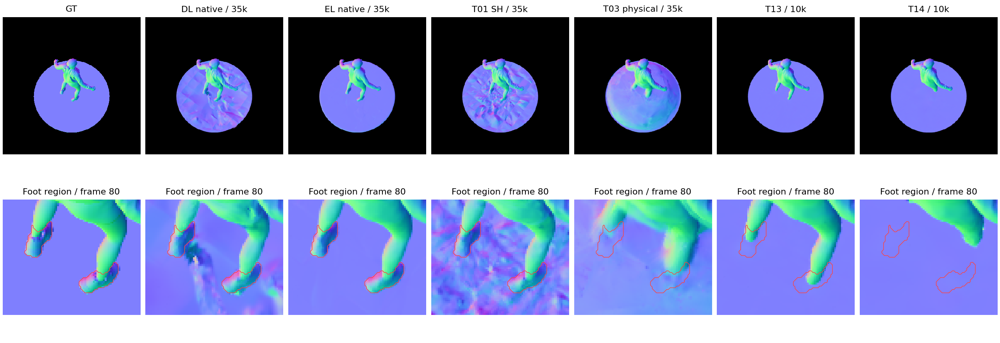
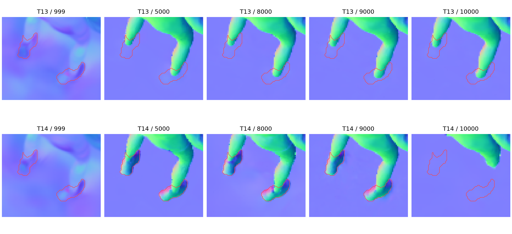

# 近期训练脚部消失审计：法线正则、透明度重置与裁剪的耦合退化

审计日期：2026-10-12（Asia/Tokyo）。服务器：`ushas`；环境：`lumimotion-ushas`。审计基线提交：`98dc847`。本次检查已有训练与检查点，新增只读渲染和梯度诊断，**没有启动训练、更新模型参数或修改训练实现**。工作区同时存在其他任务的修改，不属于本报告。

## 一、结论

**最新 T13/T14 的鞋和脚部确实丢失了三维支撑，并被台面表面替代。最有力的机制证据指向：法线自一致性正则在透明度重置后压低脚部高斯的透明度，再与低透明度裁剪共同造成不可逆的局部缺失。** T14 的失效窗口明确位于 9000—10000 步；T13 在 5000 步已经严重缺脚，不能把它的最早失效归到 9000 步。

- 固定全部 15 个测试视角，T13/T14 脚部区域分别有 **71.00%／98.56%** 的预测 expected-depth 反投影落在台面附近；脚部深度误差为 **18.44／28.65 厘米**。两个模型该区域的 Alpha 覆盖率均为 **100%**。
- T14 在 9000 步仍有完整鞋形，脚部法线误差 **13.09°**、深度误差 **1.97 厘米**；10000 步变成 **64.67°／28.65 厘米**。脚部高度带内的高斯中心从 **2240 个降到 0 个**。
- 对 T14@9000 的独立内存副本模拟透明度重置，遍历原 **135 个训练视角**：加入法线项时，**84.42%** 的脚部高斯具有降低透明度方向的平均总梯度；扣除法线项后仅 **0.0893%**。法线项的梯度绝对量为其余三项之和的 **17.49 倍**。这支持具体失效机制，而非仅凭图片猜测。
- 原来的三项平均法线指标可以数值达标，但**不能据此判定人体完整**：台面占前景 **82.48%**，脚部仅占 **1.35%**。T13 的原三指标 PASS 保留为历史数值结论；本次脚部完整性验收为 **FAILED**，T14 同样 **FAILED**。

“最近训练都没脚”也需要限定范围：原生 DL/EL Stage1、T01 SH 控制组保留了鞋形；T02/T03 的长程物理训练出现严重脚周伪几何；最新 T13/T14 则呈现更明确的脚部截断与台面替代。不是所有历史模型从输入阶段就缺脚。

## 二、审计口径与范围

复算 18 组静态实验，共 41 个检查点，每个检查点固定测试帧 `10,20,…,150`，分辨率 400×400。其中 33 个检查点复用已保存的原始 NPZ；另用原几何评测器补渲染 T13/T14 各自的 `999/5000/8000/9000`，共 8 个检查点、120 帧。动态模型未纳入该固定高度区域统计，本结论不外推到全部动态实验。

GT 坐标来自原相机和 GT 正向 camera-Z 深度，使用项目已有 `camera_rays`，不做 ICP、尺度拟合或深度对齐。台面顶面为世界 `z=0`，单位为米。脚部区域固定为 **GT 前景且 `0.05<z_GT<0.35`**，包含鞋及紧邻脚踝；这是高度定义的审计区域，不是人工逐像素语义标注。15 帧合计 7303 像素，目检确认主要覆盖两只鞋。另检查人物掩膜腐蚀 1 像素后的核心区域，以及上限 0.25/0.30/0.40/0.45 米的敏感性。

“落到台面附近”定义为原脚部像素上的预测有效 Alpha≥0.5、深度有效且反投影 `|z_pred|<0.04`；分母始终是原 GT 脚部像素。该比例是固定视线上的表面替代诊断，**不是整个三维脚体积的消失百分比**。更一般的几何错误另以 camera-Z 误差超过 5 厘米统计，因为漂浮伪平台也可能不在 `z=0` 附近。

原前景三法线口径不变，新增脚部区域是附加诊断。区域法线沿用原评测有效性规则，Depth Normal 还在区域内部腐蚀一像素；不能把这些局部指标当作旧全前景主指标。原函数独立复算及全前景核对均通过，见[审计核验](assets/1012-02-脚部消失审计/audit_validation.json)。

## 三、现象在哪里发生

### 3.1 输入有脚，预测三维表面缺脚

GT RGB、GT Normal 和 GT 深度均保留鞋子。T13 在同一像素位置输出台面颜色、近似向上的台面法线及台面高度；这排除了仅由黑色鞋面、视频编码或查看器造成的“看不见”。T13 的脚部 GS／Depth／Mesh 法线误差分别为 **52.15°／52.53°／55.13°**；T14 为 **64.67°／65.04°／65.07°**。GS 与深度已经错误，不能把原因只归到 TSDF 网格提取。

图中红线是 GT 脚部区域边界。后三列显示世界高度与 Alpha；白色 Alpha 表示该视线有不透明表面，无法区分表面来自脚还是后面的台面。

### 3.2 跨实验对照

下表均为相同 15 帧、7303 个 GT 脚部像素。深度误差为 expected camera-Z MAE；“>5cm”为全部 GT 脚部像素上的超差比例。

| 实验 | 步数 | 脚部 GS 法线误差 | 脚部深度误差／厘米 | 深度 >5cm | 落到台面附近 |
| --- | ---: | ---: | ---: | ---: | ---: |
| 原生静态 DL Stage1 | 35000 | 17.45° | 2.10 | 8.96% | 1.53% |
| 原生静态 EL Stage1 | 35000 | 15.79° | 2.72 | 10.71% | 1.08% |
| T01：静态 SH | 35000 | 18.24° | 2.28 | 10.79% | 0.63% |
| T02：Lambertian 无遮挡 | 10000 | 27.84° | 8.41 | 38.01% | 0.00% |
| T02：Lambertian 无遮挡 | 35000 | 48.63° | 19.83 | 91.21% | 0.00% |
| T03：Lambertian＋BVH | 10000 | 22.61° | 6.19 | 26.65% | 0.00% |
| T03：Lambertian＋BVH | 35000 | 54.32° | 27.53 | 99.38% | 0.00% |
| T10：expected 续训 | 13000 | 23.51° | 6.58 | 26.55% | 0.00% |
| T13：早期 normal | 10000 | **52.15°** | **18.44** | **77.86%** | **71.00%** |
| T14：晚期 normal | 10000 | **64.67°** | **28.65** | **99.82%** | **98.56%** |

T02/T03 的“台面附近比例为零”不表示脚部正确：它们在 GT 脚部视线上的深度已经严重偏离，并有升高的伪表面。脚部消失存在不同外观，不能只用单一高度阈值寻找所有失败类型。完整 T04—T12 及中间迭代见[区域汇总](assets/1012-02-脚部消失审计/regional_summary.json)和[逐帧表](assets/1012-02-脚部消失审计/regional_per_frame.csv)。

### 3.3 T14 的突然失效与 T13 的较早失效

| 模型／检查点 | 脚部 GS 误差 | 脚部深度误差／厘米 | 落到台面附近 | 脚部高度带高斯中心数 |
| --- | ---: | ---: | ---: | ---: |
| T13@5000 | 52.79° | 20.14 | 79.09% | 788 |
| T13@8000 | 53.06° | 20.06 | 76.15% | 932 |
| T13@9000 | 52.28° | 18.66 | 72.23% | 1186 |
| T13@10000 | 52.15° | 18.44 | 71.00% | 950 |
| T14@5000 | 12.82° | 1.91 | 0.10% | 1302 |
| T14@8000 | 12.65° | 2.08 | 0.00% | 1256 |
| T14@9000 | 13.09° | 1.97 | 1.38% | 2240 |
| T14@10000 | 64.67° | 28.65 | 98.56% | 0 |

点数指模型中心 `0.05<z<0.35`，没有额外 XY 人工筛选，也不是逐点语义标签。T14@10000 将上限放宽到 0.45 米仍没有该高度带中心；结合固定 GT 视线深度和渲染图，足以证明脚部三维支撑严重丢失，但仅靠中心计数不能逐点区分裁剪和迁移。

T13 的 normal 从 2001 步启用，T14 从 8001 步启用；两组均在 3000/6000/9000 步重置透明度，且在 10k 内继续增密／裁剪。T13@5000 已坏，T14@9000 仍好。因此不能简单解释为“迭代次数太少”或“晚启 normal 一直没学会鞋子”。

## 四、成因证据及可信边界

### 4.1 主要失效机制：重置后的法线梯度压低脚部透明度

训练代码的相关顺序如下：

1. [法线自一致性](../../../scene/static_dl_early_geometry.py#L83)使用同一模型的 GS Normal 和 expected-depth Normal，权重 0.1；几何副本允许 opacity、scale、XYZ、rotation 接收梯度。它没有 GT 法线约束，因此删除复杂表面、剩下平面也可能降低该损失。
2. [透明度重置](../../../scene/gaussian_model.py#L342)把每点透明度压到不高于 **0.01**；重置点上原本接近不透明的脚面变为多个半透明层，expected depth 会混合前景脚与后方台面等表面。
3. [裁剪](../../../scene/gaussian_model.py#L590)每 100 步执行，删除透明度 **<0.01** 的点；另有屏幕／世界尺度裁剪。重置值与裁剪阈值相邻，没有专门保护脚部或内部遮挡边界的机制。
4. [保存顺序](../../../scene/static_dl_early_geometry.py#L147)位于本步增密、裁剪、reset 和 optimizer.step 之前。因此 T14@9000 保存的是重置前、鞋子仍在的状态；不能把它当作“9000步重置后仍完整”的证据。

T14 训练日志在 9100 步记录 77641 点，9200 步为 58648 点，净减 **18993 点／24.46%**。这是 9100 步裁剪及随后增密的净结果，不能把 18993 当作脚部精确删除数。同期已有 normal 与 distortion 正则。T13 对应净减少 12630 点，但它在更早阶段就缺脚。

进一步进行了零参数更新的梯度反事实检查：加载各自 9000 步 checkpoint，在独立内存中保留原透明度或模拟 `min(alpha,0.01)`，固定其余参数，遍历全部原 135 个训练相机。使用真实训练 RGB、自带 Alpha、原灯方向和保存光强，按实际权重分别求 photo、Alpha、normal、distortion 对 opacity-logit 的导数。**先对每点跨视角平均，再统计符号及绝对量；正导数表示梯度下降会压低透明度。** 未使用 GT 法线或 GT 深度计算这些梯度。

| T14@9000、2240 个脚部高度带高斯 | 原透明度 | 模拟重置后 |
| --- | ---: | ---: |
| 总梯度为正的点比例 | 37.77% | **84.42%** |
| normal 梯度为正的点比例 | 37.37% | **86.03%** |
| photo 梯度为负的点比例 | 45.76% | **95.54%** |
| Alpha 梯度为负的点比例 | 100% | **100%** |

重置后，photo 和 Alpha 总体支持恢复脚部透明度；normal 却占主导，去掉 normal 后总梯度为正的点仅 2/2240，即 **0.0893%**。normal 的平均梯度绝对量为 `9.29492e-4`，photo＋Alpha＋distortion 对应绝对量之和为 `5.31480e-5`，比值 **17.49**。所以本例不能只解释成“脚太黑，RGB没有信号”。

T13@9000 的残余脚踝点也受强 normal 梯度影响，但总梯度正负约各半；它已经缺失的鞋面没有点可供本诊断统计。不能用这个晚期副本确定 T13 在 2001—5000 步的精确删除时刻。

**证据等级：** T14 的历史失效窗口、代码触发顺序、训练净减点及反事实梯度共同构成强机制证据。没有 9001—9199 步逐点谱系、原优化器状态和逐步重放，所以尚不能声称已证明“哪一个点在第几步只因哪一个裁剪条件被删”。也未执行保护 reset 的重训练，修复有效性仍待验证。原 checkpoint 哈希在诊断前后保持一致。

### 4.2 Alpha 保护不了台面前面的脚

当前 Alpha 监督来自“人物＋台面”的合并前景。脚投影处即使删除人物层，只要后方台面仍不透明，Alpha 仍接近 1。因此轮廓 BCE 不能唯一保护这些内部表面；normal 掩膜的 5×5 腐蚀同样只处理组合前景外轮廓，**不会排除脚与台面的内部深度边界**。

本次所有 15 帧中，T13/T14 的脚部 Alpha 有效覆盖率均为 100%。因此这不是只靠补报全局 coverage、或给无效法线加 180° 惩罚就能发现的问题：错误台面的法线本身仍是有效法线。

### 4.3 平均指标把局部失败稀释了

总前景有 541731 像素，台面有 446815 像素，脚部只有 7303 像素。T13 的台面 GS 误差 **0.736°**，脚部却为 **52.150°**，整体仍为 **3.255°**。原静态 EL 对应台面 **1.385°**、脚部 **15.786°**、整体 **3.507°**。

所以“整体优于 EL”与“脚部明显劣于 EL”同时成立。原验收以全前景均值及少量全图目检为主，虽然文字已提示脚部局限，仍把 T13 写成最终 PASS，缺少人体局部完整性的一票否决条件。这是本次审计确认的验收漏洞。

### 4.4 已排除或不能独立归因的解释

| 解释 | 审计判断 |
| --- | --- |
| 数据导出没鞋、输入被裁掉 | GT RGB／Normal／Depth 都有鞋；原生 DL/EL 与 SH 控制组可重建鞋形，不支持该解释。 |
| 只是鞋子黑、光照不足 | 同位置几何高度也变为台面；T14@9000 重置后的 photo 梯度多数支持增加脚部透明度，不能作为主要解释。 |
| TSDF 或视频渲染裁掉鞋 | 原 GS、expected、median 和 Mesh 同时异常；无着色的几何评测器也可复现。 |
| BVH 阴影是必要触发因素 | T13@5000 保存前尚未应用首个启用 BVH 步的参数更新，脚部已严重丢失；BVH 不是该早期失效的必要条件。 |
| distortion=1000 单独导致 | T13@5000 已坏，distortion 在 8001 步才启用；T14 重置梯度里 normal 远强于 distortion。不能据此排除 distortion 在其他阶段的影响。 |
| censored 满码损失单独导致 | T13/T14 共同使用，T14@9000 仍保留鞋；不能解释突然分化。 |
| 单纯冻结时变几何导致 | T01 同样零形变，仍保留鞋；冻结不是充分原因。 |
| Lambertian 缺少高光／间接光 | 可能影响 T02/T03 长程几何吸收光照的趋势，但本次没有独立干预证明其份额，不能用它取代已观测的 reset／normal 机制。 |

## 五、可靠性、目检及最终判定

脚部区域上限由 0.25 改到 0.45 米，T13 落到台面的比例仍为 **60.57%—84.39%**，T14 为 **98.44%—98.62%**。只统计腐蚀后核心 5222 像素，比例仍为 **65.99%／98.37%**，深度误差 **17.94／29.75 厘米**。结论不是由几个锯齿边缘或单帧造成。T13 每帧该比例为 63.00%—83.50%；T14 为 83.03%—100%。

四类目检范围：实际查看 T13 的原 10/80/150 拼图、对应 GT 和局部放大，T14@10000 原四类拼图，以及跨实验 80 帧与两组 999/5000/8000/9000/10000 的几何对比；没有宣称逐帧人工看完全部视频。

| 类别 | 审计观察 | 判定含义 |
| --- | --- | --- |
| RGB | T13 鞋头和鞋底被台面颜色替代，腿端悬空；T14 腿足截断更严重。 | 脚部外观 FAILED。 |
| Alpha | 合并轮廓仍连续，脚所在台面内区域近白。 | 只能说明组合前景存在，不能判脚部完整。 |
| Normal／Depth／Mesh | 台面平滑但鞋形丢失；脚部局部数值和 GT 对比同时失败。 | 脚部几何 FAILED。 |
| Separation | 静态零头约束下近均匀门控，没有提供人物脚与台面的独立保护。 | 不能作为运动分离成功或人体完整的证据。 |

**最终结论：审计复算及来源核验 PASS；T13@10000 与 T14@10000 的脚部完整性验收 FAILED。** 原三项全前景指标数值不改写，历史 checkpoint、渲染、失败结果和日志全部保留。

## 六、建议的修复顺序

1. **先验证 reset 与 normal 的耦合。** 使用可复现的共同起点，比较重置后 normal 渐进恢复／暂缓、或对 normal 支路限制 opacity 梯度、或延后重置后的裁剪。每次只改一个因素，额外保存 reset 前后及每次裁剪后的检查点和删除原因；不要同时混入新照明模型。T14@9000 是已有鞋形完整的定位参考，但它缺少完整续训优化器状态，不能把普通参数加载声称为精确历史重放。
2. **再改内部深度边界处理。** 检查 expected-depth 自一致性在半透明前后层混合时的置信度；合并 Alpha 的边缘腐蚀无法解决脚／台面遮挡边界。GT 脚部区域只用于离线验收，不应直接变成未经授权的训练监督。
3. **补足验收约束。** 保留原全前景三指标，同时固定报告人体／脚部深度误差、GT 脚部视线的表面替代比例与局部放大图。需要明确写出“数值指标通过”和“人体完整性通过”两项结果；脚部截断时，整模型质量不能写 PASS。
4. **最后再评估照明模型。** 对 T02/T03 的长程伪几何，在脚部完整性得到保护后独立评估物理着色与观测不匹配；继续只追求更低的全局法线均值，可能再次以局部身体缺失换取平面改善。

以上是待验证方案，本次没有执行新训练，也没有宣称某个修复已经有效。

## 七、证据与复现入口

- [完整输出及命令 README](/home/han.li/reproduce/LumiMotion-stage2-perlight/output/1012-01-LH-jumpingjacks-脚部消失审计/README.md)：8 条完整补渲染命令、source/model/iteration、日志、指标及四类目检结论。
- [区域逐帧 CSV](assets/1012-02-脚部消失审计/regional_per_frame.csv)、[区域汇总](assets/1012-02-脚部消失审计/regional_summary.json)：全部 41 个检查点和 9 个区域。
- [透明度梯度汇总](assets/1012-02-脚部消失审计/opacity_gradient_summary.json)、[点数统计](assets/1012-02-脚部消失审计/checkpoint_point_counts.json)、[reset 窗口日志摘录](assets/1012-02-脚部消失审计/reset_window_training_metrics.json)。
- [原数组来源 SHA256](assets/1012-02-脚部消失审计/array_sources_sha256.json)、[本次补渲染执行记录](assets/1012-02-脚部消失审计/checkpoint_render_executed.json)、[独立核验结果](assets/1012-02-脚部消失审计/audit_validation.json)。
- [审计脚本](/home/han.li/reproduce/LumiMotion-stage2-perlight/output/1012-01-LH-jumpingjacks-脚部消失审计/commands)、[日志](/home/han.li/reproduce/LumiMotion-stage2-perlight/output/1012-01-LH-jumpingjacks-脚部消失审计/logs)、[新增中间检查点几何数组](/home/han.li/reproduce/LumiMotion-stage2-perlight/output/1012-01-LH-jumpingjacks-脚部消失审计/checkpoint_renders)。

原始诊断中的一次低效复算主动终止、一次结果打印名称解析错误、一次验证器字段路径错误均保留日志；前两次错误不涉及模型训练，修正后的完整复算及验证已重新执行。未用失败运行替代最终核验。
