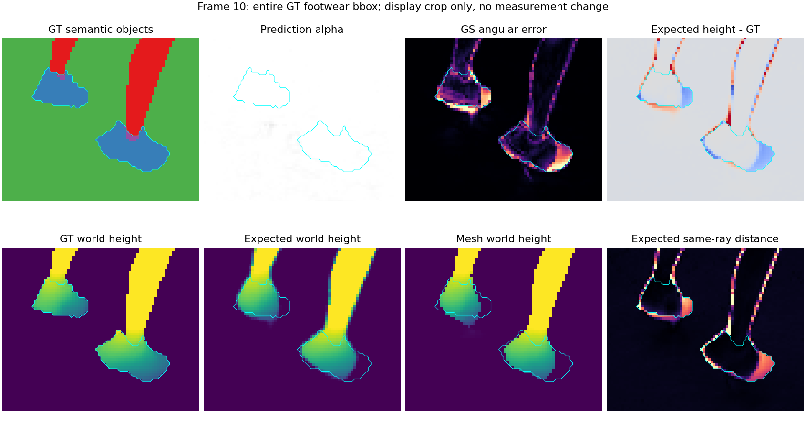

# 足部恢复重置配对完整评测报告

主机 `ushas`，环境 `lumimotion-ushas`。F-T01／F-T02从同一G2-T04@14000参数起点实际训练2000次更新至16000，唯一变量为15000透明度重置保留／跳过。两组真实训练来源与GPU身份核验通过，存活期间native／tracer映射及SHA被自动捕获，正式fresh与训练实际运行库SHA相同。原模型、失败smoke和所有正式产物全部保留。

## 原15帧与冻结基线

原固定测试10、20……150、原Alpha／GT ray-hit／有效交集、像素加权角度MAE、训练135相机TSDF及原六评测源码全部未改变。两组完整六个评测子命令均exit0；原15完整性PASS，全部互斥对象分区加总精确重现三项主指标与有效像素数。

| 同一模型 | GS／度 | Depth／度 | Mesh／度 | 相对冻结基线三项变化／度 | 新Goal数值 |
| --- | ---: | ---: | ---: | --- | --- |
| G2-T04@14000冻结基线 | 2.756110384680 | 5.424075573849 | 4.287353582305 | 0／0／0 | 基线 |
| F-T01@16000保留重置 | 2.960431106973 | 5.779198766501 | 4.302605163168 | +0.204320722293／+0.355123192652／+0.015251580863 | FAILED（GS与Depth超限） |
| F-T02@16000跳过重置 | 2.774865396904 | 5.545685124204 | 4.249532330680 | +0.018755012224／+0.121609550356／−0.037821251625 | PASS |

预注册上限为GS≤2.856110384680°、Depth≤5.624075573849°、Mesh≤4.487353582305°，未依据结果调整。T02保持约定高精度，GS未低于历史最小，不更名为GS新最佳；Mesh有改善。同一个T02检查点作为后续局部恢复候选，不能拼T01／T02／旧模型各自最佳单项。

T01 coverage为GS0.997884558942／Depth0.965922201240／Mesh0.992643950595；T02为0.997897480484／0.965933276848／0.993184809435。原条件指标、共同像素与缺失180°补充指标各自保留，不互相替代。

## 足部表面改善但尚未完整

离线语义鞋object4固定6185原可评分像素，Alpha与三法线有效性均100%。没有改分区边界或筛帧，鞋GT标签和几何不进入训练。

| 语义鞋object4 | GS／Depth／Mesh局部MAE／度 | Expected同射线2厘米内 | Mesh同射线2厘米内 | Expected距离中位数／厘米 | Expected距离p90／厘米 | Expected近台面替代代理 |
| --- | --- | ---: | ---: | ---: | ---: | ---: |
| G2-T04@14000 | 28.392145／33.089643／36.098627 | 52.0453% | 51.6734% | 1.7891 | 17.9584 | 22.7324% |
| F-T01@16000 | 19.849435／26.787740／28.775669 | 67.5990% | 66.7421% | 1.1206 | 12.5256 | 8.3751% |
| F-T02@16000 | 19.244016／26.521809／27.589072 | 68.6015% | 67.9386% | 1.0794 | 12.2395 | 8.0841% |

两组鞋表面都继续恢复。T02比T01的Expected2厘米比例高约1.0024个百分点，局部角度略低；这组单次对照支持跳过重置更有利于法线保持，但不能把全部鞋恢复归因于该单一变量，更不能把点数多少当作足部几何质量。较大部分鞋区射线仍偏离GT，必须结合图像判断。

亲自查看两组四类10／80／150拼图和鞋区10／40／80／150：两腿与鞋主体连续，鞋尖较14000增长，正面150、侧面10和俯视80仍有鞋尖末端短缩、高度偏低；40遮挡视角的可见鞋末端也不完整。Expected和Mesh一致，不能仅靠RGB黄鞋或全白Alpha判成功。人工没有逐帧看完全部视频，自动解码覆盖全部150帧。

| 类别 | 两组目检结论 |
| --- | --- |
| RGB | 人物与鞋主体可辨，暗面黑、阴影模糊，鞋尖仍短。 |
| Alpha | 人物与台面合并轮廓连续，无法识别台面内鞋尖缺损。 |
| Normal／Depth／Mesh | 双腿基本连续、鞋部部分恢复，末端持续缺失及偏低。 |
| Separation | 人物和台面基本同橄榄色，静态门控不代表独立保护或运动分离。 |

**整模型最终结论：F-T01 FAILED（数值退化超限＋足部未完整）；F-T02 FAILED（数值PASS，但足部仅部分恢复）。** 没有以全局法线保持代替足部验收，也没有修改历史最佳基线JSON。

## 来源、重载与产物完整性

两正式16000新入口fresh各11项训练／评测输出最大差0，原GeometryRun法线／Alpha／深度与六零形变头核验通过；photo17项、normal18项、拓扑40项训练审计独立读取核查。实际入口为 `scripts/train_static_dl_foot_recovery.py`，11科学源码、5起点资产与137训练输入匹配READY快照，clock未前移。来源完整smoke15110的前移clock只证明接入，未作为正式效果。

两组各600PNG均独立打开、四个400×400视频各150帧完整解码PASS，原保存PLY／deform／lighting三SHA在全评测后不变。GPU1两个槽均结束，未触碰其他用户任务。

## 完整复现与终审路径

- F-T01：`output/1012-09-LH-static-jumpingjacks_DL_V2-F-T01-保留重置足部恢复2k`；F-T02：`output/1012-10-LH-static-jumpingjacks_DL_V2-F-T02-跳过重置足部恢复2k`。两者模型均为子目录 `model_mlp`，iteration16000。
- source统一为 `output/1011-01-LH-static-jumpingjacks_DL_V2-原生LumiMotion两阶段/eval_view`。
- 每个实验根README已追加全部六条实际渲染／评测命令、精确指标、四类目检、source/model/iteration、渲染及视频路径和最终FAILED；同目录 `evaluation_16000/README.md` 为完整评测记录。
- 原定量：`evaluation_16000/goal_mae_summary.json`；鞋部：`spatial_diagnostic/summary.json`及逐帧CSV；最终：`goal3_final/goal3_acceptance.json`及 `FINAL_REVIEW_COMPLETED.json`。
- 正式fresh：根目录 `fresh_parity_16000/parity.json`；解码：`evaluation_16000/artifact_decode_audit.json`；模型保留：`checkpoint_after_audit.json`。
- 代表图 `evaluation_16000/four_classes/four_classes_10_80_150.png`；脚部局部 `spatial_diagnostic/figures/footwear_zoom_0010/0040/0080/0150.png`；四类视频 `four_classes/rgb/alpha/normal/separation.mp4`（分别为四个文件）。
- 日志：根目录 `logs/evaluation_16000_launcher.log`、`logs/fresh_parity_16000.log`及 `evaluation_16000/logs/` 各子任务日志；训练运行库证据根目录 `actual_runtime_capture.json`。

后续建议继续从T02局部恢复候选和实际保存Adam／RNG／增密统计续训，固定损失，保持原验收上限与完整足部门槛；本轮不预判延长训练必能恢复。Goal由root统一维护，LIHAN全分支同步由root统一管理。

## 随报告归档的原始图与复核

以下图片直接复制原评测产物，未重绘、裁改或改变统计区域；原路径与SHA见[归档来源](assets/1012-04-足部恢复首轮/归档来源.json)。root实际查看了T02侧面0010和俯视0080，并复核两终审各9项来源，见[终审来源核验](assets/1012-04-足部恢复首轮/终审来源核验.json)。

冻结基线侧面鞋部：

T02续训后同一侧面视角，鞋尖延伸但仍有残余短缩：

[T02俯视鞋部原图](assets/1012-04-足部恢复首轮/T02俯视鞋部.png)显示相同残余问题，不能以单一视角改善代替完整恢复。
