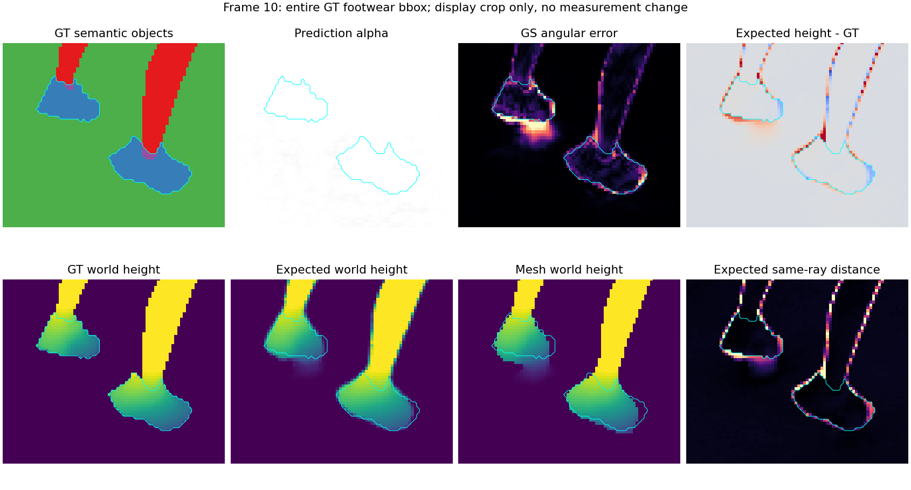
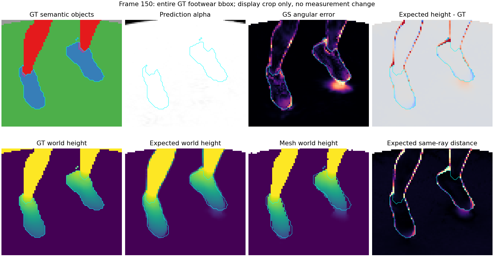

# 足部恢复三轮训练归档与验收报告

本轮F-T03@18000已完成2000次续训和全部正式评测，**法线数值PASS、足部部分恢复、联合验收FAILED**。鞋部持续改善，但多视角鞋尖仍偏低或小幅短缩，尚未达到完整稳定恢复。本次完成T01—T03、冒烟重试及失败现场的收尾归档，不启动新训练，不将联合Goal标记为完成。

主机`ushas`，环境`lumimotion-ushas`。训练结束时间为2026-10-12 11:10:42（日本时间；日志原值02:10:42 UTC），真实PID2567197／GPU1，exit0；global16001—18000、2000更新、终点55957点。16500／17000／17500／18000的PLY、形变、光照和优化器状态全部保留。指定Astra／Sol子Agent在本次收尾因账户usage limit未能执行，正式补评及人工终审由root完成；这项角色限制已写入终审证据，没有冒称独立Agent复核。

## 同一模型与原评测口径

保持原测试10、20……150、原掩膜／有效交集、像素加权MAE和135训练相机TSDF；六原评测源码SHA、测试集及计量数学均未变化。GT语义和几何只用于离线审计，不参与训练。互斥对象分区加总精确复现三主MAE与有效像素数。

| 模型 | GS／度 | Depth／度 | Mesh／度 | 本Goal数值 | 足部 |
| --- | ---: | ---: | ---: | --- | --- |
| G2-T04@14000 冻结基线 | 2.756110385 | 5.424075574 | 4.287353582 | 基线 | 部分恢复 |
| F-T01@16000 | 2.960431107 | 5.779198767 | 4.302605163 | FAILED | 部分恢复 |
| F-T02@16000 | 2.774865397 | 5.545685124 | 4.249532331 | PASS | 部分恢复 |
| F-T03@18000 | 2.777640687 | 5.562334365 | 4.242261114 | PASS | 部分恢复 |
| G2-T06@16000 后发布参考 | 2.668377838 | 5.404577799 | 4.208487287 | 不改变预注册门槛 | 部分恢复 |

预注册上限仍是GS≤2.856110384680°、Depth≤5.624075573849°、Mesh≤4.487353582305°，没有因暂停、续训或后续结果放宽。T03相对冻结基线变化为+0.021530°／+0.138259°／-0.045092°；相对T02变化为+0.002775°／+0.016649°／-0.007271°，全局GS／Depth略退、Mesh略改善。

后来并行上一Goal发布G2-T06，成为当前已审计结果中的GS／Mesh更优参考；T03相对它为+0.109263°／+0.157757°／+0.033774°。它没有取代本次预注册对照，更不能与其他模型拼接单项。T03不是最新全局法线最佳配置；G2-T06同样仍有鞋尖残缺，因此也不能作为足部恢复成功证据。

## 足部恢复与多视角检查

同一鞋object4固定6185个可评分像素，Alpha及三法线coverage均100%；台面在鞋后，覆盖100%仍可能由台面提供有效表面。鞋与袜集合没有混用于下表。

| 模型 | 鞋GS／Depth／Mesh MAE／度 | Expected同射线2厘米内 | Mesh同射线2厘米内 | Expected近台面替代代理 |
| --- | --- | ---: | ---: | ---: |
| F-T01 | 19.849435／26.787740／28.775669 | 67.5990% | 66.7421% | 8.3751% |
| F-T02 | 19.244016／26.521809／27.589072 | 68.6015% | 67.9386% | 8.0841% |
| F-T03 | 15.977356／23.809667／24.092253 | 76.3137% | 75.6508% | 3.5570% |

T03相对T02的Expected比例增加7.7122个百分点，鞋局部三MAE下降3.2667°／2.7121°／3.4968°。Expected距离中位数0.8849厘米，p90为7.6042厘米；改善实质存在，剩余误差不能被全局低MAE掩盖。2厘米比例是离线诊断，不是本轮临时新增的成功门槛。

root实际查看四类10／80／150、鞋10／20／40／80／90／140／150，以及全景诊断10／150。双腿和鞋主体连续，大面积鞋缺失显著缓解；侧面0010、正面0020／0140／0150及0090仍见鞋尖低于GT或末端缩短，Expected与Mesh均有残差。俯视0080较好、0040受遮挡，不能单独证明所有足部表面完整。没有逐帧人工看完视频；自动完整解码覆盖四类各150帧。

| 类别 | 本轮目检结论 |
| --- | --- |
| RGB | 双腿与鞋主体可见且连续；暗侧较黑、投影模糊。相较T02鞋主体和末端继续改善，鞋尖仍偏低，不能仅凭黄色鞋面判定完整恢复。 |
| Alpha | 人物与台面合并轮廓连续，鞋object4 Alpha覆盖100%；台面遮住鞋部缺损对Alpha的影响，无法用该覆盖率证明鞋面完整。 |
| Normal | 腿部主体连续，鞋轮廓接近GT且较T02改善。0010／0020／0090／0140／0150仍见鞋尖偏低或末端小幅短缩；Expected及Mesh均留有残差，未达到完整稳定恢复验收。 |
| Separation | 人物与平台近同橄榄色，静态门控不能解读为运动分离或鞋部独立保护。 |

T03侧面原诊断图：

T03正面原诊断图：

[T03俯视](assets/1012-05-足部恢复三轮归档/T03俯视鞋部.png)、[四类三视角](assets/1012-05-足部恢复三轮归档/T03四类三视角.png)、[T02同一正面](assets/1012-05-足部恢复三轮归档/T02正面鞋部.png)均直接复制原产物；没有重绘、改统计区域或制造修复图。原路径及SHA见[归档来源](assets/1012-05-足部恢复三轮归档/归档来源.json)。

## 归因与证据边界

[前期消失审计](1012-02-近期训练脚部消失审计报告.md)发现重置后normal→opacity压低透明度，随后低透明度裁剪，以及平台稀释全局MAE、Alpha无法识别平台内鞋缺失的共同问题。上一Goal自然reset配对的UID谱系进一步支持阻断normal→opacity减少真实低透明度裁剪；该高度队列不是GT鞋标签，不能把全部被保留点称为鞋点。

本GoalT01／T02支持跳过15000 reset更利于维持整体法线，两臂鞋形均改善；[配对报告](1012-04-足部恢复重置配对完整评测报告.md)保留完整反例。T03在同损失、无新监督、恢复Adam／统计／RNG后继续改善鞋部，支持几何仍可恢复，未显示恢复已停滞。T03没有重置控制臂，不能独立估计阻断opacity或取消reset的因果收益，也不能单凭残余鞋尖错误归咎阴影、遮挡或视角不足。当前结论是透明度／裁剪机制已获得支持，完整鞋尖恢复仍需另行实验；本次按用户要求在本轮结束后归档。

## 正式来源、复现与保留

正式18000 fresh真实exit0，11前向输出最大差0、189来源项核验通过，六零形变头及原GeometryRun一致。真实训练存活期native／tracer与fresh SHA一致；93项训练状态恢复证据保留。六正式评测子命令均exit0；600PNG和四个400×400、150帧视频完整解码PASS，18000检查点SHA前后不变。

- T03根目录：`/home/han.li/reproduce/LumiMotion-stage2-perlight/output/1012-11-LH-static-jumpingjacks_DL_V2-F-T03-F02完整状态恢复续训2k`；source：`/home/han.li/reproduce/LumiMotion-stage2-perlight/output/1011-01-LH-static-jumpingjacks_DL_V2-原生LumiMotion两阶段/eval_view`；model：`/home/han.li/reproduce/LumiMotion-stage2-perlight/output/1012-11-LH-static-jumpingjacks_DL_V2-F-T03-F02完整状态恢复续训2k/model_mlp`；iteration18000。
- 完整实际渲染／评测命令：根`README.md`与`evaluation_18000/README.md`，实际argv／退出码见`evaluation_18000/plan.json`、`executed.json`；训练命令见`commands/train.json`、`commands/train.sh`。
- 训练日志：`logs/train.log`；补评日志：`logs/fresh_parity_18000.log`、`logs/evaluation_18000_launcher.log`及`evaluation_18000/logs/`六子日志。
- 主指标：`evaluation_18000/goal_mae_summary.json`；足部统计：`spatial_diagnostic/summary.json`及逐帧CSV；终审：`FINAL_REVIEW_COMPLETED.json`、`visual_review_completed.json`和`goal3_final/goal3_acceptance.json`。
- 代表图：`four_classes/four_classes_10_80_150.png`、`spatial_diagnostic/figures/footwear_zoom_0010.png`／`0080.png`／`0150.png`；视频：`four_classes/rgb.mp4`、`alpha.mp4`、`normal.mp4`、`separation.mp4`。
- T01／T02全部正式与中间检查点、渲染、统计、日志原位保留，根README最终分别FAILED／FAILED；T03最终FAILED。烟测8个已存在目录及其启动失败／runtime缺证据记录全保留，见总控`smoke_archive_index.json`。
- 训练文档：[T03完整记录](../训练/1012-09-LH-static-jumpingjacks_DL_V2-F-T03-F02完整状态恢复续训2k计划.md)；Goal追加终审，保留所有旧记录。大体量模型和视频在output原位归档，文档与代表原图进入LIHAN共享资料；全分支同步证据由总控`shared_sync_selected.json`及归档SHA清单记录。

**最终验收：T01 FAILED（数值超限＋足部未完整）；T02 FAILED（数值PASS＋足部未完整）；T03 FAILED（数值PASS＋足部继续改善但未完整）。归档完成与联合修复目标完成是不同状态。**
