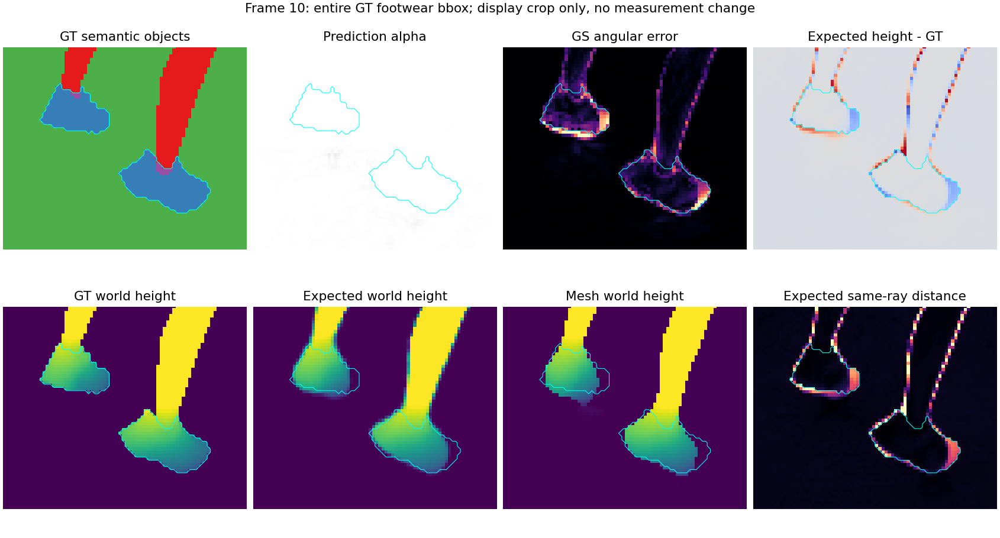
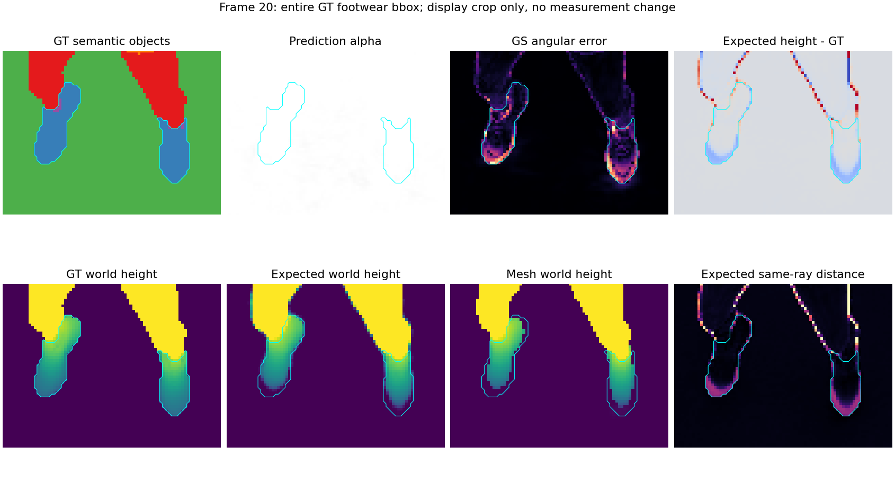

# 足部恢复新轮最佳法线基线复核

2026-10-12，ushas，lumimotion-ushas。指定评测角色Sol独立只读复核两个Goal、两个1012-05归档报告和G2-T06训练记录，重新核验现有来源、计量和产物，亲自查看四类10／80／150及足部10／20／80／90／140／150。**G2-T06@16000为当前可用的最佳单一法线模型；双腿与鞋主体连续，但鞋尖仍低矮或末端短缩，足部完整性FAILED。** 本次未训练、未执行新GPU渲染、未修改既有归档和原指标。

## 单一模型与冻结门槛

| 项目 | T06原MAE／度 | 新轮上限／度 | 首轮历史上限／度 |
| --- | ---: | ---: | ---: |
| GS Normal | 2.6683778383745302 | 2.7683778383745302 | 2.856110384679971 |
| Depth Normal | 5.404577799172339 | 5.604577799172339 | 5.624075573848699 |
| Mesh Normal | 4.20848728697561 | 4.40848728697561 | 4.487353582304789 |

新轮固定T06三项分别加0.10°／0.20°／0.20°，同时保留首轮G2-T04门槛并列报告；取两套约束交集即本表新轮上限。以十进制文本保留冻结精度，避免显示舍入放宽。该容忍范围是工程验收定义，不代表统计显著性。原旧EL门槛3.51°／7.35°／5.46°及上一Goal的GS<2°结论也继续单列，不能用旧数值PASS替代足部Goal成功。

候选索引`output/1012-01-静态DL-两度目标总控/checkpoint_candidate_index.json`的current_best为G2_T06_16000。它的GS与Mesh为已审计模型最低，Depth单项最低仍是G2-T03@14000；不拼接不同模型。后发布F-T03@18000为2.777640687397°／5.562334364716°／4.242261114472°，保持此前预注册数值PASS归档；若仅作本轮门槛对照，其GS高于新上限，不能据此改写历史结论。

## 检查点可用性

模型绝对路径：`/home/han.li/reproduce/LumiMotion-stage2-perlight/output/1012-09-LH-static-jumpingjacks_DL_V2-G2-T06-reset后normal阻断透明度2k/model_mlp`，iteration16000，67081点。

| 文件 | 字节 | 当前SHA256 |
| --- | ---: | --- |
| point_cloud/iteration_16000/point_cloud.ply | 18516317 | 346cc983263fb5d6243b5b276e73a636e865de9be38662d9db6636c2bdd4fccc |
| deform/iteration_16000/deform.pth | 2726403 | 343c279787bb2cf08d8d5527e80d02bec5dc510a2f01fd00d04431f654383ef0 |
| static_dl_lighting/iteration_16000/lighting.json | 884 | 85490b1dcce17306f4bf228a945e6950c89efbfa1fe071a1671523073ada3586 |

上述三资产当前SHA与候选索引和旧checkpoint_after_audit一致，足以供真实模型重载或三资产初始化。**优化器状态不完整：未保存。** 整个T06正式目录没有optimizer／chkpnt／checkpoint权重文件；读取真实`scripts/train_static_dl_reset_audit.py`的save_checkpoint确认仅保存PLY、复制deform、写lighting JSON。Adam动量、增密统计、RNG与相机余栈没有历史恢复资产；新轮应明确新Adam、统计清零和独立seed序列，不能借用F-T03的93项状态恢复审计或声称无缝续训。

## 原协议和真实来源复核

原协议SHA256为`7cf1e7f6e1ce7f223319899febdfb1d443440add68cddee191fe5bf47e1646be`。重新逐项校验6个固定评测源码和184个输入SHA，135训练与原15测试10、20……150互斥且覆盖全150帧；resolution2、Alpha阈值0.5、interior_radius2、原foreground／conditional-valid／signed角度像素加权MAE和Depth有限差分支持掩膜不变。TSDF仍每测试时刻仅融合全部135训练相机预测Expected深度，voxel0.02、sdf0.08、depth20，不用测试相机重建。

原指标JSONSHA与goal summary一致，原15完整性PASS；互斥8对象及unknown的误差和、有效数重新加总，在1e-12容差内恢复三主MAE，正常数分别540663／523338／538021，eligible541731。coverage为99.802854%／96.604772%／99.315158%。辅助common／missing180维持原记录，不替换主MAE。

训练5个初始化资产、12个科学源码和137个输入SHA、旧fresh48项来源SHA、旧终审10项证据SHA均重新校验。实际训练PID2500425／GPU1的存活期native及tracer捕获为PASS_CAPTURED、alive=true，两二进制当前SHA与旧fresh完全一致。既有正式fresh的11个实际前向输出max_abs均0，GeometryRun与六零头证据保留；本次只复核既有fresh证据，没有声称重新执行fresh。完整现有600PNG及四个400×400、150帧视频重新CPU解码PASS；旧正式目录877个文件前后SHA完全相同。

## 足部与四类人工复核

鞋object4固定6185个原可评分像素，不能与鞋袜集合或世界高度带混比。三法线局部MAE为21.2038507153°／27.7434105321°／30.0599170189°，Alpha与三法线coverage100%。Expected同射线2厘米内64.995958%，Median69.215845%，Mesh63.912692%；Expected距离中位数1.151963厘米、p90为13.147020厘米。Expected近台面代理10.428456%，Mesh26.386419%，说明覆盖100%仍包含低矮替代表面；这是离线诊断，不是训练监督或临时新增的成功阈值。

| 类别 | 本次亲自查看的结论 |
| --- | --- |
| RGB | 双腿与鞋主体连续，暗側较黑、投影模糊；黄色鞋面能显示，但末端形态不能仅凭外观判完整。 |
| Alpha | 人物与台面合并轮廓连续，俯视80近满盘；台面可补足鞋后背景，100%覆盖不能证明三维鞋存在。 |
| Normal及几何 | 10侧面、20／140正面及90／150斜正面的鞋尖边缘误差明显；Expected与Mesh末端偏低或短缩。80俯视鞋主体较好，不能代表全视角完整。腿主体没有明显大面积截断。 |
| Separation | 人物与台面近同橄榄色，原静态门控不能解释为运动分离或独立鞋保护。 |

本次足部状态为**部分恢复**，残余严重度为鞋末端局部重建失败，非整条腿／整个鞋主体透明消失；在多视角仍可重复看到，足部完整性**FAILED**。人工检查图像帧10／20／80／90／140／150，不声称人工逐150帧看完视频。

## 新入口评测接入建议

新`scripts/train_static_dl_foot_densify.py`与`scene/static_dl_foot_densify.py`应使用独立marker和独立评测helper，不改首轮recovery、resume、旧reset helper与六固定计量源码。先零更新TRAIN诊断，再以真实新训练入口审计和新进程fresh验证相同11前向输出；新Adam初始化、统计清零、seed首相机、photo、normal→opacity与增密算子审计应真实核查，不加入state_restore假称。GT object4／几何仅在隔离离线评测使用。

正式终点依次完成fresh-source、原15三MAE、同object4诊断及完整150视角四类图视频。同时记录新轮／历史数值状态、原有效性、coverage及缺失惩罚；以真实多视角足腿完整性作独立否决。新门槛无论是否满足，若正面／侧面／关键角度仍有鞋尖低矮、短缩或台面替代，联合结果FAILED。新轮只更新独立冻结JSON，不改首轮基线JSON及既有三轮归档。

复核产物位于`output/1012-13-LH-static-jumpingjacks_DL_V2-G2-T06新轮冻结基线复核`，其中`commands/复核基线.py`保存实际CPU核查逻辑，`基线复核.json`保存全部冻结门槛、旧产物来源和核查计数；`README.md`给出本次命令及原完整渲染命令。代表图直接复制既有原图，复制来源与SHA在本报告assets新目录的`归档来源.json`。本次最终为**基线复核PASS、已有模型足部验收FAILED**，未产生新训练或新模型科学结果。

## 收尾停点

随后仅准备了五个独立`goal3_densify_*`评测helper，CPU语法、冻结JSON和十进制门槛边界检查通过。按用户“继续，收尾实验，归档文档”停止开发，未启动任何新GPU评测或训练，未用新helper验收实际新模型。准备文件和限制见`LIHAN/DOC/修改/1012-15-足部最佳基线增密独立评测准备与收尾.md`；CPU记录为本目录`新评测入口CPU检查.json`。T06鞋尖仍FAILED，联合修复目标未完成。
