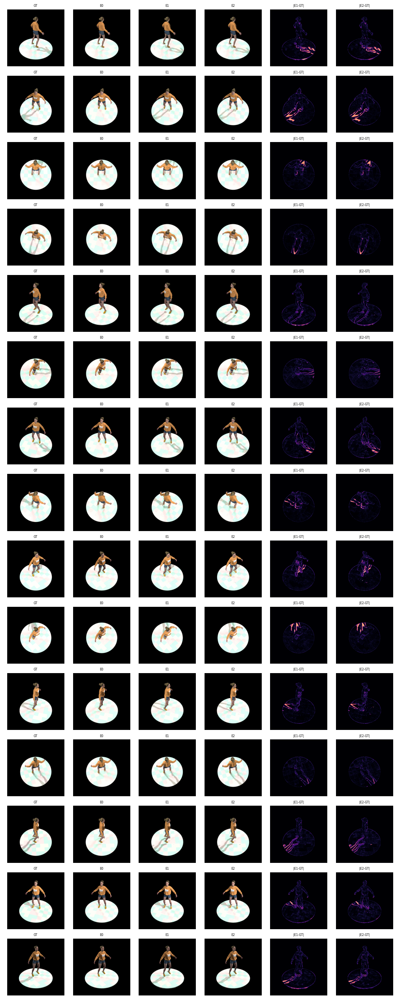
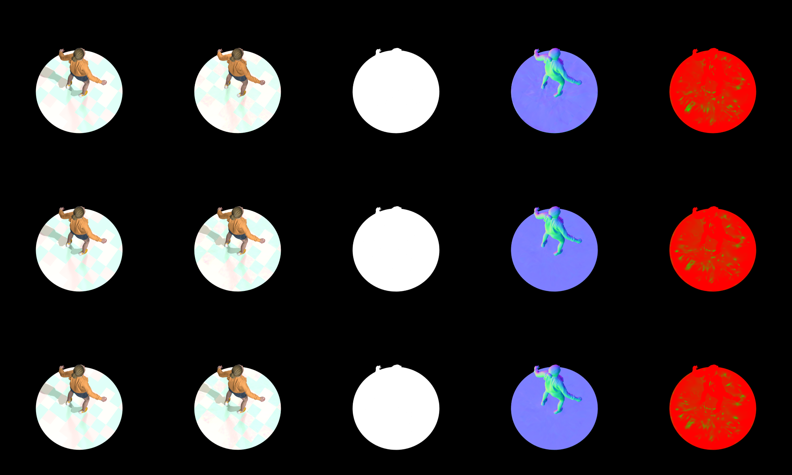
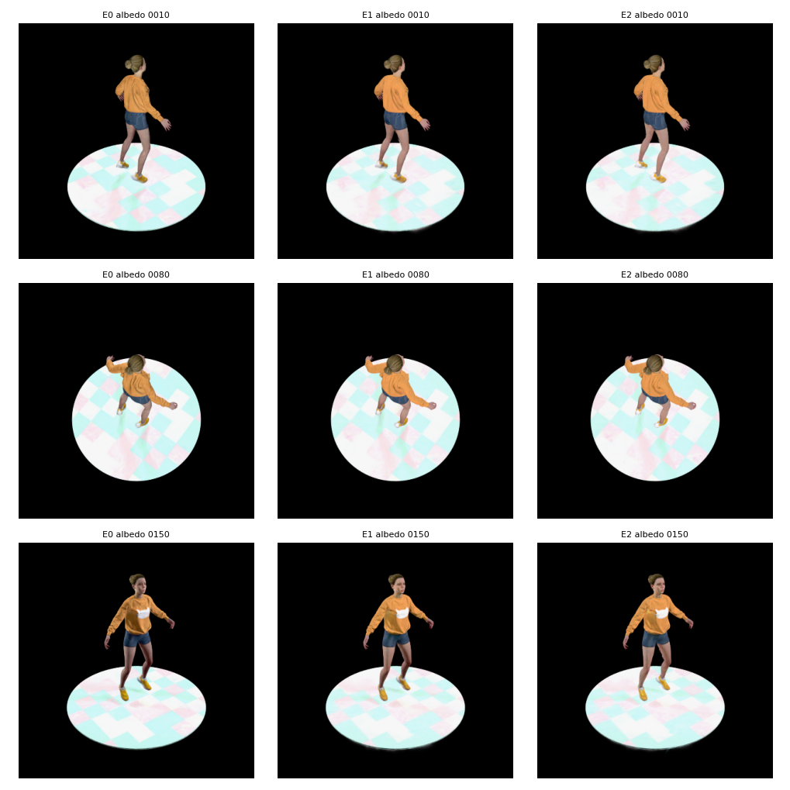
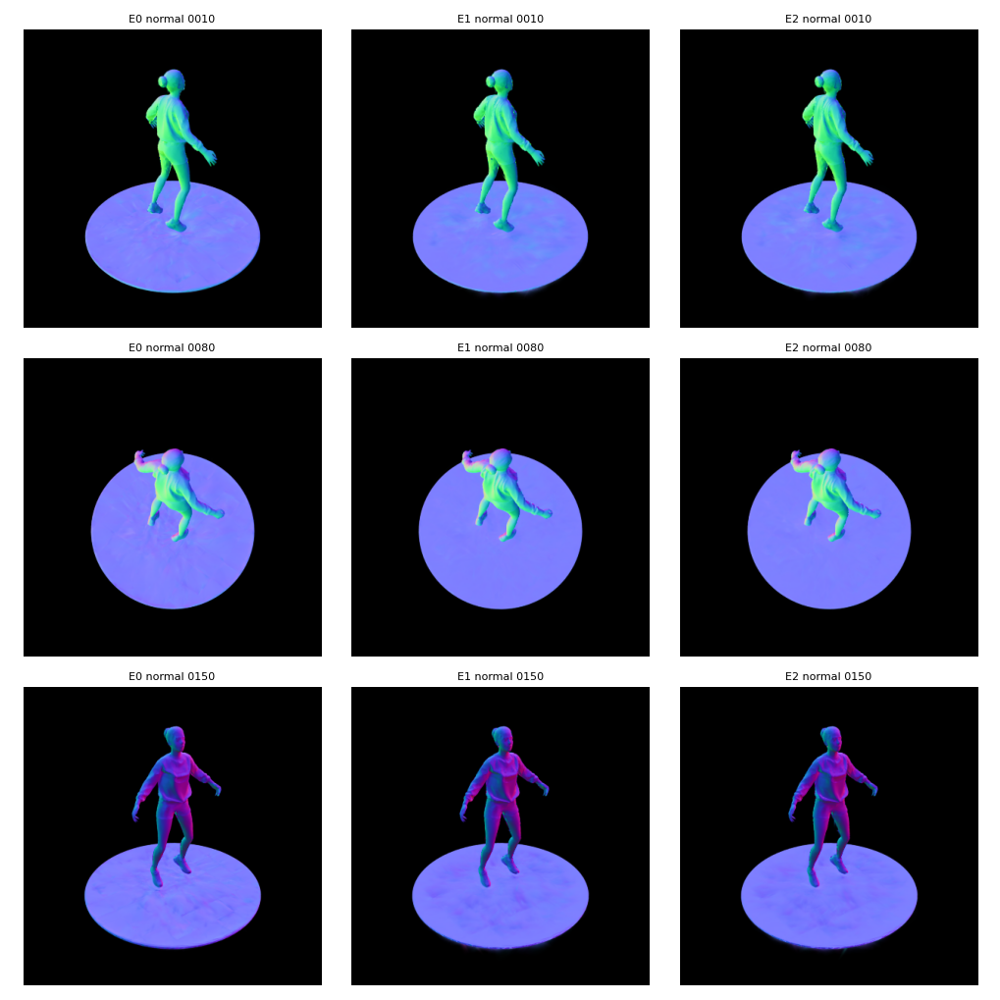
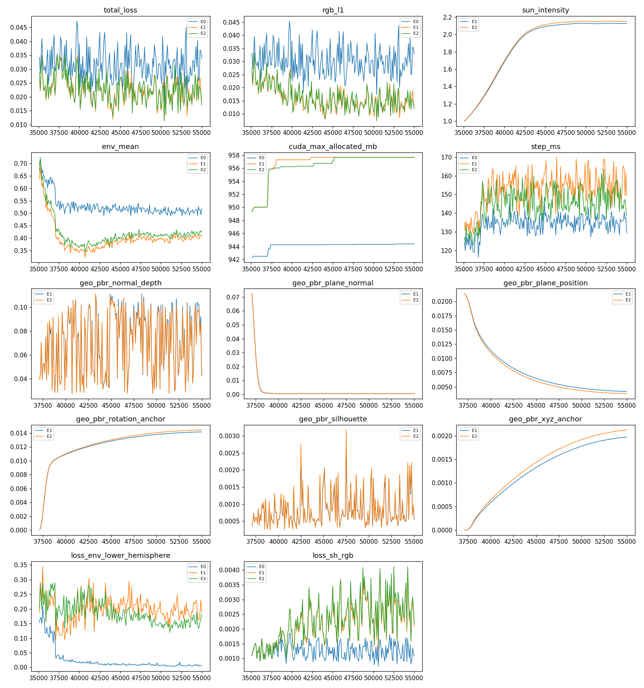

# 1107-03 完整管线（Stage 1 → E4 → Stage 3）与去 bg 对照汇报

日期：2026-11-07（Asia/Tokyo）；服务器 ushas（A40）；Conda 环境 lumimotion-ushas；分支 `1107-pipeline-nobg`。
角色：Academic-analysis（冻结后评测与报告）。

引用：
- GOAL：[1107-02-完整管线跑通与去bg对照实验](../GOAL/1107-02-完整管线跑通与去bg对照实验.md)（T01）
- 规划：[1107-03-T01完整管线与去bg规划](../规划/1107-03-T01完整管线与去bg规划.md)（判定口径见第 8 节）
- 实现记录：[1107-03-T01完整管线E4接入与去bg开关实现](../修改/1107-03-T01完整管线E4接入与去bg开关实现.md)
- 训练计划：[1107-02-T01完整管线E0E1E2执行计划](../训练/1107-02-T01完整管线E0E1E2执行计划.md)
- 冻结产物：预注册 `output/1107-03-LH-static-ELDL-V3-完整管线去bg总控/preregistration.json`（冻结于 2026-11-07T09:28:06Z，SHA 见同目录 `preregistration.sha256.json`）；E4 方向 JSON SHA：train `dc0b797a...`、dev `47dd68fd...`、test `e875510c...`；B00 PLY SHA256 `adf94a93...222ff`。
- 本报告未修改任何方法、参数、门槛，未改动冻结产物；失败/异常日志（含 `*_launchfail.log`）全部保留。

---

## 1 一句话结论

**假设“去 bg 后管线效果更好”被反对**（按规划第 8 节机械判定）：E2（去 bg）相对 E1（带 bg）在 TEST15 上 PSNR −0.285 dB、SSIM −0.0019、LPIPS +0.0041（变差），三项均超过预注册阈值。工程验收 E0/E1/E2 均 PASS。单场景、单训练种子，不作统计显著性声明。

---

## 2 管线数据流

```
数据 LH-static-jumpingjacks-ELDL-V3（150 帧 RGB/Alpha/相机；FIT117 / DEV18 / TEST15）
  │
  ├─ Stage 1（冻结）：B00 @35000（几何/SH/albedo/roughness/opacity + 形变 MLP）
  │
  ├─ Stage 2（冻结，不重跑不重评）：E4 → 150 帧世界系单位光向（表面→光源）
  │      └─ 接口适配：转为 train/dev/test 三份方向光 JSON（SUN，intensity=1，gt_read=false）
  │      光向精度（冻结引用）：Mean 4.248° / P50 3.787° / P90 8.030° / ≤5° 共 90/150 帧
  │
  └─ Stage 3（原生 PBR 外观训练，经混合光入口；+20000 循环，35000→55000）
         环境光 EnvLight(16×32，可训练) + E4 SUN（方向固定，只学一个光强标量）
         + 原生 GGX/BVH 追踪 + 逐高斯 SH 间接光通道（“bg”）
         法线：既有 PBR 几何微调（--pbr_optimize_geometry --pbr_freeze_opacity，信赖域/锚定沿用默认）
         ├─ E1：以上全部原样（带 bg）
         └─ E2：E1 + --wo_indirect（去 bg）
  评测：TEST15 重渲染（400×400，512 采样）→ PSNR/SSIM/LPIPS；泄漏监测 M1–M6（FIT117+DEV18）
```

三组差异：

| 组 | 方向光 | 几何微调 | `--wo_indirect` |
|---|---|---|---|
| E0 原始管线 | 无（仅环境光） | 无 | 否 |
| E1 带 bg | E4 固定、学光强 | 是（N1） | 否 |
| E2 去 bg | 同 E1 | 同 E1 | 是 |

E1 与 E2 仅差 `--wo_indirect`（实现自检逐项断言过）；E0 与 E1 差“SUN + 几何微调”两项，E0 只用作与原始管线的参照，不作单因素归因。

---

## 3 去 bg 的最终做法与依据

**前提核查**：仓库 Stage 3 中不存在从 Stage 2 带入的逐高斯 b_g 自由变量；E4 只交付 150 帧光向，其 ρ/b 仅在 `photometric_diagnostics.npz`（`diagnostic_only=True`，只覆盖 2683 个采样点、单通道、Lambert 尺度，与 PBR 尺度不兼容）。代码里字面的 “bg” 是黑底背景合成色，与 b_g 无关。

**定义（主会话裁定 D1，规划 R2）**：Stage 3 的“逐高斯 bg”= 逐高斯 SH 间接光通道（Stage 1 的 SH 颜色×(1−d_color) 经追踪后作为入射光；参数可训练且默认不 detach，可吸收残差）。

**方案 BG-R2-①③（预注册，定死）**：
- ① 逐高斯 bg 恒置零：用仓库既有开关 `--wo_indirect`（`render_ir.py:557-558`）；
- ③ 环境光位置由本就存在的全局 EnvLight 承担；
- 不采用 ②（全局单标量：与 EnvLight 直流分量共线、不可辨识、要新增参数）；不采用 ①′（连环境光一起去掉，是结构破坏）。
- 依据：零新代码、不改损失与结构，E2 与 E1 只差一个开关，满足“Stage 3 除去 bg 外不改模型”。

M6 正确性检查通过：E2 间接分量在 15 个 TEST 帧上恒为 0，E1 间接分量均值 0.04–0.09（>0）。

---

## 4 定量对照表

### 4.1 TEST15（seed 0，均值；seed 1 与 seed 0 逐位相同）

| 指标 | E0 | E1 带 bg | E2 去 bg | Δ(E2−E1) |
|---|---|---|---|---|
| PSNR (dB) | 30.307 | **35.722** | 35.437 | −0.285 |
| SSIM | 0.9788 | **0.9836** | 0.9816 | −0.0019 |
| LPIPS(vgg)，越低越好 | 0.0270 | **0.0218** | 0.0258 | +0.0041 |
| 前景 PSNR | 23.900 | **29.697** | 29.274 | −0.423 |
| 前景包围框 SSIM | 0.9414 | **0.9581** | 0.9526 | −0.0055 |
| 前景包围框 LPIPS | 0.0730 | **0.0539** | 0.0655 | +0.0116 |

逐帧：E2 的 PSNR 优于 E1 的有 3/15 帧（0010 +0.05、0100 +0.04、0150 +0.31 dB 等小幅），SSIM 优于 1/15，LPIPS 优于 0/15。

### 4.2 DEV18 / FIT117（诊断，不参与判定；仅 E1/E2）

| 集 | 臂 | PSNR | SSIM | LPIPS |
|---|---|---|---|---|
| DEV18 | E1 | 36.427 | 0.9846 | 0.0219 |
| DEV18 | E2 | 36.057 | 0.9825 | 0.0261 |
| FIT117 | E1 | 36.178 | 0.9847 | 0.0202 |
| FIT117 | E2 | 35.817 | 0.9827 | 0.0243 |

E2 在训练帧（FIT117）上同样更差，说明差距主要来自拟合容量而非泛化。

### 4.3 机械判定（规划第 8 节）

- 评测采样噪声：seed 0/1 逐位相同，实测 δ=0，τ 按预注册规则退化为下限：τ_P=0.05 dB，τ_S=1e-4，τ_L=1e-3（规则未改动）。
- 支持条件：ΔPSNR ≥ +0.05 且 ΔSSIM ≥ +1e-4 且 ΔLPIPS ≤ +1e-3 — **不成立**（−0.285 / −0.0019 / +0.0041）。
- 反对条件：ΔPSNR ≤ −0.05 且 ΔSSIM ≤ −1e-4 — **成立**（−0.285 ≤ −0.05，−0.00193 ≤ −1e-4）。
- 判定：**反对假设**。“支持且旗标≥2 则加泄漏限定”条款不适用。法线 GT MAE 与 DEV 指标仅作描述，不改变判定。
- 附带：E1 相对 E0 PSNR +5.41 dB，主要体现 E4 方向光带来的阴影建模（见图），但该差异包含“SUN + 几何微调”两个因素，不可单因素归因。

### 4.4 法线与 Stage 2 光向

- 法线 GT MAE（规划 7.2 的 `eval_geometry_gt.py`）**本轮未执行**，不报数字；只报无 GT 的法线变化统计（M5，相对 B00，逐 Gaussian，n=146272）：

| 臂 | 法线角度变化 mean / p50 / p90 / p99 | ≥59°占比 | 位移 mean / max (m) |
|---|---|---|---|
| E1 | 7.84° / 4.39° / 19.67° / 51.83° | 0.104% | 0.0032 / 0.0640 |
| E2 | 7.86° / 4.37° / 19.87° / 51.91° | 0.106% | 0.0033 / 0.0641 |

  E1/E2 几何变化几乎一致（p90 差 0.21°），去 bg 没有改变法线微调的幅度。
- Stage 2 光向精度（引用 E4 冻结，不重评）：Mean 4.248° / P50 3.787° / P90 8.030°。

---

## 5 泄漏监测解读（E1 vs E2，FIT117+DEV18 前景，各模型用自己的 V、s 分层）

预注册阈值下：M1、M3 触发；M2、M4、M5 未触发；共 2 个旗标；M6 正确性通过。旗标只用于如实报告。

| 编号 | 实测 | 旗标 |
|---|---|---|
| M1 albedo | 低可见度档(V<0.5)像素 albedo 亮度中位数 E1 0.0684 → E2 0.0754（+10.1%，刚过 10% 线）；受光档 −0.28%；逐 Gaussian albedo 亮度均值差 −0.006，clamp 上界占比 57.6%/56.8% | 触发（临界） |
| M2 albedo–光照相关 | 与 s 的 r：0.379/0.373；与 V 的 r：0.187/0.198；\|r\| 增量 −0.005/+0.012 | 未触发 |
| M3 残差（渲染−目标，线性域） | 全体 mean：E1 +0.0031，E2 +0.0057（\|mean\| 比值 1.81，未到 2 倍）；**低 V 档 mean：E1 −0.0021，E2 −0.0300**（14 倍，MAE 0.0165→0.0357）；阴影档 mean 两者几乎相同（−0.0130/−0.0132） | 触发（由低 V 档 <−0.01 引起） |
| M4 环境光 | 立体角加权环境均值 E1 0.464 → E2 0.499，比值 1.075（<1.2）；SUN 光强 2.127/2.152 | 未触发 |
| M5 法线 | p90 差 0.21°（<2°）；像素版 N/A | 未触发 |
| M6 分量 | E2 间接≡0，E1 间接>0 | 通过 |

解读（仅描述，不据此调整任何设置）：
1. 去 bg 的主要效应集中在**被遮挡、低环境可见度的小区域**（该档仅约 1% 的前景像素）：失去逐高斯间接光后，这些位置渲染偏暗（残差 −0.030），albedo 略微提亮（+10%）但没有补足；这与规划预期的“被遮挡区失去间接光、albedo 变亮”方向一致，但幅度小。
2. 受光区 albedo 基本不变（−0.3%），环境光仅小幅上升 7.5%，法线几乎不变，**未见明显的环境光向 albedo 或法线的大面积泄漏**。
3. 全局指标变差（PSNR −0.285 dB）与上述“间接光缺失导致的局部欠亮”相符，但本轮只有一个种子、未做逐区域因果消融，只给出相关性层面的解读。
4. 注意 M1 旗标为临界触发（10.1% vs 阈值 10%），低 V 档样本占比小，旗标稳健性有限。

---

## 6 代表渲染图

均位于 `LIHAN/DOC/报告/assets/1107-03-完整管线去bg对照/`（原始产物见第 9 节）。

E1/E2 并排（全部 15 个 TEST 帧，列：GT | E0 | E1 | E2 | |E1−GT| | |E2−GT|，统一色标）：



四类可视化（TEST 0080；行 E0/E1/E2，列 GT | RGB | Alpha | 法线 | 分离）：



albedo 与法线面板（TEST 0010/0080/0150；列 E0/E1/E2）：




收敛曲线（E0/E1/E2 叠加）：



泄漏监测图：[M1](assets/1107-03-完整管线去bg对照/m1_albedo_by_visibility.png)、[M3](assets/1107-03-完整管线去bg对照/m3_residual_hist.png)。

目检要点：
- E0 没有方向光，地面阴影缺失；E1/E2 都能复现 GT 中的人体投影，E2 的阴影略浅、边缘略弱，与误差图中 E2 在阴影边缘误差更广一致。
- E1/E2 的 albedo 与 E0 相比，棋盘格地面更平滑；E1/E2 地面圆盘下沿（面向相机一侧）有轻微拖尾/发虚，E0 无此现象，推测与几何微调有关（目检观察，未做归因）。
- 法线三组整体一致，E1/E2 地面略平滑，无翻转或空洞。
- 收敛曲线：E1/E2 的 RGB L1 明显低于 E0；SUN 光强 1.0 → 约 2.13/2.15 后平稳；E0 的环境光均值停在约 0.5，E1/E2 降到约 0.4（光被 SUN 分担）；几何各项平稳无发散。

---

## 7 耗时与显存

| 臂 | GPU | 训练墙钟 | 单步毫秒（每 100 循环抽样均值） | 训练峰值显存 torch.max_memory_allocated |
|---|---|---|---|---|
| E0 | 0（A40） | 2782 s（46.4 min） | 133.9 | 944 MB |
| E1 | 1（A40） | 3023 s（50.4 min） | 152.1 | 958 MB |
| E2 | 2（A40） | 2902 s（48.4 min） | 145.1 | 958 MB |

- 三臂并行于三张不同 A40（GPU2 为 49 GB 版本，其余 46 GB），耗时仅作量级参考；E2 比 E1 快约 4%（间接项置零），E1 比 E0 慢约 14%（SUN 分支 + 几何微调）。
- 显存仅为 torch 口径（nvidia-smi 按 PID 采样未在训练期执行），不含 CUDA 上下文与扩展缓存，真实占用更高。
- 评测：TEST15 每臂约 41–47 s，评测峰值约 1033 MB。

---

## 8 打通中解决的关键问题清单

1. **前提不符**：Stage 3 中不存在 E4 的逐高斯 b_g。主会话裁定以逐高斯 SH 间接光通道作为功能等价物（R2），E2 仅加 `--wo_indirect`。
2. **GT 方向光门禁放宽**：仓库几何微调门禁只放行 `gt_directional` 光路。只在 snapshot 副本内放宽为“envmap 且 `pbr_mixed_lights_path` 非空也放行”（补丁 P3），不改几何损失、信赖域与预热；仓库本体未动，自检覆盖放行/拒绝分支。
3. **E4 → 方向光 JSON 接口**：新增转换脚本，断言 predictions SHA 与冻结清单一致、单位范数、帧序 1..150、相机矩阵与 E4 提取时一致（最大差 0.0）、缺帧必须报错；不读 GT。
4. **读取不到 B00**：B00 目录无 `stage2_config.json`，评测入口无法渲染 B00，导致（a）冒烟 B 的“Alpha IoU 对 B00”回退判据无法按规划测量，改用对训练源掩码的代理 IoU（0.992–0.995）；该点由主会话裁定后才冻结预注册（裁定原文以主会话记录为准，训练计划文档中仅记录了待裁定状态）；（b）M5 像素版（渲染法线相对 B00）为 N/A，改用逐 Gaussian 旋转法线变化量。
5. **冒烟（24 循环 A、2040 循环 B）**：A 阶段几何预热默认 2000 与 24 循环冲突，冒烟 A 对 E1/E2 追加 `--pbr_geometry_warmup 8`（预注册命令不含该项）；B 阶段几何激活前后 PSNR 降幅（E1 −0.145、E2 −0.086 dB）远小于回退阈值 1 dB，N1 保持。冒烟 A 中 E2 间接分量=0、E1>0，`wo_indirect` 开关接线验证通过。
6. **FIT117 图像与 B00 训练源字节不一致**：同名图像 SHA 全不相同，但 Alpha>0 的前景像素与 Alpha 通道逐像素相同（117/117），差异仅在 PNG 编码与 Alpha=0 背景，训练用黑底合成，无影响（已披露）。
7. **评测首次启动失败**：评测启动器的输出路径变量为空，写 `/eval_test_seed0` 报 PermissionError；日志保留为 `exp_run_logs/eval_test_seed0_*_launchfail.log`，修正路径后重启，评测结果与训练无关。
8. **门禁/预注册**：在 N1 回退判据无法按规划测量处停下并请主会话裁定，裁定后才冻结预注册（09:28Z）再启动正式训练，未为跑通而降配置、减步数或换数据。

---

## 9 披露项（必须如实陈述）

1. **采样噪声 δ=0**：seed 0/1 评测逐位相同，τ 退化为预注册下限；未改判定规则。本评测路径下的 seed 不引入随机性，因此无法借此估计噪声；训练种子方差未量化（单训练种子，CUDA 原子加法有非确定性）。
2. **M5 像素版 N/A**，Alpha IoU 仅为训练源掩码代理指标。
3. **保存重载与内存渲染一致性（≤1e-6）未做**；仅断言评测前后 checkpoint 文件 SHA 未变。
4. **TEST 光向来自 E4**：E4 拟合使用了含 TEST 视角的 150 帧 RGB（无 GT），存在 “TEST RGB 参与光向估计” 的信息流；Stage 1 见过 DEV18；该数据集 TEST 历史上多次被查看，不称盲测。
5. **显存仅为 torch 口径**；三臂在不同 GPU 上并行，耗时不严格可比。
6. **法线 GT MAE 未执行**，仅有无 GT 的法线变化统计。
7. E0 与 E1 差两个因素，E1−E0 的增益不能归因于单一原因；E0 不进入判定。
8. “逐高斯 bg”采用功能等价定义（SH 间接通道），并非字面的 Stage 2 b_g；结论仅适用于该定义。
9. 泄漏旗标 M1 为临界触发，M3 旗标由占比约 1% 的低 V 区域引起。
10. 单场景、单训练种子，不作统计显著性声明。
11. `LIHAN` 目录与 `LIHAN.md` 的全分支同步：本轮只落在分支 `1107-pipeline-nobg`，未向其他分支同步（工作树另有他人未提交改动），需主会话安排。

---

## 10 产物索引

- 总控与预注册：`output/1107-03-LH-static-ELDL-V3-完整管线去bg总控/`
- E0：`output/1107-04-LH-static-ELDL-V3-E0原始管线环境PBR/`；E1：`output/1107-05-LH-static-ELDL-V3-E1完整管线带bg/`；E2：`output/1107-06-LH-static-ELDL-V3-E2完整管线去bg/`（各含 README、train.log、state.json、model_mlp、eval_test_seed0/1，E1/E2 另含 eval_dev、eval_fit）
- 泄漏监测：`output/1107-07-LH-static-ELDL-V3-完整管线去bg泄漏监测/leakage.json`
- 资源与图：`output/1107-09-LH-static-ELDL-V3-完整管线去bg资源与图/`（resources.json、convergence_curves.png、sidebyside、panels）
- 冒烟：`output/smoke_test/1107-0{4,5,6}-*-冒烟A|B`
