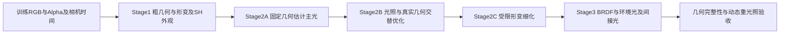

# 近五日实验复盘与动态方向光三阶段几何恢复路线

日期：2026-10-15，Asia/Tokyo。复核服务器：`ushas`；环境：`lumimotion-ushas`。起始代码版本：`fd32c7f`，分支：`1001-stage2-perlight`。

讨论窗口为 **10月11日至15日五个日历日，截至本次检查**；10月10日启动、11日完成的实验作为必要前史。实验编号不等于实际执行日期，历史 UTC 与日本时间记录也不强行混同。

本次工作是实验记录、现有指标文件、代表图、实现与论文的综合复核，没有启动新训练，也没有修改训练代码。下文明确区分“已有证据”“机制推断”和“待执行方案”。本机没有找到部分历史输出，包括文档所指的 `output/1013-06-LH-static-jumpingjacks_EL_V2-1011-02原版Stage2续训`；这部分依据已提交的训练／修改记录，不冒充本次重跑或原数组复算。

## 一、核心判断

你的终极目标可以明确为：**利用随时间变化的主方向光，对同一物质表面提供额外的光度约束，在同时恢复运动和光照的过程中改善真实三维几何，最终获得可重光照的动态场景。** RGB 重建和材质分解服务于这个目标，但不能取代几何验证。

三阶段路线值得推进，建议定义为：

1. **Stage1：动态辐射场与粗几何初始化。** 保留默认 LumiMotion 管线，输出 canonical Gaussian、形变、动静门控，以及 SH 与时变颜色头构成的外观先验。
2. **Stage2：主方向光标定与几何／运动受限联合细化。** 先用粗几何和多时刻光度信息估光，再分块交替更新光照、简化材质、真实几何与必要的形变；这一阶段承担主要科学贡献。
3. **Stage3：固定或强约束几何下的完整 BRDF 与光传输恢复。** 逐步接入环境光、镜面和受物理约束的间接光，检查材质分离与新光照泛化。

需要调整的三处表述：

- 现有静态 DL 结果是**已知光照方向条件下的经验参考**，不是动态场景的严格 upper bound，也不是完整几何已经通过的结果。
- Stage1 SH 可以帮助提供光度先验，但**不能直接把所有 Gaussian 的 SH 叠加找峰，当成主光方向**。它编码的是视角相关出射颜色，时变明暗还有 `d_color` 的贡献。
- RadioGS 值得借鉴的是**学习辐射与物理渲染之间的一致性约束**。把它扩展到未知时变 DL、动态形变和几何联合恢复，是本项目需要验证的新设计，不能当作现成已证明的能力。

## 二、最近五天实际获得了什么

### 2.1 实验主线与证据边界

| 时间／主线 | 已有结果 | 对目标的意义 | 不能据此得出的结论 |
| --- | --- | --- | --- |
| 10/11，四个 V2 数据集与六组实验 | 原生 Stage1 四组完成；原生 Stage2 当时因 CUDA 架构问题失败；GT 方向 PBR／Lambertian 的材质仍有投影残留 | 强 DL 对默认管线确实提出了额外困难；只换物理着色并不能自动修复错误初始几何 | 不能把环境失败解释为原生算法收敛失败；不能把读取 GT 方向得到的零方向误差称为估光成功 |
| 10/11，T01—T14 静态 DL 探索 | T13 的三项平均法线指标达到旧目标；T13／T14 的配对支持较早启用法线一致性有益 | 几何与法线相互约束、启用日程是有效抓手 | T13 没有使用方向加权或遮挡到 XYZ 的反向，不能将达标归功于这两者 |
| 10/12，两度目标与足部修复 | G2-T06、F-T04 等进一步降低法线均值；足部部分恢复，完整性仍失败 | 优化过程中真实几何会被 opacity／剪枝／增密机制改变，必须同时检查局部结构 | 全局均值下降、Alpha 完整不代表鞋体完整；没有实现 GS<2° 的完整几何目标 |
| 10/13，外观与两度目标恢复 | 基线／接口审计完成，但新科学训练更新为零；来源门禁导致冒烟失败 | 工程身份问题与科学方法效果必须分开记账 | 不能将未执行的外观、间接光或新诊断候选写成已验证改进 |
| 10/13—14，原版 EL Stage2 与 roughness 修复 | 已提交记录报告完整续训及评测链路 PASS；RGB 好，roughness 并未改善 | 管线可运行与物理分解正确是不同目标；评测真值本身也需要校验 | 不能把该流程 PASS 写成 DL 材质问题解决 |
| 10/15，官方 jumpingjacks150_v5_spec32 重跑 | 本次在日本时间11:50核对时，状态为 Stage1 RUNNING，控制与训练进程存活 | 可补充默认动态管线参考 | 尚无本轮最终结果；它使用官方 HDR 数据，不能直接充当 LH 动态 DL 的同数据对照 |

来源：[六组总报告](../报告/1011-07-四个V2数据集六组训练与全部MAE总报告.md)、[T13总结](../报告/1011-30-静态DL法线优化达标与因果边界总结.md)、[G2归档](../报告/1012-05-静态DL两度目标T01至T06与脚部机制归档报告.md)、[低产出审计与收尾](../报告/1013-05-两个Goal长时低产出审计与最终收尾.md)、[EL完整续训](../训练/1013-03-LH-static-jumpingjacks_EL_V2-1011-02原版Stage2完整续训.md)、[1015训练计划](../训练/1015-01-jumpingjacks150_v5_spec32-原版LumiMotion两阶段训练计划.md)。

### 2.2 应当保留的主要几何结果

以下每行三项指标来自同一检查点，单位为度。跨行存在数据、预算、监督与管线差异，表格用于事实梳理，不是受控消融排名。

| 模型 | GS法线 | Depth法线 | Mesh法线 | 正确解读 |
| --- | ---: | ---: | ---: | --- |
| 原生静态 DL Stage1@35000 | 10.508859 | 18.518966 | 14.106568 | 默认管线在该强DL数据上的参考 |
| 原生静态 EL Stage1@35000 | 3.506764 | 7.354675 | 5.457503 | 独立EL数据参考，不是同照度／同成像条件控制 |
| 原生动态 DL Stage1@35000 | 14.545084 | 24.556631 | 18.612443 | 动态DL的现有默认基线，尚无对应未知DL联合优化成功证据 |
| 原生动态 EL Stage1@35000 | 5.621282 | 10.527860 | 7.528458 | 动态EL参考 |
| 静态DL T13@10000 | 3.255367 | 5.887606 | 4.750744 | 已知方向、零形变、提前normal；旧均值目标PASS，足部完整性FAILED |
| 静态DL G2-T06@16000 | 2.668378 | 5.404578 | 4.208487 | 有用的整模型参考；脚部仍未完整 |
| 静态DL F-T04@16500 | 2.663858 | 5.469950 | 4.179823 | 当前记录中的最低GS；Depth不优于T06，且属于事后回溯中间点 |

T13 的 expected-Z 误差为 **0.01780551米**，原静态 EL 为 **0.00881066米**；不能将三类法线变好扩展为全部几何指标优于 EL。T13 的法线覆盖率也不是100%。G2-T06 的 expected-Z 为0.01392249米，仍须独立检查距离误差。

本次直接读取了 T13@10000、G2-T06@16000 的 `goal_mae_summary.json`，核对其数值与原协议标识；没有重跑 GPU 渲染或重新计算原数组。F-T04@16500依据[独立基线审查](../报告/1012-12-两度目标基线与光度诊断独立审查.md)和[Stage2基线复核](../报告/1013-01-Stage2基线法线与外观复核.md)。不同检查点的单项最低值不能拼成一个不存在的模型。

### 2.3 已有实验真正支持的机制判断

**法线与几何必须绑定。** T13/T14 同起点、同10k预算，主要区别是 normal 从2001还是8001开始。T13更好，支持较早／更长时间施加几何一致性的价值；尚未分离“开始更早”与“累计正则步数更多”。这不是“默认 Stage1 已经做到同样结果”，而是改造过的静态物理管线结果。

**阴影方向加权不是当前主要收益来源。** T12 相对 T11 的 GS／Depth／Mesh 改善约0.0080°／0.0016°／0.0068°，单次500步差异很小。它没有证明方向信息无用，但不支持继续把同一种权重当作最主要突破口。[原配对总结](../报告/1011-30-静态DL法线优化达标与因果边界总结.md)

**opacity 是几何退化的逃逸通道之一。** T14@9000→10000 的足部高度带点数从2240降到0；normal 对 opacity 的梯度与 reset／prune 共同作用有具体证据。但是 T13@5000 已严重缺脚，不能把所有缺脚都归因于9000步重置。T06在reset后阻断normal→opacity降低了大量低透明度删除，却没有彻底修复鞋部。[足部审计](../报告/1012-02-近期训练脚部消失审计报告.md)

**增密数量不等于信息增加。** F-T04/F-T05 的非normal增密下限对照中，候选增加了出生，却没有取得一致优势；鞋区局部改善与衣物／身体误差上升同时存在。没有证据支持仅靠多增密解决问题。[增密正式验收](../报告/1012-09-足部增密配对正式验收与成因分析.md)

**更低RGB残差不保证更真实材质。** 已提交的EL续训记录中，55000步NVS PSNR为39.83271128dB；使用相同修复GT，roughness MAE从37100步的0.17082512升到55000步的0.17627544。记录仍指出 albedo 阴影残留和 roughness 纹理／阴影状误差。该输出当前不在本机，本次引用记录，不另宣称目检。[评测修复](../修改/1014-01-roughness-GT透明路径导出与MAE独立复算修复.md)

**可观测性比灯光强度更重要。** 原135帧静态DL审计中，前景任一RGB通道满码约53.53%。更强的DL可能增加明暗变化，也可能造成更严重截断和暗部低信噪比；这会损失几何信息。满码是观测下界，不是精确辐射度。改变曝光、使用有效HDR或降低饱和率应作为独立数据条件比较，不能改写已有测试集。

### 2.4 本次实际看过的图

本次打开了 T13 四类10／80／150拼图，以及 F-T04 正面鞋部0020诊断图。前者可见平台法线较平滑、暗侧近黑、投影模糊；组合Alpha把人物与平台合在一起，不能单独确认足部三维完整。后者可见鞋尖的预测高度与GT差异及局部法线误差，符合“部分恢复、不能宣告完整”的历史结论。本次没有逐帧观看全部视频。

- [T13四类代表图](/home/han.li/reproduce/LumiMotion-stage2-perlight/output/1011-27-LH-static-jumpingjacks_DL_V2-T13-normal2000-Stage1早期法线正则10k/evaluation_10000/four_classes/four_classes_10_80_150.png)
- [F-T04鞋部诊断图](../报告/assets/1012-09-足部增密配对正式验收/T04正面鞋部.png)

## 三、如何正确使用静态DL的“上界”

你的判断有一个成立的核心：**已知光照条件下能获得更好法线，说明该数据和表示并非完全没有几何恢复潜力。** 它值得保留为研究参照。

但当前结果同时改变了光照监督、静态假设、法线日程、损失、拓扑过程和预算，并有局部几何缺失。它既不是数学上界，也不是未知光照动态模型在相同设置下必然能达到的值。对于误差，理想 oracle 对应的是“希望接近的低误差参考”；经验训练结果也不保证一定优于未知光照优化。

建议将参考拆成三层：

| 参考 | 固定条件 | 回答的问题 |
| --- | --- | --- |
| 历史静态已知方向参考 | 当前T13／T06／F-T04，保留所有缺陷 | 过去在较强先验下达到过什么水平？ |
| 同初始化静态oracle | 新三阶段管线，方向固定GT，其余设置与未知方向组完全一致 | 未知方向估计损失了多少几何精度？ |
| 同初始化动态oracle | 同一动态数据、同一形变模型、已知GT方向 | 动态对应与未知光照分别带来多大困难？ |

oracle的GT方向只能进入明确标注的控制组。未知光照组的初始化、筛点、候选选择、损失与早停均不得读取GT光向量。GT几何／材质只用于隔离评测。若历史检查点本身使用过GT方向，不能将它包装成未知光照方法的无监督起点；用于单独诊断时应明确标注额外先验。

## 四、Stage1的SH能不能反推方向光

### 4.1 先弄清当前SH的语义

源码核对：

- [Stage1渲染器](/home/han.li/reproduce/LumiMotion-stage2-perlight/gaussian_renderer/__init__.py:113)先用 `d_color` 调制 SH 的 DC 部分，再组合高阶系数。
- 同文件129行的Python路径将**点与相机之间的方向**送入 `eval_sh`。该实现的方向符号是相机到点；转为物理“表面到观察者”的出射方向时要处理符号，而不能直接复用变量名。
- [时变网络](/home/han.li/reproduce/LumiMotion-stage2-perlight/utils/time_utils.py:195)以位置、时间与隐特征生成 `d_color`。SH系数本身并没有独立的逐时间光源状态。
- [原生IR渲染器](/home/han.li/reproduce/LumiMotion-stage2-perlight/gaussian_renderer/render_ir.py:149)重建同一类SH外观；543行将追踪到的Stage1颜色从sRGB转线性后作为间接辐射近似。

因此可概念化为：

\[
\widehat C_i(t,\omega_o)
=\operatorname{SH}\bigl(c_{i,00}\text{经}d_{color}(x_i,t)\text{调制},\;c_{i,lm};\omega_o\bigr).
\]

它是已受材质、光照、遮挡、视角以及拟合误差共同影响的出射外观，不是入射光的球谐展开。Stage1的DC也不能直接当作已恢复albedo。

### 4.2 为什么“把所有SH找一个最亮方向”不可靠

一个直接反例：理想Lambertian平面受某方向照明，固定时刻的出射亮度对观察方向是常数。无论主光来自哪个方向，单点SH都可能只有DC显著；它的出射方向峰值无法给出入射方向。光照信息在**不同表面法线之间、以及同一表面的不同时间之间的亮度关系**里。

镜面表面的最亮出射方向还需要结合法线和反射定律解释；它也不等于光源方向。场景中材质、遮挡、采样密度不同，直接叠加SH会让大面积台面、较密的Gaussian区域或白色材质支配结果。高阶SH还可能拟合相机轨迹与时间的相关性，而不是物理反射。

所以应把你的想法改写为：**由Stage1得到粗几何与有置信度的表面光度轨迹，拟合一个全场景共享、低自由度的动态主光模型。** SH提供辅助观测和初始化依据，原训练RGB仍是最终约束。

### 4.3 一个可实现的初始化路线

对canonical Gaussian或局部表面块建立跨时间轨迹，收集当前可见时刻的训练RGB贡献、粗法线、曝光约定与时变外观。无法从合成像素中唯一分离每个Gaussian的颜色，因此可采用可见表面块聚合，或直接在图像域拟合；不能把同一个像素无条件分配为多个独立观测。

在暂时忽略强镜面、使用近似可见性的初始化阶段，考虑：

\[
y_{it}\approx a_i E_t V_{it}\max(0,n_{it}^{\mathsf T}l_t)+b_{it},
\quad \|l_t\|=1,\ E_t>0.
\]

这里是标量亮度近似，常数如Lambertian的\(1/\pi\)统一吸收到\(E_t\)；正式BRDF渲染恢复明确单位。\(a_i\)跨时间共享，\(b_{it}\)只能是受限的低频背景项，初版可固定为零。若让每点每时刻拥有任意\(b_{it}\)，它会直接解释掉DL信号。

建议流程：

1. 首先冻结Stage1几何／形变，从可见、非饱和、非边界且较稳定的表面区域建立候选观测。置信度来自训练观测与预测支持，不读取GT标签。预测背光不能被硬判为永远无效，否则错误初始法线可能永远得不到纠正。
2. 对单位球上粗候选方向逐个评估训练重建残差，同时拟合非负能量；保留多个近似解及其分数间隔，避免一开始就锁死方向。
3. 在固定粗几何条件下交替估计跨时刻共享的\(a_i\)和光照；限制材质与能量尺度，加入适度时间约束。必要时对法线分布均衡抽样，而不是按Gaussian数目投票。
4. 比较“原RGB直接拟合”“SH／颜色头辅助的拟合”“随机初始化”，用同预算的最终光向误差、几何与收敛表现判断SH的净价值。

若\(a_i,V_{it},b_{it}\)已有近似值，且样本位于正入射区，可令\(q_t=E_tl_t\)，用加权最小二乘获得初值：

\[
q_t^{(0)}=\arg\min_q\sum_i w_{it}
\left[(y_{it}-b_{it})/(a_iV_{it})-n_{it}^{\mathsf T}q\right]^2,
\quad l_t^{(0)}=q_t^{(0)}/\|q_t^{(0)}\|.
\]

该式仅说明条件成立时的初始化，不是对真实数据的无条件闭式解。暗区、低反照率、低可见性下不做不稳定除法；可直接优化未相除的前向式。法线矩阵秩不足、\(q\)接近零、解落在错误受光半球时应保留不确定性并回到候选搜索。

同一物质点跨时间的比值能在理想模型下消去\(a_i\)，但真实数据中阴影、间接光、饱和、法线变化和小分母会破坏这种关系。它适合诊断或稳健初始化，不适合不加筛选地替代完整RGB损失。

### 4.4 强光先验能提供什么，不能提供什么

强主光先验支持“一个主方向＋低频余项”的低维模型，明显比任意逐点时变照明更易约束。但是它不自动消除以下歧义：

- 反照率与能量缩放：\(a_iE_t\)可由不同尺度组合产生，需要固定能量均值、曝光或其他明确规范。
- 法线与光照互相补偿：未知材质、法线和方向的光度分解具有歧义；多视角几何、静态支撑和时序约束能帮助，但不保证唯一解。
- 光色与材质颜色混淆：首版若采用白光，是明确的先验；不能把仅由RGB估计的光色当作已校准真值。
- 两盏完全同向远场灯在图像中通常只体现为总能量。已有静态DL记录包含重合SUN；未知光模型不应强求恢复不可辨识的灯具数量。

## 五、三阶段的职责与参数边界

### 5.1 Stage1：保留默认初始化，同时承认它可能有偏

保留默认Stage1有利于比较与工程复用。但目前动态DL默认基线已经出现地面起伏、投影进入动静分离等现象，不能假定其形变和binary gate正确。阶段输出应包括完整模型、相机／时间约定、SH与颜色头，而非只保存一张法线图。

建议把“默认Stage1”固定为主线；后续另做一次“早期物理／几何约束Stage1”的受控扩展。因为T13的证据表明较早约束可能有益，若只允许Stage2在晚期修补，可能错过错误拓扑形成之前的窗口。但不能在首次验证三阶段时同时替换Stage1，以免无法判断新Stage2的贡献。

### 5.2 Stage2A：固定几何，先确认能估光

先固定XYZ、旋转、scale、opacity、拓扑和形变；估计\(l(t)\)、\(E(t)\)及最低限度的跨时间共享反照率。以球面单位向量或归一化非零向量表示方向，以对数参数表示正能量。使用少量时间节点／球面插值作为初版轨迹模型，保留逐帧独立方向作为消融。

时间平滑是待验证先验：真实光照若快速切换，过强平滑会抹掉有效激励。未知组不能根据GT轨迹挑选节点或最优平滑系数。时间节点、带宽和容忍误差应在独立验证设置中确定。

这一阶段的失败也有意义：若固定几何、使用真实训练RGB仍无法定位灯向，就应先检查法线覆盖、饱和、坐标、材质与阴影假设，不直接把更多自由度开放给几何。

### 5.3 Stage2B：联合目标，分块更新

建议一个共同的物理目标，但采用交替更新，初版次序为：

| 更新块 | 允许更新 | 暂时固定 | 目的 |
| --- | --- | --- | --- |
| 光照块 | 主光方向、能量 | 几何、形变、材质 | 让全局光源解释跨区域一致的变化 |
| 材质块 | 跨时间共享albedo，必要时少量全局BRDF参数 | 光照、几何、形变 | 避免几何承担基础颜色差异 |
| 几何块 | XYZ、surfel旋转，后续视证据开放scale | 光照、形变；初期固定opacity和拓扑 | 将光度约束传入真实形状 |
| 形变块 | 受信任范围内的位移／旋转形变 | 光照及主要材质 | 纠正动态对应，不把变化全部吞入运动 |

每块步数、学习率及开放时机需要实验确定，不能由这个表声称最优。交替优化也不保证避开局部最优；必须与同计算预算的同时更新比较。

法线一致性保留几何与法线两侧的有效导数；针对normal→opacity的路径可单独做阻断对照，不应把整项detach而失去几何梯度。只优化一套独立“着色法线”可能改善渲染法线但不改善深度／网格，因此应约束surfel法线、由真实XYZ导出的深度法线，以及运动后的表面方向一致。

opacity和拓扑初期固定是一种减少逃逸自由度的措施，不是永久正确策略。若Stage1已经缺失鞋部，完全禁止新增点也无法长回结构。待光照稳定后，再以训练多视角残差和几何支持决定是否开启受控增密；不使用GT鞋区选点，不以大面积背景Alpha作为人体局部完整性的替代。

### 5.4 Stage2C：动态推广不能只“打开MLP”

用canonical材料参数\(a_i,r_i\)，以及\(x_i(t)=\Phi_t(x_i^0)\)描述同一物质点。光照\(l_t\)位于世界坐标系，不随物体局部坐标自动旋转。法线必须与实际动态表面一致：若使用形变映射运输法线，理想关系为\(n_t\propto J_{\Phi_t}^{-\mathsf T}n_0\)；若沿用独立旋转头，则需检查它和变形后切平面／深度是否一致，不能假设独立头天然满足该关系。

已有模型的颜色头与形变头共享部分特征。仅移除一个optimizer组，不等于另一路输出固定；几何／颜色隔离要检查共享主干、实际参数变化和输出。Stage1的binary gate也可能被移动阴影污染，不能直接把“低gate”定义为绝对可靠静态背景。

每个时刻的可见性与间接光追踪应使用该时刻的变形几何。切换时间、更新XYZ／旋转或改变拓扑后，要更新相应BVH与缓存身份，不能继续使用旧时刻遮挡。

### 5.5 Stage3：继承物理渲染框架，明确新的冻结契约

Stage3可以沿用原生Stage2的BRDF、trace等框架，但不是原入口原样调用。当前原生Stage2还允许opacity、Stage1颜色与颜色头更新，不能称为严格固定几何。为了判断几何是否保留，首版建议明确冻结几何、opacity、拓扑及运动，后续小幅联合微调单独列消融。

完整着色应以线性辐射度相加：

\[
L_o(x,t,\omega_o)
= E_t V(x,t,l_t)f_r(x,t,\omega_o,l_t)[n_t\cdot l_t]_+
+\int_{\Omega^+}V(x,t,\omega) L_{env}(\omega)
f_r(x,t,\omega_o,\omega)[n_t\cdot\omega]_+d\omega
+L_{bounce}(x,t,\omega_o).
\]

再按统一的Alpha合成与相机响应生成图像。这里DL是离散远场光，其能量参数不是环境图纹素辐射度；不能不经单位与积分约定就做简单数值混合。“加权方向光＋env”中的权重应对应非负物理能量或明确采样权重，不能让一个任意逐像素gate吸收错误。

低频环境项先作为残差，避免把同一SUN同时放进环境图与DL重复计能。开始时可固定／限制其频率与强度，随后验证放宽后的收益；这是一种可辨识性先验，会限制真实复杂环境，需报告偏差。

当前实现中方向光分支与env分支是分路选择，`rendering_equation_directional`接收DL并追踪SH间接项，没有自动把env直接光一起积分。因此“后续加env”需要明确的渲染接口变更，不能只增加一个配置值。[方向光分支](/home/han.li/reproduce/LumiMotion-stage2-perlight/gaussian_renderer/render_ir.py:584)

另外，逐Gaussian线性着色后合成，与先渲染材质图再逐像素BRDF并不等价。Stage2到Stage3切换时要用相同参数做前向对比，将合成差异与真实优化收益分开。[接口与Alpha审计](../报告/1013-02-Stage2实际预算与物理外观接口审计.md)

## 六、RadioGS应怎样借鉴

RadioGS的核心是让surfel的SH出射辐射与PBR辐射一致，并对未被相机直接观察的方向施加物理约束，改善用于间接光查询的辐射。论文使用环境cubemap；初始化使用简化近似，后续使用光线追踪。其问题设定不能直接证明未知时变DL与非刚性运动的联合恢复。[论文第4节](https://arxiv.org/html/2603.01491v1#S4)、[作者项目页](https://qbhan.github.io/radiogs-page/)

以下是本项目的扩展提议，不是RadioGS的已验证动态算法。

定义当前时间、方向下的辐射缓存\(R_\psi(i,t,\omega_o)\)和物理预测\(P_\theta(i,t,\omega_o)\)，考虑：

\[
\mathcal L=\mathcal L_{RGB}^{PBR}
+\lambda_{cache}\mathcal L_{RGB}^{cache}
+\lambda_{cons}\mathbb E_{i,t,\omega_o}
 w_{it\omega_o}\,\rho\bigl(R_\psi-P_\theta\bigr)
+\lambda_n\mathcal L_{normal-depth}
+\lambda_m\mathcal L_{motion}
+\lambda_l\mathcal L_{light-time}.
\]

关键不是多加一个loss名字，而是保证信息来源与优化自由度：

1. **两个分支都要锚定真实训练观测。** 仅让两个可学习分支互相一致，会允许它们共同偏离图像、形成错误自洽解。物理一致性缩小解空间，但不是新增独立观测。
2. **先观察方向，后未观察方向。** 最初在实际训练视角及邻域使用一致性；物理分解稳定后，再增加未观察方向。Stage1在未观察方向的SH不可当作强真值。
3. **区分固定教师与可学习缓存。** 固定Stage1教师适合初始化，长期强制匹配会锁住原先的阴影污染。可学习缓存适合光传输，但需图像锚点、容量限制和分块更新；不直接给每点每时刻任意RGB残差。
4. **动态缓存必须带条件。** 旧照明下的SH不能在新光照或新姿态下原样作为间接光。至少显式依赖时间；若要独立控制“物体姿态时间”和“光照轨迹时间”，需以光照状态为条件，或在重光照时重新计算／适配缓存。
5. **防止缓存遮蔽主光误差。** Stage2的间接项先关闭或受限；主光与几何有证据后再启用一致性间接光。比较缓存开关时保持其余采样与预算一致。

PS-GS也值得作为邻近方法参考：它面向多视角多光照，利用UPS法线与方向光可见性约束进行几何、材质、光照恢复。这里最重要的差别是当前动态序列没有天然的同姿态多光堆栈，不能直接套用静态像素对应。[PS-GS论文](https://arxiv.org/html/2507.18231v1)

## 七、动态场景中最需要提前解决的可辨识性问题

### 7.1 当前采集协议把时间、视角、运动与光照绑在一起

本次读取动态DL `data_view/transforms_train.json`：135个训练frame，135个不同time；测试为15个frame、15个不同time。当前数据不是“每个姿态同时采集多个光照与多个视角”。因此每个时刻单帧误差可能被光向、形变、法线、材质或阴影共同解释。

canonical跟踪把同一物质点跨时间连起来，才可能将这些观测汇聚为几何约束；这也是动态方法最关键的假设。若形变错了，即使光照完全正确，也可能把不同表面的亮度拼成一个伪光度轨迹。

建议在后续合成数据中建立最小的采集因素拆分：固定物体只转灯、固定灯只运动、二者同时变化，并增加少量固定姿态的多光锚点。它们属于新的可控实验数据，不能混入原测试集作为同条件提升。

### 7.2 静态背景能帮助估光，但平面本身不够

静态背景没有形变干扰，可以用来估计全局光照轨迹，再让动态物体提供补充法线方向。这是值得优先验证的结构先验。

但若背景几乎全是同一法线的台面，仅凭漫反射亮度只能约束\(E_t(n\cdot l_t)\)，不能唯一确定完整三维方向。需结合不同朝向的静态表面、人体粗法线，或可靠的投影位置与遮挡几何。阴影可以补充方向信息，但投影位移还与遮挡物高度、几何误差相关，不能将其直接当作无歧义GT。

静态锚点应由低运动、跨视角几何一致和观测支持共同判断；不能依据RGB不变，因为静态表面也会受动态光照影响。

### 7.3 统计“每个表面看到了哪些有效光”，不能只数全局转灯角度

对近似局部刚性、旋转\(R_{it}\)可信的表面，可把光方向变换到canonical坐标：\(\widetilde l_{it}=R_{it}^{\mathsf T}l_t\)。诊断矩阵为：

\[
H_i=\sum_{t\in\mathcal T_i}w_{it}E_t^2
\widetilde l_{it}\widetilde l_{it}^{\mathsf T}.
\]

它可用于观察方向覆盖的特征值谱；权重应体现相机可见性、未饱和程度、有效入射与可信对应。大量不可见、背光或满码帧不等于有效激励。一般非刚性形变不只含旋转，应使用实际渲染关于局部几何参数的Jacobian构造\(J^\mathsf TWJ\)，而不是强套刚体公式。

上式只是条件诊断，不是完整可辨识性证明。单位法线只有切平面上的两个自由度，albedo与光照也可能未知；更严格的检查应投影到法线切空间，并考虑其他未知量的耦合。若物体与灯同步旋转，世界光向看似变化很大，物体局部的有效光向仍可能几乎不变。

### 7.4 遮挡梯度与方向梯度必须实测

当前tracer的Python backward返回`grad_rays_o`和`grad_rays_d`，CUDA也累积射线方向导数，说明接口存在相应路径；这不等于所有实际分支都能有效学习灯向。`detach_indirect`、可见性饱和、背光余弦截断、bias、BVH交点切换都可能切断或扭曲实际信号。[Python接口](/home/han.li/reproduce/LumiMotion-stage2-perlight/submodules/surfel_tracer/surfel_tracer/raytracer.py:28)

首个小规模验证应分别检查：余弦→灯向、镜面→灯向、可见性→灯向、可见性→遮挡物XYZ，以及几何一致性→XYZ／旋转的导数。用有限差分与真实反传比较，并说明阴影边界不连续区域的限制。不要在尚未确认信号能流到目标参数时启动长训练。

## 八、建议的最小实验路线

以下是讨论中的优先级，不是已经启动的训练计划；实际执行前再在 `LIHAN/DOC/训练` 登记命令、预算、输入和验收协议。

### 8.1 第一优先级：验证“Stage1能帮助估光”

在同一个默认静态DL Stage1起点，固定几何与形变，使用同一训练划分、同一光照参数化与预算，比较：

| 组别 | 初始化／监督 | 要回答的问题 |
| --- | --- | --- |
| A0 | GT方向固定；仅oracle组可读方向 | 当前几何与简化材质下的可达到参考 |
| A1 | 随机／球面均匀候选初值，训练RGB拟合 | 没有SH辅助时能否恢复光向？ |
| A2 | 粗法线＋训练RGB光度拟合初值 | 几何辅助本身是否足够？ |
| A3 | A2加Stage1 SH／颜色头的表面光度先验 | SH是否提供额外收益或更快收敛？ |

若A3不优于A2，不应继续把SH反推作为核心叙事；若初始方向变好但最终几何不变，也只能声称初始化收益。至少对入选方案与核心对照做多个seed重复，报告均值与离散程度，避免根据一次小差异下结论。

已知方向oracle用于评测对比，不用其GT给未知组挑选初值。可单独做GT法线的诊断性估光测试来定位光照求解器问题，但必须明确它使用额外真值，不能计入主方法。

### 8.2 第二优先级：证明光照约束改善真实几何

从相同默认Stage1与相同光照初值开始，逐步比较：固定几何、开放几何、交替优化、同时优化；先不加入RadioGS缓存与复杂环境光。保留一个同预算GT方向控制组。

关键验收为GS／Depth／Mesh法线、深度距离、局部完整性与覆盖率共同变化。若只有GS法线改善、深度／网格不变，优先检查是不是独立法线或透明度在吸收误差。若几何变好而光向变差，需要检查两者是否形成补偿解。

### 8.3 第三优先级：动态推广

依次验证：

1. 固定默认形变、GT方向：观察动态oracle能否改善几何。
2. 固定默认形变、未知方向：测未知光照增加的困难。
3. 未知方向＋受限形变更新：判断运动细化是否带来净收益。
4. 静态锚点开／关：验证背景是否帮助全局光照标定。

如果第一步就失败，问题更可能在动态对应、物理模型或几何优化，而不是SH初始化。动态指标除逐帧误差，还要有运动补偿后的几何／材质一致性；直接惩罚相邻帧法线相同会误罚真实运动。

### 8.4 第四优先级：完整材质与物理一致性

在几何结果稳定后逐项加入镜面、受限env、间接辐射一致性。每次只增加一个关键机制，观察是否损害几何、是否减少albedo阴影残留、是否改善新光照。不要一次打开全部分支，随后无法判断收益或失败来自何处。

静态模型的新光照实验与动态模型的姿态／光照解耦实验应分开报告。理想测试包含：固定姿态转灯、固定灯播放动作、未见过的姿态与灯光组合。仅沿原来时间轨迹重放RGB，可能只是在复现训练相关性。

## 九、统一验收与工程边界

### 9.1 指标组合

| 维度 | 必报内容 | 防止的误判 |
| --- | --- | --- |
| 光照 | 训练／保留时间的方向角误差、能量规范、失败帧、轨迹稳定性 | 只报平均方向或读取GT方向后的零误差 |
| 几何 | 同模型三法线、expected／median深度误差、覆盖率、固定缺失处理 | 拼接单项最佳；删除困难区域后均值变好 |
| 完整性 | 人体与鞋部等独立评测区域、距离／高度／表面覆盖、代表多视角 | 台面Alpha填满就宣称鞋体完整 |
| 动态 | 动态／静态区域分开，运动补偿一致性、未见时间 | 静态大平台主导整体成绩，掩盖动态人体失败 |
| 材质／重光照 | albedo、roughness、固定曝光新灯RGB、投影是否随灯正确变化 | 训练PSNR高就宣称完成分解 |
| 预算 | 循环、optimizer实际更新、采样光线、总时间与显存 | 把不同更新频率的相同步数当同预算 |

GT语义分区可以用于评测，但不得回流训练筛点。原15测试帧已经被多轮迭代观察，后续保留它用于历史对比，同时应建立新的最终保留集；否则只能声称现有基准上的改进，不能称未经选择的泛化验证。动态留出时间不应偷偷从相应GT灯轨迹插值，未知灯向应由训练得到的时间模型推断。

阈值应在实际训练前依据目标与有效对照预注册。本讨论不把历史静态EL阈值机械套到动态模型，也不在看到结果之后改变缺失处理或验收上限。

### 9.2 实现复用与尚缺内容

| 现有资产 | 可复用部分 | 仍需实现／核验 |
| --- | --- | --- |
| `scripts/train_stage1.py`及动态网络 | 默认粗几何、运动、SH初始化 | 输出置信度；照明污染下的运动可靠性 |
| `scene/static_dl_photometric.py` | 方向Lambertian、可见性与方向约定的参考 | 当前方向来自固定资产；未知方向时间模型及动态适配不是现成功能 |
| `gaussian_renderer/render_ir.py` | GGX、方向光求和、追踪接口 | DL与env合并、统一合成契约、动态辐射一致性 |
| `scene/pbr_directional.py` | 已知光元数据控制实验 | 会读取GT能量与颜色，不适合作为未知光主线加载器 |
| `submodules/surfel_tracer` | 光线追踪及已有反向接口 | 对实际方向优化分支做有限差分；动态BVH一致性 |
| 现有几何／足部评测 | 历史协议与区域诊断 | 新动态保留测试、同模型联合验收 |

来源身份校验是复现手段，不是科学性能指标。同源码重编译得到不同二进制时，应单独建立前向与反向兼容证据，再决定是否登记新运行环境；既不直接删校验，也不重复长时间搭建脚本而没有最小真实验证。现有记录中原生Stage2的35000→55000为20000循环、按源码条件推导4999次Adam更新；新阶段预算不能仅按循环数比较。[预算审计](../报告/1013-02-Stage2实际预算与物理外观接口审计.md)

本次没有创建新实验结果。后续训练输出使用 `output/日期-当日计数-数据集-特征`，冒烟放 `output/smoke_test`，日志同目录；每卡在显存允许时最多3个训练。实验README应包含完整渲染命令、source/model/iteration、输出与日志、定量指标、代表图片／视频、RGB／Alpha／Normal／动静分离四类目检和最终PASS／FAILED；训练失败保留全部现场。文档与代码更改遵循各自目录要求。

## 十、建议确立的研究主线

最有价值的主张不是“又加了一阶段”或“SH直接求出灯向”，而是：

> 在单目时序的动态场景中，利用全局低维主方向光、canonical表面对应及光度—几何一致性，分离光照变化与物体运动，使方向光提供的额外约束改善可验证的三维形状。

当前已被实验支持的是：已知方向的静态DL加上合适的几何约束能够明显改善平均法线；同时拓扑退化、光度截断和材质污染会限制收益。未知方向恢复、默认Stage1到新Stage2的有效过渡、动态形变联合优化、RadioGS式动态一致性，都仍待实测。

**下一步最值得先做的是固定默认静态几何的估光对照A0—A3。** 它能直接检验你关于Stage1光照先验的核心想法，成本比完整三阶段重构低，结论也更清楚。通过后再开放几何，随后扩展到动态，最后加入完整光传输。这样每一步都能回答一个独立问题，并逐步靠近最终目标。

## 十一、追加文献搜索：哪些内容已有工作覆盖，哪里值得继续推进

追加日期：2026-10-15，Asia/Tokyo。本节至第十九节为用户要求的进一步搜索与创新方向讨论，保留前十节原文。检索覆盖动态逆渲染、非标定光度立体、阴影几何监督、辐射一致性和信息驱动采集；依据论文原文、作者项目页和正式论文库，不将二手解读当成方法依据。

**本轮最推荐的是“方向一＋方向二”作为主线，方向三作为有针对性的备选增强，方向四后置，方向五用于形成有说服力的数据与分析贡献。** 这五条是结合现有失败模式提出的研究候选，不是已经验证的新算法，也不是已完成穷尽查新的“首次”声明。

### 11.1 搜索后需要进一步收紧的创新表述

“利用动态增加光照信息”已有相当直接的来源。LumiMotion明确使用运动带来的光照交互变化，但假设**世界照明固定且未知**；PS-NeRF／PS-GS已经利用多视角多光照恢复几何、材质与灯光。因此，三阶段拆分、增加BRDF、引入未知灯向，单独看都不足以构成强创新。[LumiMotion第1节](https://arxiv.org/html/2604.10994v1#S1)、[PS-NeRF](https://arxiv.org/abs/2207.11406)、[PS-GS](https://arxiv.org/html/2507.18231v1)

更直接的重叠来自公开稿 **Latent Light Source Modeling for Scene Reconstruction under Dynamic Illumination**：可检索的原稿描述了时间驱动的移动点光位置／能量网络，以及位置—时间条件的可见性和环境项，结合2DGS与BRDF。这已经覆盖了“用MLP估计未知动态主光”的基本构想。原稿讨论的是近场点光，本文目标是远场DL；仅把位置改成方向仍不足以建立有力区别。[公开稿](https://openreview.net/pdf?id=dUoqAziyKj)

该公开稿的网页／PDF直接访问本次遇到OpenReview浏览器验证；上述判断限于检索系统返回的原稿摘要、引言和方法说明。返回文本标注为匿名审稿稿件，**本次未核实最终录用状态、最新作者版本及完整动态形变实验**，不采用第三方网站标注的录用信息，也不声称该文已解决本项目全部设定。它应作为下一阶段必须精读和比较的近邻，而不能忽略。

另外，“阴影帮助几何”已有ShadowNeuS；“SH与PBR自洽”已有RadioGS；“按信息量选观测”已有FisherRF和光度立体最优照明设计。值得争取的是：**在非刚性物体与主光同时变化、每时刻单张观测、存在饱和与遮挡的条件下，设计可验证的约束和优化机制，改善真实形状及完整性。** 这是本次提出的研究定位，不是从文献直接推出的性能结论。[ShadowNeuS](https://gerwang.github.io/shadowneus/)、[RadioGS](https://arxiv.org/html/2603.01491v1)、[FisherRF](https://www.ecva.net/papers/eccv_2024/papers_ECCV/papers/02130.pdf)

### 11.2 与本项目最相关的设定差别

| 已有工作 | 已经提供的思路／能力 | 对本项目的启发与边界 |
| --- | --- | --- |
| LumiMotion，2026 | 固定未知世界照明下的动态2DGS与材质分解 | 可复用表示；需新增世界主光变化的建模与几何收益证据，而不是只重光照 |
| PS-NeRF，ECCV 2022；PS-GS，2025公开版本 | 多视角、多未知方向光下的联合恢复；光度法线和可见性约束 | 不应假设当前时序数据具有同姿态多光像素堆栈 |
| SCPS-NIR，ECCV 2022 | 未知灯向／强度与表面联合优化，显式利用镜面信息 | 为自标定提供思路；静态光度立体设定不能直接覆盖本项目非刚性对应 |
| Photometric Stereo for Dynamic Surface Orientations，ECCV 2010 | 显式考虑跨帧法线变化，并处理动态光度观测对齐 | 说明“对齐后假设法线不变”仍会出错；其受控采集条件不能直接照搬 |
| Dynamic Inverse Rendering for Enhanced Material-Lighting Decomposition，ECCV 2026作者页 | 刚体运动、跟踪与逆渲染结合 | 运动有助分解已不是空白；需区分刚体与非刚体、固定环境与未知移动主光 |
| DR-GS，ECCV 2026作者页 | 静态重建／参数分解后，用模拟或动画形变驱动可重光照Gaussian | 支持形变后物理一致着色的参考；不是由单目未知运动视频直接恢复全部形变的同一问题 |
| Disco-GS，CVPR 2026 | 时变彩色照明下的canonical外观恢复 | 原文局限仍为静态物体与固定光源位置；外观归一化不等于DL几何恢复 |
| Latent Light Source Modeling，公开审稿稿件 | 未知移动单点光、2DGS、BRDF及可见性／环境分支 | 最接近的光源建模重叠；要进一步核实其运动设定与几何评测 |

各行来源分别为：[LumiMotion](https://arxiv.org/html/2604.10994v1)、[PS-NeRF](https://arxiv.org/abs/2207.11406)、[PS-GS](https://arxiv.org/html/2507.18231v1)、[SCPS-NIR](https://www.ecva.net/papers/eccv_2022/papers_ECCV/papers/136620160.pdf)、[动态光度立体](https://www.microsoft.com/en-us/research/publication/photometric-stereo-for-dynamic-surface-orientations/)、[动态刚体逆渲染](https://razayunus.github.io/DIR)、[DR-GS](https://jiaxinlia.github.io/DR-GS/)、[Disco-GS第5.1节](https://openaccess.thecvf.com/content/CVPR2026/papers/Kumar_Disco-GS_Gaussian_Splatting_in_Dynamic_Color_Lighting_CVPR_2026_paper.pdf)、[移动光源公开稿](https://openreview.net/pdf?id=dUoqAziyKj)。表格是问题设定比较，不是统一协议下的性能排名。

## 十二、方向一：跨时间表面对应驱动的主光自标定

**推荐程度：最高；适合作为主方法的基础。**

核心问题是：能否把不同时间、不同视角、不同物体姿态下对同一物质表面的观测，变成一组有效的光度立体约束，同时恢复未知主光轨迹？这比“SH估灯”更准确，也更直接服务于你的几何目标。

### 12.1 思路来源与值得补上的部分

PS-NeRF／PS-GS提供多光约束与几何优化的入口；SCPS-NIR提示灯向、能量和材质需要联合处理，镜面也可能是校准信息；动态光度立体工作提醒我们显式运输表面法线。Dynamic 3D Gaussians通过持续的Gaussian身份和局部运动约束实现跟踪，提供跨时刻对应的表示思路。[PS-NeRF](https://arxiv.org/abs/2207.11406)、[SCPS-NIR](https://arxiv.org/abs/2207.07815)、[动态表面法线](https://www.microsoft.com/en-us/research/wp-content/uploads/2010/09/Kim-ECCV-final.pdf)、[Dynamic 3D Gaussians](https://arxiv.org/abs/2308.09713)

**候选区别**不是给这些方法拼一个动态模块，而是建立：非刚性canonical表面轨迹、可验证的对应可靠性、全局共享主光，以及几何细化之间的联合约束。特别要证明即使没有同姿态多光堆栈，这套约束仍能带来几何收益；若必须增加锚定采集，需将条件写入问题定义。

### 12.2 适合当前仓库的最小实现

对每个可靠canonical表面块\(i\)，形成观测集合\(\mathcal O_i\)，每个元素包含时间、相机、当前表面点、动态法线与该处真实训练图像的观测。初版使用较大表面块而非所有点逐个独立拟合，降低混合像素与错误匹配的影响。

定义两个明确独立的状态：

\[
\text{几何状态 }s_t\longmapsto\Phi(s_t),\qquad
\text{光源状态 }z_t\longmapsto(l_t,E_t).
\]

当前视频中二者都由时间索引得到，但网络输入与输出职责分开；换光照时不应改变XYZ和形变。共享材质随canonical表面走，世界主光由所有表面的证据共同约束。

在Lambertian近似与固定当前光照／几何下，令

\[
h_{it}=E_tV_{it}[n_{it}^{\mathsf T}l_t]_+/\pi.
\]

对于未饱和、受支持的观测，逐通道albedo可以用加权最小二乘消去：

\[
a_i^*=\frac{\sum_{t\in\mathcal O_i}w_{it}h_{it}y_{it}}
{\sum_{t\in\mathcal O_i}w_{it}h_{it}^2}.
\]

分母近零时标记不可辨识，不做除法；存在环境底项时须先建模或联合求解；镜面、截断和未知相机响应下不能直接使用该闭式式子。这个标准最小二乘消元本身不是创新，作用是减少albedo与光照互相补偿的自由度，再让几何／方向优化面对跨时间整体残差。

可先用原Stage1几何与颜色轨迹提供初值，但优化目标保持对真实训练图像负责。建立两种互补估光支撑：静态可靠区域约束全局光照，动态区域提供更丰富的法线；必须避免只有平面背景时把秩不足误认为高置信。跨区域估得的灯向应能解释未参与拟合的另一部分表面，这比仅在拟合集上降低RGB误差更有说服力。

初版可先用漫反射主导区域初始化；**不建议永久丢掉镜面**。未饱和且模型可信的镜面反射可能帮助约束方向和消除部分歧义，这是SCPS-NIR带来的一个有价值补充。开启镜面要单独比较，不能把高亮全部当成坏像素。

### 12.3 最小对照与停止条件

采用相同默认Stage1、相同训练图像与预算，比较：逐帧灯光自由拟合；时间平滑灯光；加入canonical对应；再加入静态／动态跨区域一致性。对应质量另做“固定默认形变”和“允许受限形变”的配对。

先看未知灯向误差与保留观测预测，再看开放几何后的Depth／Mesh／局部完整性。若只提高训练RGB、不改善灯向或几何，说明还只是更强的外观拟合；若收益只在读取GT形变时出现，说明主要瓶颈仍是对应，不能声称未知运动条件下成立。

**创新风险：中等。** 自标定与时序对应都是已有概念，贡献必须落实为可靠性机制、非刚性条件下的有效约束，以及真实几何的受控改善。仅实现时间MLP或canonical共享材质不够。

## 十三、方向二：扣除光照与材质歧义后的几何更新

**推荐程度：最高；更可能成为区别于普通联合优化的核心机制。**

你最近的实验说明，大梯度可能推动opacity下降或删除局部结构，而不是补充形状。值得研究的问题是：**某一片表面的残差，到底能区分几何错误与光照／材质错误吗？只有在有证据区分时，才开放相应的几何自由度。**

### 13.1 思路来源与候选创新

光度立体最优照明设计研究了灯光布局与法线估计不确定性的关系；FisherRF使用信息量选择辐射场观测。本项目可借鉴“参数是否被观测约束”的思路，但需要进一步考虑未知主光、albedo和运动的耦合，而不只计算光方向Gram矩阵或原始梯度范数。[最优光配置，ICCV 2005](https://www.macs.hw.ac.uk/texturelab/files/publications/papers/Papers_PDF/On%20Optimal%20Light%20Configurations%20in%20Photometric%20Stereo.pdf)、[最优实验设计，2022](https://arxiv.org/abs/2204.05218)、[FisherRF，ECCV 2024](https://www.ecva.net/papers/eccv_2024/papers_ECCV/papers/02130.pdf)

下面的消元是标准局部最小二乘分析，数学运算本身不是创新。候选贡献在于：把它变成适用于动态DL的低成本诊断与更新策略，并证明它比固定日程、简单降学习率或盲目加强法线正则更可靠。

### 13.2 可计算的局部近似

对一个表面块和短时间窗，将几何变量记为\(g\)，灯光、材质和必要运动参数记为干扰变量\(z\)。线性化观测残差：

\[
r(g+\Delta g,z+\Delta z)
\approx r+J_g\Delta g+J_z\Delta z.
\]

令\(H=J^{\mathsf T}WJ\)，在固定规范、处理秩亏后，消去\(z\)得到对几何的有效约束近似：

\[
H_{g\mid z}=H_{gg}
-H_{gz}(H_{zz}+\Lambda_z)^{-1}H_{zg}.
\]

\(\Lambda_z\)是明确登记的阻尼或先验。若\(J_g\)的变化几乎能被\(J_z\)替代，那么\(H_{gg}\)看似很大，消元后的几何信息却可能很弱。它揭示的是局部可区分性，不是非线性问题的全局唯一性证明。

初版只选少量可解释参数：法线切空间的两个转角、一个局部深度位移、当前时间窗的灯向／能量和共享albedo。不要直接构造整个MLP或全场景Gaussian的稠密矩阵。全局光源由多个表面共同约束，局部块计算要引入其他区域对光源的约束，否则会过度悲观；引入的先验强度也应单独报告，避免用很强先验制造虚假的“高置信”。

对饱和观测使用符合截断的残差或似然，并报告有效导数；简单把满码当精确亮度会产生错误信息量。使用稳健残差时，这更适合称为局部Gauss–Newton信息代理，未经统计校准不能将其直接解释为真实置信区间。

### 13.3 如何用于更新，而不是又添加一种任意权重

建议先只做观测分析：检查该分数能否预测哪些区域在后续更新中真实改善、哪些区域发生光向—法线补偿。只有存在预测价值后，才测试以下策略：

- 对得到充分约束的几何方向开放更新；对弱方向采用较小信赖域，保留跨视角几何先验。
- 暗部不可辨识时暂缓依据光度残差进行破坏性opacity／拓扑操作，等待新的有效受光观测；不把“不确定”理解为“该表面不存在”。
- 优先采样能增加弱方向约束的已有训练帧，保留均匀采样比例，避免只学习容易区域。
- 置信度从前一状态或停止梯度的估计产生，不让模型通过制造阴影、降低Alpha或增加饱和来逃避损失。

这不等于永久冻结不确定区域；错误初始形状若一直得不到新观测，不能靠保护规则自动变正确。也不能把过去已否决的“深度置信度降权”换个名字直接恢复：需要新的预测性证据，并与等效降权／降学习率控制比较。

### 13.4 最小对照与停止条件

比较四组：固定交替日程；按原始\(H_{gg}\)或方向覆盖更新；按\(H_{g\mid z}\)更新；匹配平均更新幅度的普通小学习率控制。保持总光线数、更新机会及评测区域一致，记录矩阵构造的额外耗时。

成功证据应包括：光向更稳定，几何误差或完整性更好，并且改善不能仅由训练更慢、更少更新解释。若消元分数无法预测错误区域，或与普通减小步长没有区别，应把它降为分析工具，不强行保留为方法模块。

**创新风险：中等，工程成本：中等偏高。** 它最贴近“为什么已有光照信息没有转化为更好几何”的核心问题，也能将近期足部失败转化为有价值的研究动机。

## 十四、方向三：把移动投影作为第二条几何观测路径

**推荐程度：较高，但先独立验证，不能重复上一轮阴影加权。**

明暗项主要约束接收面的方向；投影位置与边界还约束遮挡物的位置和轮廓。你的数据有强DL、静态接收台面、运动人物与明显投影，具有开展这一方向的条件。

### 14.1 思路来源与已有工作的覆盖

ShadowNeuS直接利用阴影射线监督几何，说明相机视线以外的遮挡也可能提供形状信息。GTS的正式库摘要也明确将透射与阴影建模用于几何重建。因此，“利用阴影恢复几何”不能作为独立新颖性主张。[ShadowNeuS，CVPR 2023](https://gerwang.github.io/shadowneus/)、[GTS，2026正式库摘要](https://diglib7.eg.org/items/4b27e167-0f87-4422-b6b4-19df6a2c39ed)

GTS本次只核到正式库的摘要与书目信息，正文直接访问受限，未验证其完整优化细节；这里只用于标明重叠风险，不把未读细节写成结论。

本项目可以检验的区别是：**未知动态DL与非刚性遮挡物同时变化时，利用接收面上的时序阴影变化，联合约束光向与遮挡几何，并防止接收面自身变形去拟合投影。**

### 14.2 与T11／T12具体有什么不同

T11／T12主要改变同一RGB残差沿可见性路径的梯度权重，仍受原trace饱和和背光死区限制。新方向必须增加不同的可核验约束或改善测量模型，而不只是调大阴影区域loss。

建议从稳定台面区域开始，在当前几何下将多时刻像素对应到同一接收面位置\(x\)，联合解释：

\[
y_t(x)=a(x)\,E_t[n(x)\cdot l_t]_+V(x,t,l_t)/\pi+b_t(x).
\]

跨时刻共享\(a(x)\)，以明显受光时刻建立参考；在光度可靠且主光占优的条件下，得到阴影转变的软证据，而非将暗像素直接标注为阴影。棋盘黑格、饱和、相机插值和镜面都可能破坏该证据。

然后比较预测的阴影转变位置／时间与观测证据。若能提取可靠边界，可加入对称距离或软边界对齐项；若边界伪标签不可靠，则保留显式可见性的RGB似然，不能强行加入错误二值监督。GT阴影只作为诊断oracle和隔离评测。

分开分析三条梯度：接收面法线、灯向、遮挡物几何。初期固定可靠接收面的几何，在主光方向收敛后再更新遮挡物；最后才放开其余变量。固定接收面应根据训练几何稳定性选取，不读GT平面参数。

完全遮挡区的梯度消失不能靠提高权重解决。若采用有限光源角度、软可见性或连续化边界，须说明它是新的前向近似，并检查逼近硬阴影时是否保留收益；不能只为了梯度把真实delta灯永久改成很宽的软光。

### 14.3 最小实验

先用一个简单运动遮挡物＋台面，以及一个固定姿态人物＋移动灯，比较无阴影、原生RGB可见性、T12式权重、时序阴影约束。随后才进入人物与灯同时运动。

核心指标为遮挡物真实深度／Mesh、局部形状完整性、阴影边界与灯向角误差。若阴影边界改善但人物形状变差，可能只是灯向补偿；若平台出现起伏，说明误差仍走错路径。鞋与台面接触处投影可能重叠，不能预先保证该方法一定修好鞋部。

**创新风险：中等偏高，工程成本：较高。** 这条路线具有清楚的几何物理意义，但最好作为方向一稳定后的独立增强。

## 十五、方向四：姿态与光照分别条件化的辐射一致性

**推荐程度：中期储备；最适合Stage3，不建议成为首个大改造。**

### 15.1 思路来源与边界

RadioGS提供SH辐射与PBR一致性的直接参考；Neural Radiosity从渲染方程残差求解辐射；Relightable Gaussian Codec Avatars已经将表情条件下的辐射传输与输入光照结合。所以“动态Gaussian＋光照条件外观”并非空白。[RadioGS](https://arxiv.org/html/2603.01491v1)、[Neural Radiosity](https://saeedhd96.github.io/neural-radiosity/)、[Gaussian Codec Avatars，CVPR 2024](https://openaccess.thecvf.com/content/CVPR2024/papers/Saito_Relightable_Gaussian_Codec_Avatars_CVPR_2024_paper.pdf)

候选研究点是：在一般动态场景、稀疏未知光照训练条件下，构造依赖实际形变和显式光照的受限间接辐射表示，防止时间缓存把运动与主光绑定，并验证它是否改善材质与几何。

### 15.2 关键设计：两种状态分开查询

当前只以时间为条件的缓存只能保证复现训练轨迹上的\((s_t,L_t)\)。建议使用：

\[
R_\psi(i,s,L,\omega_o),\qquad
P_\theta(i,s,L,\omega_o).
\]

其中\(s\)确定实际几何／遮挡，\(L\)确定入射照明。材质绑定canonical表面；由BRDF、同状态BVH和光源共同得到物理预测，再让缓存与之匹配。首版可只缓存间接项，保持主光直射显式计算，避免缓存把灯向错误隐藏起来。

对于固定几何、固定材质、线性成像前的被动光传输，输出对入射光强具有线性关系，可作为额外约束：

\[
R(i,s,\alpha L_1+\beta L_2,\omega_o)
\approx\alpha R(i,s,L_1,\omega_o)
+\beta R(i,s,L_2,\omega_o),\quad\alpha,\beta\ge0.
\]

比较时必须固定姿态，去除自发光等非齐次项，并在线性辐射度域计算；经过sRGB、曝光截断或姿态变化后不能使用该式。光传输线性本身是物理性质，不是本文新发现。

可用少量物理渲染的姿态—光照交换组合进行一致性约束，但这只是模型内部正则：**由模型自己渲染的交换图不能证明分解正确。** 真实验证必须来自未参与训练的合成GT组合，或具有真实重光照观测的采集。

### 15.3 最小对照与成本控制

在同一冻结几何上比较：无间接项、原Stage1 SH间接项、只按时间的可学习缓存、姿态／光照分开的缓存。保持参数量、光线预算接近，并报告真实耗时。先检查固定姿态转灯，再检查固定灯改变姿态，最后检查未见组合。

若只改善沿原时间轨迹的RGB，交换状态后仍保留旧阴影，不能声称解耦。只有在固定几何下稳定改善材质与重光照后，再测试允许几何微调是否带来额外收益。

**创新风险：中等偏高，工程成本：高。** 它与RadioGS连接自然，但当前足部／未知灯问题尚未解决，过早引入高容量缓存可能让因果分析更困难。

## 十六、方向五：面向动态几何的信息驱动灯光轨迹与基准

**推荐程度：作为方法的配套贡献很高；单独做采集优化需明确是否符合你的研究重心。**

### 16.1 思路来源

最优光度立体配置、最优实验设计与FisherRF分别提供了光源设计和观测选择的依据。但这些已有结论不能直接推出“动态未知灯场景中转得越快、照得越强越好”。你的数据同时受可见性、物体局部旋转、饱和与跟踪质量影响。[ICCV 2005光配置](https://www.macs.hw.ac.uk/texturelab/files/publications/papers/Papers_PDF/On%20Optimal%20Light%20Configurations%20in%20Photometric%20Stereo.pdf)、[OED光配置](https://arxiv.org/abs/2204.05218)、[FisherRF](https://www.ecva.net/papers/eccv_2024/papers_ECCV/papers/02130.pdf)

候选贡献是用**物体局部的有效光度激励**而不是世界灯光角度描述数据难度，并设计公平实验回答：什么运动／灯光组合真正有助于几何，什么组合只增加优化难度？

### 16.2 两个层次，不能混为一谈

**已有数据上的选择。** 只从现有训练帧中选择能改善局部弱方向约束的观测，与均匀采样、按大残差采样比较。它提高利用效率，不创造新的信息；未采到的受光状态无法通过重新加权补出来。

**新采集／新合成数据上的设计。** 主动改变灯轨迹、曝光或少量固定姿态的校准片段。它改变了输入条件，应与同图像数、同曝光／能量约束、同相机轨迹的控制组比较，并单独标为主动采集。若采集时知道灯命令但训练声称未知光照，应隔离命令记录；还需报告机器人／灯具控制提供了哪些额外条件。

可以用局部几何信息增益作为选择代理，例如：

\[
\Delta(c)=\log\det(H_{g\mid z}+\Delta H(c)+\epsilon I)
-\log\det(H_{g\mid z}+\epsilon I),
\]

其中候选\(c\)可能是已有帧，也可能是未来光照状态。此式是设计示意；实际增加观测后需要重新计算包含干扰变量的联合信息或其近似，不能把\(\Delta H(c)\)简单理解成对所有区域独立相加的灯向Gram矩阵。未知未来可见性与对应误差使分数带有模型偏差。

### 16.3 最值得制作的小型基准

| 因素 | 建议控制条件 | 检查的问题 |
| --- | --- | --- |
| 物体运动／灯光运动 | 静态物体＋固定灯；静态物体＋动灯；动态物体＋固定灯；动态物体＋动灯 | 动态DL的净价值来自哪里？ |
| 相对运动 | 同步旋转、异步旋转、不同局部法线覆盖 | 世界灯向变化是否转化为表面有效激励？ |
| 曝光 | 低饱和参考与原强光条件，分别控制 | 信息增益是否被截断抵消？ |
| 阴影／材质 | 无投射阴影、存在遮挡；漫反射、加入镜面 | 方法依赖哪些近似，哪些失效？ |
| 对应 | 真实预测形变；GT对应仅作oracle诊断 | 几何／光照恢复的上限是否被跟踪主导？ |

初版用少量对象、固定总帧数建立因素对照；不必立刻渲染庞大数据集。至少保留一个未用于选择方法和超参的对象／动作，并留出姿态—光照组合做最终验证。用于诊断的GT光、材质、法线、对应均不能流入未知监督主线。

**创新风险：单独做“更多数据”较高；若给出可重复的信息分析、采集规律及方法对应证据，则价值明显提高。** 它能把“DL理论上应该有帮助”变成可测量、可解释的结论。

## 十七、优先级、组合方式与不建议单独作为贡献的内容

### 17.1 适配当前进展的排序

| 排序 | 方向 | 与现有资产适配 | 首个验证成本 | 主要科学风险 | 建议角色 |
| --- | --- | --- | --- | --- | --- |
| 1 | canonical对应驱动的主光自标定 | 高：已有动态GS、方向渲染、SH与颜色头 | 中 | 对应误差与近邻工作重叠 | 必要基础与主要方法之一 |
| 2 | 消除光照／材质歧义后的几何更新 | 高：已有真实梯度及足部诊断资产 | 中偏高 | 信息代理是否真能预测几何收益 | 优先争取的机制贡献 |
| 3 | 时序阴影对遮挡几何的约束 | 高：现有BVH、强DL和台面投影 | 中偏高 | 阴影观测不可靠、梯度不连续 | 独立验证后择优加入 |
| 4 | 有效光照激励与可控基准 | 高：已有Blender和多版本数据 | 中，规模可控 | 公平预算、采集额外先验 | 配套分析／数据贡献 |
| 5 | 姿态／光照条件辐射一致性 | 中：可复用IR与SH，需新缓存 | 高 | 容量吸收误差、代价上升 | Stage3中期扩展 |

“创新风险”是基于本次文献与项目条件的判断，不是对录用概率的预测。方向一的必要性最高；方向二如果被实验证明有效，更可能形成区别于常规自标定／交替优化的核心。方向三和方向四不应同时无条件塞进首版模型。

### 17.2 我最建议形成的一条完整研究叙事

研究问题：**未知动态主光下的单目非刚性几何恢复。**

方法核心：利用canonical对应汇聚跨时间光度约束，通过全局主光与局部表面共同自标定；再根据扣除光照／材质自由度后的局部几何约束，决定更新方向与结构操作，减少照明误差诱发的伪形变和几何消失。

证据链：先证明能估光，再证明光照约束提升Depth／Mesh和人体完整性；用运动／灯光因素拆分与保留组合验证，说明收益来自有效光度激励，而非更多参数、更多迭代或重新挑选测试集。Stage3物理渲染用于验证分解与重光照，不必承担所有创新点。

这条叙事能够自然解释你目前最有价值的经验：已知DL确实能改善法线，但信息不足与优化逃逸使局部形状失败。它把“方向光有什么信息”和“怎样把信息转化为真实形状”连接起来。

### 17.3 适合保留为组件，但不足以单独作为创新的内容

- 三阶段训练、交替优化、时间平滑、SH辅助初始化：可以有效，但需要与已有方法及简单控制比较。
- normal→opacity的梯度隔离、reset／prune修复：先视为合理工程／稳定性措施；只有形成普遍机制与跨场景证据，才考虑上升为方法贡献。
- 单纯改变灯的表示：把点光位置换成DL单位向量，或把MLP换成样条，不能单独支撑完整贡献。
- 将RadioGS一致性loss直接接到动态MLP：需要说明状态条件、错误自洽与新光照外推，不能只看训练PSNR。
- 让模型输出更多独立法线：必须同步改善真实表面，而不只是着色法线或GS法线指标。

形变法线一致性可以作为方向一的支撑组件：让动态surfel方向与变形切平面一致；DR-GS的形变驱动物理表示和Dynamic 3D Gaussians的局部运动约束值得参考。但当前没有证据说明单独换一套法线运输就足以解决未知DL问题。[DR-GS](https://jiaxinlia.github.io/DR-GS/)、[Dynamic 3D Gaussians](https://arxiv.org/abs/2308.09713)

### 17.4 最小推进顺序与明确的否证条件

1. **估光小实验：** 完成前文A0—A3，并增加无canonical对应的简单控制。若未知灯向仍不能可靠估计，先定位观测、材质和对应问题，不启动完整大联合训练。
2. **信息代理小实验：** 对同一起点统计简单覆盖分数与消元分数，检验对后续几何改善／退化的预测力。若无预测力，不投入复杂更新调度。
3. **几何训练配对：** 比较同预算固定日程与信息驱动策略，同时检查足部、人体和平台。若只减少坏更新但无法超越合理小学习率控制，贡献不足。
4. **动态配对：** GT灯向控制、未知灯向、固定／可调形变逐级加入。若仅静态有效，收窄主张；若GT方向组都失败，优先处理动态几何，不继续堆估光网络。
5. **选一个增强：** 若主要瓶颈是投影几何，选方向三；若几何稳定但材质／间接光污染突出，再选方向四。方向五提供统一评测条件。

本次只形成讨论与实验候选，没有启动上述实验。实际执行仍须单独登记训练计划、具体预算和预注册验收，不能将建议项计入已完成结果。

## 十八、论文来源与建议阅读顺序

以下题名保留论文原名便于检索，说明使用中文。年份依据论文／作者页面；不将搜索引擎“最近抓取”时间视为发表时间。所有链接均为原论文、作者或正式出版机构来源。

### 18.1 优先精读：直接决定方法区别

| 编号 | 论文与来源 | 建议重点 |
| --- | --- | --- |
| R1 | Kaleta等，**LumiMotion: Improving Gaussian Relighting with Scene Dynamics**，2026。[论文](https://arxiv.org/html/2604.10994v1) | 固定世界照明假设、动静分离、颜色头与Stage2冻结范围 |
| R2 | Chen等，**PS-GS: Gaussian Splatting for Multi-View Photometric Stereo**，2025公开版本。[论文](https://arxiv.org/html/2507.18231v1) | 几何与光度法线约束、方向光可见性；检查与本项目监督条件差异 |
| R3 | Yang等，**PS-NeRF: Neural Inverse Rendering for Multi-view Photometric Stereo**，ECCV 2022。[论文](https://arxiv.org/abs/2207.11406) | 多未知方向光下的联合恢复，避免重复已有问题定义 |
| R4 | Junxuan Li、Hongdong Li，**Self-calibrating Photometric Stereo by Neural Inverse Rendering**，ECCV 2022。[论文](https://www.ecva.net/papers/eccv_2022/papers_ECCV/papers/136620160.pdf)；[作者代码](https://github.com/junxuan-li/SCPS-NIR) | 自标定与镜面线索，而不是只把高亮当异常 |
| R5 | **Latent Light Source Modeling for Scene Reconstruction under Dynamic Illumination**，本次核到的版本为ICLR 2026匿名审稿稿件。[公开稿](https://openreview.net/pdf?id=dUoqAziyKj) | 必须继续核查的最近邻；本次未确认录用、完整运动设定与代码可用性 |
| R6 | Han等，**Radiometrically Consistent Gaussian Surfels for Inverse Rendering**，ICLR 2026。[论文](https://arxiv.org/html/2603.01491v1)；[作者页](https://qbhan.github.io/radiogs-page/) | 一致性两端、间接光与未观察方向；动态条件属于另需验证的扩展 |

### 18.2 机制来源：对应、可观测性与阴影

| 编号 | 论文与来源 | 建议重点 |
| --- | --- | --- |
| R7 | Kim、Wilburn、Ben-Ezra，**Photometric Stereo for Dynamic Surface Orientations**，ECCV 2010。[机构页面](https://www.microsoft.com/en-us/research/publication/photometric-stereo-for-dynamic-surface-orientations/)；[论文](https://www.microsoft.com/en-us/research/wp-content/uploads/2010/09/Kim-ECCV-final.pdf) | 动态法线不能被简单的图像对齐替代，注意受控照明条件 |
| R8 | Luiten等，**Dynamic 3D Gaussians: Tracking by Persistent Dynamic View Synthesis**，2023预印本。[论文](https://arxiv.org/abs/2308.09713) | 持续身份与局部运动约束；不可直接继承其固定颜色假设处理动态DL |
| R9 | Ling、Wang、Xu，**ShadowNeuS: Neural SDF Reconstruction by Shadow Ray Supervision**，CVPR 2023。[作者页](https://gerwang.github.io/shadowneus/) | 阴影射线如何增加几何约束，区分RGB与已知阴影监督 |
| R10 | Drbohlav、Chantler，**On Optimal Light Configurations in Photometric Stereo**，ICCV 2005。[作者机构论文](https://www.macs.hw.ac.uk/texturelab/files/publications/papers/Papers_PDF/On%20Optimal%20Light%20Configurations%20in%20Photometric%20Stereo.pdf) | 光源配置与法线不确定性，注意其噪声与反射假设 |
| R11 | Gardi、Walter、Garbe，**An Optimal Experimental Design Approach for Light Configurations in Photometric Stereo**，2022预印本。[论文](https://arxiv.org/abs/2204.05218) | 用实验设计选择光源，不能直接推广其静态已标定假设 |
| R12 | Jiang、Lei、Daniilidis，**FisherRF: Active View Selection and Mapping with Radiance Fields using Fisher Information**，ECCV 2024。[正式论文](https://www.ecva.net/papers/eccv_2024/papers_ECCV/papers/02130.pdf) | 信息代理与选观测；本项目还需处理未知光照和形变的耦合 |

### 18.3 查新边界与中期扩展

| 编号 | 论文与来源 | 建议重点 |
| --- | --- | --- |
| R13 | Yunus等，**Dynamic Inverse Rendering for Enhanced Material-Lighting Decomposition**，ECCV 2026作者页。[作者页](https://razayunus.github.io/DIR) | 刚体运动已被用于改善分解，不把“运动有帮助”泛化为自己的首次贡献 |
| R14 | Jiaxin Li等，**DR-GS: Physically-Based Deformable and Relightable 2D Gaussians**，ECCV 2026作者页。[作者页](https://jiaxinlia.github.io/DR-GS/) | 区分重建后驱动与从动态视频估计形变；参考动态物理着色 |
| R15 | Kumar、Rajagopalan，**Disco-GS: Gaussian Splatting in Dynamic Color Lighting**，CVPR 2026。[正式论文](https://openaccess.thecvf.com/content/CVPR2026/papers/Kumar_Disco-GS_Gaussian_Splatting_in_Dynamic_Color_Lighting_CVPR_2026_paper.pdf) | 动态彩色照明相关工作，原文第5.1节限定静态物体和固定光源位置 |
| R16 | Hadadan、Chen、Zwicker，**Neural Radiosity**，SIGGRAPH Asia 2021／TOG。[作者页](https://saeedhd96.github.io/neural-radiosity/) | 渲染方程残差与辐射求解的思想来源 |
| R17 | Saito等，**Relightable Gaussian Codec Avatars**，CVPR 2024。[正式论文](https://openaccess.thecvf.com/content/CVPR2024/papers/Saito_Relightable_Gaussian_Codec_Avatars_CVPR_2024_paper.pdf) | 条件辐射传输已有先例，区分头像训练条件与一般未知DL单目场景 |
| R18 | Buenaposada等，**A Model of Brightness Variations Due to Illumination Changes and Non-rigid Motion Using Spherical Harmonics**，BMVC 2008。[会议页面](https://bmva-archive.org.uk/bmvc/2008/papers/252.html)；[论文](https://bmva-archive.org.uk/bmvc/2008/papers/252.pdf) | 早已有SH照明／非刚性亮度分解思想；原方法分开使用光变静态段与恒光形变段，不能混同当前任意同步变化 |
| R19 | Sun、Ramamoorthi，**GTS: Gaussian Transmittance Splatting for Efficient Neural Inverse Rendering and Relighting with Shadows**，2026。[正式库条目](https://diglib7.eg.org/items/4b27e167-0f87-4422-b6b4-19df6a2c39ed) | 阴影改善Gaussian几何的近邻；本次只核摘要，正文待进一步获取 |

## 十九、本次搜索后的最终建议

如果现在只选一条主线，我建议：**用canonical对应把动态视频转换为可用的跨时间光度约束，并显式判断这些约束在未知灯光／材质条件下是否真的支持几何更新。**

把它拆成两个可证明的贡献即可：一是主光自标定与动态对应的联合约束，二是减少光照误差诱发几何退化的更新机制。通过有控制的运动—灯光组合与真实几何评测建立证据。阴影、完整环境光和RadioGS式缓存按实际瓶颈逐步加入。

这比同时承诺“估灯、修几何、修形变、完整BRDF、多跳间接光、实时重光照”更容易形成清楚的研究结果。是否构成充分创新，最终还取决于最近邻完整核查、机制消融、动态几何改善和跨对象验证；本次文献搜索提供的是有依据的选题与实施顺序，不替代这些验证。
