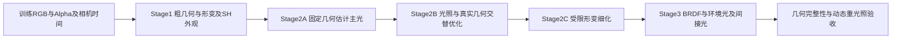

# 近五日实验复盘与动态方向光三阶段几何恢复路线

日期：2026-10-15，Asia/Tokyo。复核服务器：`ushas`；环境：`lumimotion-ushas`。起始代码版本：`fd32c7f`，分支：`1001-stage2-perlight`。

讨论窗口为 **10月11日至15日五个日历日，截至本次检查**；10月10日启动、11日完成的实验作为必要前史。实验编号不等于实际执行日期，历史 UTC 与日本时间记录也不强行混同。

本次工作是实验记录、现有指标文件、代表图、实现与论文的综合复核，没有启动新训练，也没有修改训练代码。下文明确区分“已有证据”“机制推断”和“待执行方案”。本机没有找到部分历史输出，包括文档所指的 `output/1013-06-LH-static-jumpingjacks_EL_V2-1011-02原版Stage2续训`；这部分依据已提交的训练／修改记录，不冒充本次重跑或原数组复算。

## 一、核心判断

你的终极目标可以明确为：**利用随时间变化的主方向光，对同一物质表面提供额外的光度约束，在同时恢复运动和光照的过程中改善真实三维几何，最终获得可重光照的动态场景。** RGB 重建和材质分解服务于这个目标，但不能取代几何验证。

三阶段路线值得推进，建议定义为：

1. **Stage1：动态辐射场与粗几何初始化。** 保留默认 LumiMotion 管线，输出 canonical Gaussian、形变、动静门控，以及 SH 与时变颜色头构成的外观先验。
2. **Stage2：主方向光标定与几何／运动受限联合细化。** 先用粗几何和多时刻光度信息估光，再分块交替更新光照、简化材质、真实几何与必要的形变；这一阶段承担主要科学贡献。
3. **Stage3：固定或强约束几何下的完整 BRDF 与光传输恢复。** 逐步接入环境光、镜面和受物理约束的间接光，检查材质分离与新光照泛化。

需要调整的三处表述：

- 现有静态 DL 结果是**已知光照方向条件下的经验参考**，不是动态场景的严格 upper bound，也不是完整几何已经通过的结果。
- Stage1 SH 可以帮助提供光度先验，但**不能直接把所有 Gaussian 的 SH 叠加找峰，当成主光方向**。它编码的是视角相关出射颜色，时变明暗还有 `d_color` 的贡献。
- RadioGS 值得借鉴的是**学习辐射与物理渲染之间的一致性约束**。把它扩展到未知时变 DL、动态形变和几何联合恢复，是本项目需要验证的新设计，不能当作现成已证明的能力。

## 二、最近五天实际获得了什么

### 2.1 实验主线与证据边界

| 时间／主线 | 已有结果 | 对目标的意义 | 不能据此得出的结论 |
| --- | --- | --- | --- |
| 10/11，四个 V2 数据集与六组实验 | 原生 Stage1 四组完成；原生 Stage2 当时因 CUDA 架构问题失败；GT 方向 PBR／Lambertian 的材质仍有投影残留 | 强 DL 对默认管线确实提出了额外困难；只换物理着色并不能自动修复错误初始几何 | 不能把环境失败解释为原生算法收敛失败；不能把读取 GT 方向得到的零方向误差称为估光成功 |
| 10/11，T01—T14 静态 DL 探索 | T13 的三项平均法线指标达到旧目标；T13／T14 的配对支持较早启用法线一致性有益 | 几何与法线相互约束、启用日程是有效抓手 | T13 没有使用方向加权或遮挡到 XYZ 的反向，不能将达标归功于这两者 |
| 10/12，两度目标与足部修复 | G2-T06、F-T04 等进一步降低法线均值；足部部分恢复，完整性仍失败 | 优化过程中真实几何会被 opacity／剪枝／增密机制改变，必须同时检查局部结构 | 全局均值下降、Alpha 完整不代表鞋体完整；没有实现 GS<2° 的完整几何目标 |
| 10/13，外观与两度目标恢复 | 基线／接口审计完成，但新科学训练更新为零；来源门禁导致冒烟失败 | 工程身份问题与科学方法效果必须分开记账 | 不能将未执行的外观、间接光或新诊断候选写成已验证改进 |
| 10/13—14，原版 EL Stage2 与 roughness 修复 | 已提交记录报告完整续训及评测链路 PASS；RGB 好，roughness 并未改善 | 管线可运行与物理分解正确是不同目标；评测真值本身也需要校验 | 不能把该流程 PASS 写成 DL 材质问题解决 |
| 10/15，官方 jumpingjacks150_v5_spec32 重跑 | 本次在日本时间11:50核对时，状态为 Stage1 RUNNING，控制与训练进程存活 | 可补充默认动态管线参考 | 尚无本轮最终结果；它使用官方 HDR 数据，不能直接充当 LH 动态 DL 的同数据对照 |

来源：[六组总报告](../报告/1011-07-四个V2数据集六组训练与全部MAE总报告.md)、[T13总结](../报告/1011-30-静态DL法线优化达标与因果边界总结.md)、[G2归档](../报告/1012-05-静态DL两度目标T01至T06与脚部机制归档报告.md)、[低产出审计与收尾](../报告/1013-05-两个Goal长时低产出审计与最终收尾.md)、[EL完整续训](../训练/1013-03-LH-static-jumpingjacks_EL_V2-1011-02原版Stage2完整续训.md)、[1015训练计划](../训练/1015-01-jumpingjacks150_v5_spec32-原版LumiMotion两阶段训练计划.md)。

### 2.2 应当保留的主要几何结果

以下每行三项指标来自同一检查点，单位为度。跨行存在数据、预算、监督与管线差异，表格用于事实梳理，不是受控消融排名。

| 模型 | GS法线 | Depth法线 | Mesh法线 | 正确解读 |
| --- | ---: | ---: | ---: | --- |
| 原生静态 DL Stage1@35000 | 10.508859 | 18.518966 | 14.106568 | 默认管线在该强DL数据上的参考 |
| 原生静态 EL Stage1@35000 | 3.506764 | 7.354675 | 5.457503 | 独立EL数据参考，不是同照度／同成像条件控制 |
| 原生动态 DL Stage1@35000 | 14.545084 | 24.556631 | 18.612443 | 动态DL的现有默认基线，尚无对应未知DL联合优化成功证据 |
| 原生动态 EL Stage1@35000 | 5.621282 | 10.527860 | 7.528458 | 动态EL参考 |
| 静态DL T13@10000 | 3.255367 | 5.887606 | 4.750744 | 已知方向、零形变、提前normal；旧均值目标PASS，足部完整性FAILED |
| 静态DL G2-T06@16000 | 2.668378 | 5.404578 | 4.208487 | 有用的整模型参考；脚部仍未完整 |
| 静态DL F-T04@16500 | 2.663858 | 5.469950 | 4.179823 | 当前记录中的最低GS；Depth不优于T06，且属于事后回溯中间点 |

T13 的 expected-Z 误差为 **0.01780551米**，原静态 EL 为 **0.00881066米**；不能将三类法线变好扩展为全部几何指标优于 EL。T13 的法线覆盖率也不是100%。G2-T06 的 expected-Z 为0.01392249米，仍须独立检查距离误差。

本次直接读取了 T13@10000、G2-T06@16000 的 `goal_mae_summary.json`，核对其数值与原协议标识；没有重跑 GPU 渲染或重新计算原数组。F-T04@16500依据[独立基线审查](../报告/1012-12-两度目标基线与光度诊断独立审查.md)和[Stage2基线复核](../报告/1013-01-Stage2基线法线与外观复核.md)。不同检查点的单项最低值不能拼成一个不存在的模型。

### 2.3 已有实验真正支持的机制判断

**法线与几何必须绑定。** T13/T14 同起点、同10k预算，主要区别是 normal 从2001还是8001开始。T13更好，支持较早／更长时间施加几何一致性的价值；尚未分离“开始更早”与“累计正则步数更多”。这不是“默认 Stage1 已经做到同样结果”，而是改造过的静态物理管线结果。

**阴影方向加权不是当前主要收益来源。** T12 相对 T11 的 GS／Depth／Mesh 改善约0.0080°／0.0016°／0.0068°，单次500步差异很小。它没有证明方向信息无用，但不支持继续把同一种权重当作最主要突破口。[原配对总结](../报告/1011-30-静态DL法线优化达标与因果边界总结.md)

**opacity 是几何退化的逃逸通道之一。** T14@9000→10000 的足部高度带点数从2240降到0；normal 对 opacity 的梯度与 reset／prune 共同作用有具体证据。但是 T13@5000 已严重缺脚，不能把所有缺脚都归因于9000步重置。T06在reset后阻断normal→opacity降低了大量低透明度删除，却没有彻底修复鞋部。[足部审计](../报告/1012-02-近期训练脚部消失审计报告.md)

**增密数量不等于信息增加。** F-T04/F-T05 的非normal增密下限对照中，候选增加了出生，却没有取得一致优势；鞋区局部改善与衣物／身体误差上升同时存在。没有证据支持仅靠多增密解决问题。[增密正式验收](../报告/1012-09-足部增密配对正式验收与成因分析.md)

**更低RGB残差不保证更真实材质。** 已提交的EL续训记录中，55000步NVS PSNR为39.83271128dB；使用相同修复GT，roughness MAE从37100步的0.17082512升到55000步的0.17627544。记录仍指出 albedo 阴影残留和 roughness 纹理／阴影状误差。该输出当前不在本机，本次引用记录，不另宣称目检。[评测修复](../修改/1014-01-roughness-GT透明路径导出与MAE独立复算修复.md)

**可观测性比灯光强度更重要。** 原135帧静态DL审计中，前景任一RGB通道满码约53.53%。更强的DL可能增加明暗变化，也可能造成更严重截断和暗部低信噪比；这会损失几何信息。满码是观测下界，不是精确辐射度。改变曝光、使用有效HDR或降低饱和率应作为独立数据条件比较，不能改写已有测试集。

### 2.4 本次实际看过的图

本次打开了 T13 四类10／80／150拼图，以及 F-T04 正面鞋部0020诊断图。前者可见平台法线较平滑、暗侧近黑、投影模糊；组合Alpha把人物与平台合在一起，不能单独确认足部三维完整。后者可见鞋尖的预测高度与GT差异及局部法线误差，符合“部分恢复、不能宣告完整”的历史结论。本次没有逐帧观看全部视频。

- [T13四类代表图](/home/han.li/reproduce/LumiMotion-stage2-perlight/output/1011-27-LH-static-jumpingjacks_DL_V2-T13-normal2000-Stage1早期法线正则10k/evaluation_10000/four_classes/four_classes_10_80_150.png)
- [F-T04鞋部诊断图](../报告/assets/1012-09-足部增密配对正式验收/T04正面鞋部.png)

## 三、如何正确使用静态DL的“上界”

你的判断有一个成立的核心：**已知光照条件下能获得更好法线，说明该数据和表示并非完全没有几何恢复潜力。** 它值得保留为研究参照。

但当前结果同时改变了光照监督、静态假设、法线日程、损失、拓扑过程和预算，并有局部几何缺失。它既不是数学上界，也不是未知光照动态模型在相同设置下必然能达到的值。对于误差，理想 oracle 对应的是“希望接近的低误差参考”；经验训练结果也不保证一定优于未知光照优化。

建议将参考拆成三层：

| 参考 | 固定条件 | 回答的问题 |
| --- | --- | --- |
| 历史静态已知方向参考 | 当前T13／T06／F-T04，保留所有缺陷 | 过去在较强先验下达到过什么水平？ |
| 同初始化静态oracle | 新三阶段管线，方向固定GT，其余设置与未知方向组完全一致 | 未知方向估计损失了多少几何精度？ |
| 同初始化动态oracle | 同一动态数据、同一形变模型、已知GT方向 | 动态对应与未知光照分别带来多大困难？ |

oracle的GT方向只能进入明确标注的控制组。未知光照组的初始化、筛点、候选选择、损失与早停均不得读取GT光向量。GT几何／材质只用于隔离评测。若历史检查点本身使用过GT方向，不能将它包装成未知光照方法的无监督起点；用于单独诊断时应明确标注额外先验。

## 四、Stage1的SH能不能反推方向光

### 4.1 先弄清当前SH的语义

源码核对：

- [Stage1渲染器](/home/han.li/reproduce/LumiMotion-stage2-perlight/gaussian_renderer/__init__.py:113)先用 `d_color` 调制 SH 的 DC 部分，再组合高阶系数。
- 同文件129行的Python路径将**点与相机之间的方向**送入 `eval_sh`。该实现的方向符号是相机到点；转为物理“表面到观察者”的出射方向时要处理符号，而不能直接复用变量名。
- [时变网络](/home/han.li/reproduce/LumiMotion-stage2-perlight/utils/time_utils.py:195)以位置、时间与隐特征生成 `d_color`。SH系数本身并没有独立的逐时间光源状态。
- [原生IR渲染器](/home/han.li/reproduce/LumiMotion-stage2-perlight/gaussian_renderer/render_ir.py:149)重建同一类SH外观；543行将追踪到的Stage1颜色从sRGB转线性后作为间接辐射近似。

因此可概念化为：

\[
\widehat C_i(t,\omega_o)
=\operatorname{SH}\bigl(c_{i,00}\text{经}d_{color}(x_i,t)\text{调制},\;c_{i,lm};\omega_o\bigr).
\]

它是已受材质、光照、遮挡、视角以及拟合误差共同影响的出射外观，不是入射光的球谐展开。Stage1的DC也不能直接当作已恢复albedo。

### 4.2 为什么“把所有SH找一个最亮方向”不可靠

一个直接反例：理想Lambertian平面受某方向照明，固定时刻的出射亮度对观察方向是常数。无论主光来自哪个方向，单点SH都可能只有DC显著；它的出射方向峰值无法给出入射方向。光照信息在**不同表面法线之间、以及同一表面的不同时间之间的亮度关系**里。

镜面表面的最亮出射方向还需要结合法线和反射定律解释；它也不等于光源方向。场景中材质、遮挡、采样密度不同，直接叠加SH会让大面积台面、较密的Gaussian区域或白色材质支配结果。高阶SH还可能拟合相机轨迹与时间的相关性，而不是物理反射。

所以应把你的想法改写为：**由Stage1得到粗几何与有置信度的表面光度轨迹，拟合一个全场景共享、低自由度的动态主光模型。** SH提供辅助观测和初始化依据，原训练RGB仍是最终约束。

### 4.3 一个可实现的初始化路线

对canonical Gaussian或局部表面块建立跨时间轨迹，收集当前可见时刻的训练RGB贡献、粗法线、曝光约定与时变外观。无法从合成像素中唯一分离每个Gaussian的颜色，因此可采用可见表面块聚合，或直接在图像域拟合；不能把同一个像素无条件分配为多个独立观测。

在暂时忽略强镜面、使用近似可见性的初始化阶段，考虑：

\[
y_{it}\approx a_i E_t V_{it}\max(0,n_{it}^{\mathsf T}l_t)+b_{it},
\quad \|l_t\|=1,\ E_t>0.
\]

这里是标量亮度近似，常数如Lambertian的\(1/\pi\)统一吸收到\(E_t\)；正式BRDF渲染恢复明确单位。\(a_i\)跨时间共享，\(b_{it}\)只能是受限的低频背景项，初版可固定为零。若让每点每时刻拥有任意\(b_{it}\)，它会直接解释掉DL信号。

建议流程：

1. 首先冻结Stage1几何／形变，从可见、非饱和、非边界且较稳定的表面区域建立候选观测。置信度来自训练观测与预测支持，不读取GT标签。预测背光不能被硬判为永远无效，否则错误初始法线可能永远得不到纠正。
2. 对单位球上粗候选方向逐个评估训练重建残差，同时拟合非负能量；保留多个近似解及其分数间隔，避免一开始就锁死方向。
3. 在固定粗几何条件下交替估计跨时刻共享的\(a_i\)和光照；限制材质与能量尺度，加入适度时间约束。必要时对法线分布均衡抽样，而不是按Gaussian数目投票。
4. 比较“原RGB直接拟合”“SH／颜色头辅助的拟合”“随机初始化”，用同预算的最终光向误差、几何与收敛表现判断SH的净价值。

若\(a_i,V_{it},b_{it}\)已有近似值，且样本位于正入射区，可令\(q_t=E_tl_t\)，用加权最小二乘获得初值：

\[
q_t^{(0)}=\arg\min_q\sum_i w_{it}
\left[(y_{it}-b_{it})/(a_iV_{it})-n_{it}^{\mathsf T}q\right]^2,
\quad l_t^{(0)}=q_t^{(0)}/\|q_t^{(0)}\|.
\]

该式仅说明条件成立时的初始化，不是对真实数据的无条件闭式解。暗区、低反照率、低可见性下不做不稳定除法；可直接优化未相除的前向式。法线矩阵秩不足、\(q\)接近零、解落在错误受光半球时应保留不确定性并回到候选搜索。

同一物质点跨时间的比值能在理想模型下消去\(a_i\)，但真实数据中阴影、间接光、饱和、法线变化和小分母会破坏这种关系。它适合诊断或稳健初始化，不适合不加筛选地替代完整RGB损失。

### 4.4 强光先验能提供什么，不能提供什么

强主光先验支持“一个主方向＋低频余项”的低维模型，明显比任意逐点时变照明更易约束。但是它不自动消除以下歧义：

- 反照率与能量缩放：\(a_iE_t\)可由不同尺度组合产生，需要固定能量均值、曝光或其他明确规范。
- 法线与光照互相补偿：未知材质、法线和方向的光度分解具有歧义；多视角几何、静态支撑和时序约束能帮助，但不保证唯一解。
- 光色与材质颜色混淆：首版若采用白光，是明确的先验；不能把仅由RGB估计的光色当作已校准真值。
- 两盏完全同向远场灯在图像中通常只体现为总能量。已有静态DL记录包含重合SUN；未知光模型不应强求恢复不可辨识的灯具数量。

## 五、三阶段的职责与参数边界

### 5.1 Stage1：保留默认初始化，同时承认它可能有偏

保留默认Stage1有利于比较与工程复用。但目前动态DL默认基线已经出现地面起伏、投影进入动静分离等现象，不能假定其形变和binary gate正确。阶段输出应包括完整模型、相机／时间约定、SH与颜色头，而非只保存一张法线图。

建议把“默认Stage1”固定为主线；后续另做一次“早期物理／几何约束Stage1”的受控扩展。因为T13的证据表明较早约束可能有益，若只允许Stage2在晚期修补，可能错过错误拓扑形成之前的窗口。但不能在首次验证三阶段时同时替换Stage1，以免无法判断新Stage2的贡献。

### 5.2 Stage2A：固定几何，先确认能估光

先固定XYZ、旋转、scale、opacity、拓扑和形变；估计\(l(t)\)、\(E(t)\)及最低限度的跨时间共享反照率。以球面单位向量或归一化非零向量表示方向，以对数参数表示正能量。使用少量时间节点／球面插值作为初版轨迹模型，保留逐帧独立方向作为消融。

时间平滑是待验证先验：真实光照若快速切换，过强平滑会抹掉有效激励。未知组不能根据GT轨迹挑选节点或最优平滑系数。时间节点、带宽和容忍误差应在独立验证设置中确定。

这一阶段的失败也有意义：若固定几何、使用真实训练RGB仍无法定位灯向，就应先检查法线覆盖、饱和、坐标、材质与阴影假设，不直接把更多自由度开放给几何。

### 5.3 Stage2B：联合目标，分块更新

建议一个共同的物理目标，但采用交替更新，初版次序为：

| 更新块 | 允许更新 | 暂时固定 | 目的 |
| --- | --- | --- | --- |
| 光照块 | 主光方向、能量 | 几何、形变、材质 | 让全局光源解释跨区域一致的变化 |
| 材质块 | 跨时间共享albedo，必要时少量全局BRDF参数 | 光照、几何、形变 | 避免几何承担基础颜色差异 |
| 几何块 | XYZ、surfel旋转，后续视证据开放scale | 光照、形变；初期固定opacity和拓扑 | 将光度约束传入真实形状 |
| 形变块 | 受信任范围内的位移／旋转形变 | 光照及主要材质 | 纠正动态对应，不把变化全部吞入运动 |

每块步数、学习率及开放时机需要实验确定，不能由这个表声称最优。交替优化也不保证避开局部最优；必须与同计算预算的同时更新比较。

法线一致性保留几何与法线两侧的有效导数；针对normal→opacity的路径可单独做阻断对照，不应把整项detach而失去几何梯度。只优化一套独立“着色法线”可能改善渲染法线但不改善深度／网格，因此应约束surfel法线、由真实XYZ导出的深度法线，以及运动后的表面方向一致。

opacity和拓扑初期固定是一种减少逃逸自由度的措施，不是永久正确策略。若Stage1已经缺失鞋部，完全禁止新增点也无法长回结构。待光照稳定后，再以训练多视角残差和几何支持决定是否开启受控增密；不使用GT鞋区选点，不以大面积背景Alpha作为人体局部完整性的替代。

### 5.4 Stage2C：动态推广不能只“打开MLP”

用canonical材料参数\(a_i,r_i\)，以及\(x_i(t)=\Phi_t(x_i^0)\)描述同一物质点。光照\(l_t\)位于世界坐标系，不随物体局部坐标自动旋转。法线必须与实际动态表面一致：若使用形变映射运输法线，理想关系为\(n_t\propto J_{\Phi_t}^{-\mathsf T}n_0\)；若沿用独立旋转头，则需检查它和变形后切平面／深度是否一致，不能假设独立头天然满足该关系。

已有模型的颜色头与形变头共享部分特征。仅移除一个optimizer组，不等于另一路输出固定；几何／颜色隔离要检查共享主干、实际参数变化和输出。Stage1的binary gate也可能被移动阴影污染，不能直接把“低gate”定义为绝对可靠静态背景。

每个时刻的可见性与间接光追踪应使用该时刻的变形几何。切换时间、更新XYZ／旋转或改变拓扑后，要更新相应BVH与缓存身份，不能继续使用旧时刻遮挡。

### 5.5 Stage3：继承物理渲染框架，明确新的冻结契约

Stage3可以沿用原生Stage2的BRDF、trace等框架，但不是原入口原样调用。当前原生Stage2还允许opacity、Stage1颜色与颜色头更新，不能称为严格固定几何。为了判断几何是否保留，首版建议明确冻结几何、opacity、拓扑及运动，后续小幅联合微调单独列消融。

完整着色应以线性辐射度相加：

\[
L_o(x,t,\omega_o)
= E_t V(x,t,l_t)f_r(x,t,\omega_o,l_t)[n_t\cdot l_t]_+
+\int_{\Omega^+}V(x,t,\omega) L_{env}(\omega)
f_r(x,t,\omega_o,\omega)[n_t\cdot\omega]_+d\omega
+L_{bounce}(x,t,\omega_o).
\]

再按统一的Alpha合成与相机响应生成图像。这里DL是离散远场光，其能量参数不是环境图纹素辐射度；不能不经单位与积分约定就做简单数值混合。“加权方向光＋env”中的权重应对应非负物理能量或明确采样权重，不能让一个任意逐像素gate吸收错误。

低频环境项先作为残差，避免把同一SUN同时放进环境图与DL重复计能。开始时可固定／限制其频率与强度，随后验证放宽后的收益；这是一种可辨识性先验，会限制真实复杂环境，需报告偏差。

当前实现中方向光分支与env分支是分路选择，`rendering_equation_directional`接收DL并追踪SH间接项，没有自动把env直接光一起积分。因此“后续加env”需要明确的渲染接口变更，不能只增加一个配置值。[方向光分支](/home/han.li/reproduce/LumiMotion-stage2-perlight/gaussian_renderer/render_ir.py:584)

另外，逐Gaussian线性着色后合成，与先渲染材质图再逐像素BRDF并不等价。Stage2到Stage3切换时要用相同参数做前向对比，将合成差异与真实优化收益分开。[接口与Alpha审计](../报告/1013-02-Stage2实际预算与物理外观接口审计.md)

## 六、RadioGS应怎样借鉴

RadioGS的核心是让surfel的SH出射辐射与PBR辐射一致，并对未被相机直接观察的方向施加物理约束，改善用于间接光查询的辐射。论文使用环境cubemap；初始化使用简化近似，后续使用光线追踪。其问题设定不能直接证明未知时变DL与非刚性运动的联合恢复。[论文第4节](https://arxiv.org/html/2603.01491v1#S4)、[作者项目页](https://qbhan.github.io/radiogs-page/)

以下是本项目的扩展提议，不是RadioGS的已验证动态算法。

定义当前时间、方向下的辐射缓存\(R_\psi(i,t,\omega_o)\)和物理预测\(P_\theta(i,t,\omega_o)\)，考虑：

\[
\mathcal L=\mathcal L_{RGB}^{PBR}
+\lambda_{cache}\mathcal L_{RGB}^{cache}
+\lambda_{cons}\mathbb E_{i,t,\omega_o}
 w_{it\omega_o}\,\rho\bigl(R_\psi-P_\theta\bigr)
+\lambda_n\mathcal L_{normal-depth}
+\lambda_m\mathcal L_{motion}
+\lambda_l\mathcal L_{light-time}.
\]

关键不是多加一个loss名字，而是保证信息来源与优化自由度：

1. **两个分支都要锚定真实训练观测。** 仅让两个可学习分支互相一致，会允许它们共同偏离图像、形成错误自洽解。物理一致性缩小解空间，但不是新增独立观测。
2. **先观察方向，后未观察方向。** 最初在实际训练视角及邻域使用一致性；物理分解稳定后，再增加未观察方向。Stage1在未观察方向的SH不可当作强真值。
3. **区分固定教师与可学习缓存。** 固定Stage1教师适合初始化，长期强制匹配会锁住原先的阴影污染。可学习缓存适合光传输，但需图像锚点、容量限制和分块更新；不直接给每点每时刻任意RGB残差。
4. **动态缓存必须带条件。** 旧照明下的SH不能在新光照或新姿态下原样作为间接光。至少显式依赖时间；若要独立控制“物体姿态时间”和“光照轨迹时间”，需以光照状态为条件，或在重光照时重新计算／适配缓存。
5. **防止缓存遮蔽主光误差。** Stage2的间接项先关闭或受限；主光与几何有证据后再启用一致性间接光。比较缓存开关时保持其余采样与预算一致。

PS-GS也值得作为邻近方法参考：它面向多视角多光照，利用UPS法线与方向光可见性约束进行几何、材质、光照恢复。这里最重要的差别是当前动态序列没有天然的同姿态多光堆栈，不能直接套用静态像素对应。[PS-GS论文](https://arxiv.org/html/2507.18231v1)

## 七、动态场景中最需要提前解决的可辨识性问题

### 7.1 当前采集协议把时间、视角、运动与光照绑在一起

本次读取动态DL `data_view/transforms_train.json`：135个训练frame，135个不同time；测试为15个frame、15个不同time。当前数据不是“每个姿态同时采集多个光照与多个视角”。因此每个时刻单帧误差可能被光向、形变、法线、材质或阴影共同解释。

canonical跟踪把同一物质点跨时间连起来，才可能将这些观测汇聚为几何约束；这也是动态方法最关键的假设。若形变错了，即使光照完全正确，也可能把不同表面的亮度拼成一个伪光度轨迹。

建议在后续合成数据中建立最小的采集因素拆分：固定物体只转灯、固定灯只运动、二者同时变化，并增加少量固定姿态的多光锚点。它们属于新的可控实验数据，不能混入原测试集作为同条件提升。

### 7.2 静态背景能帮助估光，但平面本身不够

静态背景没有形变干扰，可以用来估计全局光照轨迹，再让动态物体提供补充法线方向。这是值得优先验证的结构先验。

但若背景几乎全是同一法线的台面，仅凭漫反射亮度只能约束\(E_t(n\cdot l_t)\)，不能唯一确定完整三维方向。需结合不同朝向的静态表面、人体粗法线，或可靠的投影位置与遮挡几何。阴影可以补充方向信息，但投影位移还与遮挡物高度、几何误差相关，不能将其直接当作无歧义GT。

静态锚点应由低运动、跨视角几何一致和观测支持共同判断；不能依据RGB不变，因为静态表面也会受动态光照影响。

### 7.3 统计“每个表面看到了哪些有效光”，不能只数全局转灯角度

对近似局部刚性、旋转\(R_{it}\)可信的表面，可把光方向变换到canonical坐标：\(\widetilde l_{it}=R_{it}^{\mathsf T}l_t\)。诊断矩阵为：

\[
H_i=\sum_{t\in\mathcal T_i}w_{it}E_t^2
\widetilde l_{it}\widetilde l_{it}^{\mathsf T}.
\]

它可用于观察方向覆盖的特征值谱；权重应体现相机可见性、未饱和程度、有效入射与可信对应。大量不可见、背光或满码帧不等于有效激励。一般非刚性形变不只含旋转，应使用实际渲染关于局部几何参数的Jacobian构造\(J^\mathsf TWJ\)，而不是强套刚体公式。

上式只是条件诊断，不是完整可辨识性证明。单位法线只有切平面上的两个自由度，albedo与光照也可能未知；更严格的检查应投影到法线切空间，并考虑其他未知量的耦合。若物体与灯同步旋转，世界光向看似变化很大，物体局部的有效光向仍可能几乎不变。

### 7.4 遮挡梯度与方向梯度必须实测

当前tracer的Python backward返回`grad_rays_o`和`grad_rays_d`，CUDA也累积射线方向导数，说明接口存在相应路径；这不等于所有实际分支都能有效学习灯向。`detach_indirect`、可见性饱和、背光余弦截断、bias、BVH交点切换都可能切断或扭曲实际信号。[Python接口](/home/han.li/reproduce/LumiMotion-stage2-perlight/submodules/surfel_tracer/surfel_tracer/raytracer.py:28)

首个小规模验证应分别检查：余弦→灯向、镜面→灯向、可见性→灯向、可见性→遮挡物XYZ，以及几何一致性→XYZ／旋转的导数。用有限差分与真实反传比较，并说明阴影边界不连续区域的限制。不要在尚未确认信号能流到目标参数时启动长训练。

## 八、建议的最小实验路线

以下是讨论中的优先级，不是已经启动的训练计划；实际执行前再在 `LIHAN/DOC/训练` 登记命令、预算、输入和验收协议。

### 8.1 第一优先级：验证“Stage1能帮助估光”

在同一个默认静态DL Stage1起点，固定几何与形变，使用同一训练划分、同一光照参数化与预算，比较：

| 组别 | 初始化／监督 | 要回答的问题 |
| --- | --- | --- |
| A0 | GT方向固定；仅oracle组可读方向 | 当前几何与简化材质下的可达到参考 |
| A1 | 随机／球面均匀候选初值，训练RGB拟合 | 没有SH辅助时能否恢复光向？ |
| A2 | 粗法线＋训练RGB光度拟合初值 | 几何辅助本身是否足够？ |
| A3 | A2加Stage1 SH／颜色头的表面光度先验 | SH是否提供额外收益或更快收敛？ |

若A3不优于A2，不应继续把SH反推作为核心叙事；若初始方向变好但最终几何不变，也只能声称初始化收益。至少对入选方案与核心对照做多个seed重复，报告均值与离散程度，避免根据一次小差异下结论。

已知方向oracle用于评测对比，不用其GT给未知组挑选初值。可单独做GT法线的诊断性估光测试来定位光照求解器问题，但必须明确它使用额外真值，不能计入主方法。

### 8.2 第二优先级：证明光照约束改善真实几何

从相同默认Stage1与相同光照初值开始，逐步比较：固定几何、开放几何、交替优化、同时优化；先不加入RadioGS缓存与复杂环境光。保留一个同预算GT方向控制组。

关键验收为GS／Depth／Mesh法线、深度距离、局部完整性与覆盖率共同变化。若只有GS法线改善、深度／网格不变，优先检查是不是独立法线或透明度在吸收误差。若几何变好而光向变差，需要检查两者是否形成补偿解。

### 8.3 第三优先级：动态推广

依次验证：

1. 固定默认形变、GT方向：观察动态oracle能否改善几何。
2. 固定默认形变、未知方向：测未知光照增加的困难。
3. 未知方向＋受限形变更新：判断运动细化是否带来净收益。
4. 静态锚点开／关：验证背景是否帮助全局光照标定。

如果第一步就失败，问题更可能在动态对应、物理模型或几何优化，而不是SH初始化。动态指标除逐帧误差，还要有运动补偿后的几何／材质一致性；直接惩罚相邻帧法线相同会误罚真实运动。

### 8.4 第四优先级：完整材质与物理一致性

在几何结果稳定后逐项加入镜面、受限env、间接辐射一致性。每次只增加一个关键机制，观察是否损害几何、是否减少albedo阴影残留、是否改善新光照。不要一次打开全部分支，随后无法判断收益或失败来自何处。

静态模型的新光照实验与动态模型的姿态／光照解耦实验应分开报告。理想测试包含：固定姿态转灯、固定灯播放动作、未见过的姿态与灯光组合。仅沿原来时间轨迹重放RGB，可能只是在复现训练相关性。

## 九、统一验收与工程边界

### 9.1 指标组合

| 维度 | 必报内容 | 防止的误判 |
| --- | --- | --- |
| 光照 | 训练／保留时间的方向角误差、能量规范、失败帧、轨迹稳定性 | 只报平均方向或读取GT方向后的零误差 |
| 几何 | 同模型三法线、expected／median深度误差、覆盖率、固定缺失处理 | 拼接单项最佳；删除困难区域后均值变好 |
| 完整性 | 人体与鞋部等独立评测区域、距离／高度／表面覆盖、代表多视角 | 台面Alpha填满就宣称鞋体完整 |
| 动态 | 动态／静态区域分开，运动补偿一致性、未见时间 | 静态大平台主导整体成绩，掩盖动态人体失败 |
| 材质／重光照 | albedo、roughness、固定曝光新灯RGB、投影是否随灯正确变化 | 训练PSNR高就宣称完成分解 |
| 预算 | 循环、optimizer实际更新、采样光线、总时间与显存 | 把不同更新频率的相同步数当同预算 |

GT语义分区可以用于评测，但不得回流训练筛点。原15测试帧已经被多轮迭代观察，后续保留它用于历史对比，同时应建立新的最终保留集；否则只能声称现有基准上的改进，不能称未经选择的泛化验证。动态留出时间不应偷偷从相应GT灯轨迹插值，未知灯向应由训练得到的时间模型推断。

阈值应在实际训练前依据目标与有效对照预注册。本讨论不把历史静态EL阈值机械套到动态模型，也不在看到结果之后改变缺失处理或验收上限。

### 9.2 实现复用与尚缺内容

| 现有资产 | 可复用部分 | 仍需实现／核验 |
| --- | --- | --- |
| `scripts/train_stage1.py`及动态网络 | 默认粗几何、运动、SH初始化 | 输出置信度；照明污染下的运动可靠性 |
| `scene/static_dl_photometric.py` | 方向Lambertian、可见性与方向约定的参考 | 当前方向来自固定资产；未知方向时间模型及动态适配不是现成功能 |
| `gaussian_renderer/render_ir.py` | GGX、方向光求和、追踪接口 | DL与env合并、统一合成契约、动态辐射一致性 |
| `scene/pbr_directional.py` | 已知光元数据控制实验 | 会读取GT能量与颜色，不适合作为未知光主线加载器 |
| `submodules/surfel_tracer` | 光线追踪及已有反向接口 | 对实际方向优化分支做有限差分；动态BVH一致性 |
| 现有几何／足部评测 | 历史协议与区域诊断 | 新动态保留测试、同模型联合验收 |

来源身份校验是复现手段，不是科学性能指标。同源码重编译得到不同二进制时，应单独建立前向与反向兼容证据，再决定是否登记新运行环境；既不直接删校验，也不重复长时间搭建脚本而没有最小真实验证。现有记录中原生Stage2的35000→55000为20000循环、按源码条件推导4999次Adam更新；新阶段预算不能仅按循环数比较。[预算审计](../报告/1013-02-Stage2实际预算与物理外观接口审计.md)

本次没有创建新实验结果。后续训练输出使用 `output/日期-当日计数-数据集-特征`，冒烟放 `output/smoke_test`，日志同目录；每卡在显存允许时最多3个训练。实验README应包含完整渲染命令、source/model/iteration、输出与日志、定量指标、代表图片／视频、RGB／Alpha／Normal／动静分离四类目检和最终PASS／FAILED；训练失败保留全部现场。文档与代码更改遵循各自目录要求。

## 十、建议确立的研究主线

最有价值的主张不是“又加了一阶段”或“SH直接求出灯向”，而是：

> 在单目时序的动态场景中，利用全局低维主方向光、canonical表面对应及光度—几何一致性，分离光照变化与物体运动，使方向光提供的额外约束改善可验证的三维形状。

当前已被实验支持的是：已知方向的静态DL加上合适的几何约束能够明显改善平均法线；同时拓扑退化、光度截断和材质污染会限制收益。未知方向恢复、默认Stage1到新Stage2的有效过渡、动态形变联合优化、RadioGS式动态一致性，都仍待实测。

**下一步最值得先做的是固定默认静态几何的估光对照A0—A3。** 它能直接检验你关于Stage1光照先验的核心想法，成本比完整三阶段重构低，结论也更清楚。通过后再开放几何，随后扩展到动态，最后加入完整光传输。这样每一步都能回答一个独立问题，并逐步靠近最终目标。
